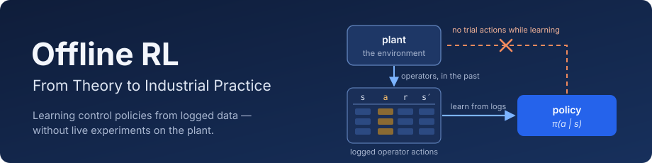
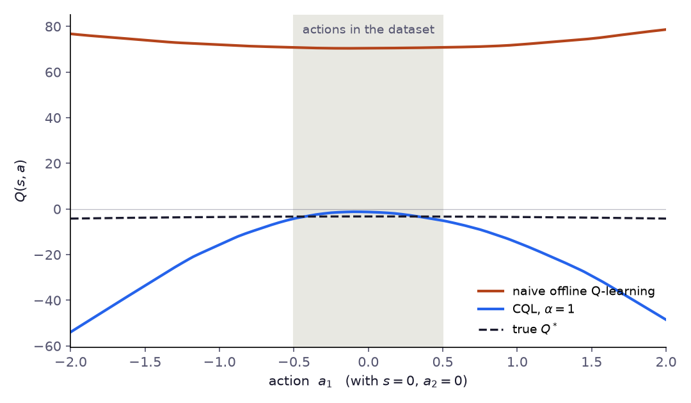

<p align="center">
  
</p>

<p align="center"><em>applied learning notes on offline deep reinforcement learning — from behavioral cloning to physics-informed control and tool-using agents</em></p>

<p align="center">
  
</p>
<p align="center"><em>The central problem of the book in one picture: trained on a fixed dataset, naive Q-learning overestimates actions it has never seen; CQL keeps those values below the truth. — <a href="https://corba777.github.io/offline-rl-book/en/chapter4.html">Chapter 4</a></em></p>

<p align="center">
  <b>Thirteen chapters in English and Russian, each built as idea → formalization → code → limitations.</b><br/>
  Every chapter script runs in CI; the case-study numbers in Chapters 10–12 are the output of those scripts.
</p>

<p align="center">
  <a href="https://doi.org/10.5281/zenodo.24045871"></a>
  <a href="https://github.com/corba777/offline-rl-book/actions/workflows/ci.yml"></a>
  <a href="LICENSE"></a>
  <a href="LICENSE-text"></a>
  
  
  
  <a href="https://corba777.github.io/offline-rl-book/"></a>
</p>

<p align="center">
  <a href="https://corba777.github.io/offline-rl-book/">Read (EN)</a> ·
  <a href="https://corba777.github.io/offline-rl-book/ru/">Читать (RU)</a> ·
  <a href="https://github.com/corba777/offline-rl-book/releases/download/pdf/offline-rl-book.pdf">PDF</a> ·
  <a href="https://leanpub.com/offline-rl-book">Ebook (Leanpub)</a> ·
  <a href="#contents">Contents</a> ·
  <a href="#run-the-examples">Run the examples</a> ·
  <a href="#repository-layout">Layout</a> ·
  <a href="#writing-and-building">Writing and building</a> ·
  <a href="#pdf">PDF</a> ·
  <a href="#how-to-cite">Cite</a> ·
  <a href="#license">License</a>
</p>

---

Created and maintained by **Artem Zvyagintsev**. These are applied learning notes, not an authoritative textbook: the chapters summarize algorithms, implementation patterns and practical caveats, and the code is educational scaffolding rather than benchmark-grade implementations.

## Contents

| # | Chapter | EN | RU | Code |
|---|---|---|---|---|
| 1 | Behavioral Cloning | [read](https://corba777.github.io/offline-rl-book/en/chapter1.html) | [читать](https://corba777.github.io/offline-rl-book/ru/chapter1.html) | [`behavioral_cloning.py`](code/behavioral_cloning.py) |
| 2 | The Offline RL Problem | [read](https://corba777.github.io/offline-rl-book/en/chapter2.html) | [читать](https://corba777.github.io/offline-rl-book/ru/chapter2.html) | [`extrapolation_error.py`](code/extrapolation_error.py) |
| 3 | Off-Policy Evaluation (OPE) | [read](https://corba777.github.io/offline-rl-book/en/chapter3.html) | [читать](https://corba777.github.io/offline-rl-book/ru/chapter3.html) | [`fqe.py`](code/fqe.py) |
| 4 | Conservative Q-Learning (CQL) | [read](https://corba777.github.io/offline-rl-book/en/chapter4.html) | [читать](https://corba777.github.io/offline-rl-book/ru/chapter4.html) | [`cql.py`](code/cql.py) |
| 5 | Implicit Q-Learning (IQL) | [read](https://corba777.github.io/offline-rl-book/en/chapter5.html) | [читать](https://corba777.github.io/offline-rl-book/ru/chapter5.html) | [`iql.py`](code/iql.py) |
| 6 | Policy-Constraint and Actor-Critic (TD3+BC, AWAC) | [read](https://corba777.github.io/offline-rl-book/en/chapter6.html) | [читать](https://corba777.github.io/offline-rl-book/ru/chapter6.html) | [`td3bc.py`](code/td3bc.py) |
| 7 | Decision Transformers | [read](https://corba777.github.io/offline-rl-book/en/chapter7.html) | [читать](https://corba777.github.io/offline-rl-book/ru/chapter7.html) | [`decision_transformer.py`](code/decision_transformer.py) |
| 8 | Model-Based Offline RL (MOPO, MOReL) | [read](https://corba777.github.io/offline-rl-book/en/chapter8.html) | [читать](https://corba777.github.io/offline-rl-book/ru/chapter8.html) | [`mopo.py`](code/mopo.py), [`morel.py`](code/morel.py) |
| 9 | Physics-Informed Offline RL | [read](https://corba777.github.io/offline-rl-book/en/chapter9.html) | [читать](https://corba777.github.io/offline-rl-book/ru/chapter9.html) | [`physics_informed.py`](code/physics_informed.py) |
| 10 | Industrial Applications | [read](https://corba777.github.io/offline-rl-book/en/chapter10.html) | [читать](https://corba777.github.io/offline-rl-book/ru/chapter10.html) | [`chapter10.py`](code/chapter10.py) |
| 11 | Explainability in Offline RL | [read](https://corba777.github.io/offline-rl-book/en/chapter11.html) | [читать](https://corba777.github.io/offline-rl-book/ru/chapter11.html) | [`chapter11.py`](code/chapter11.py) |
| 12 | Offline RL for Tool-Using LLM Agents | [read](https://corba777.github.io/offline-rl-book/en/chapter12.html) | [читать](https://corba777.github.io/offline-rl-book/ru/chapter12.html) | [`agentic_offline_rl_toy.py`](code/agentic_offline_rl_toy.py) |
| 13 | Conclusion and Future Directions | [read](https://corba777.github.io/offline-rl-book/en/chapter13.html) | [читать](https://corba777.github.io/offline-rl-book/ru/chapter13.html) | — |
| App. | Algorithm Selection Guide | [read](https://corba777.github.io/offline-rl-book/en/appendix.html) | [читать](https://corba777.github.io/offline-rl-book/ru/appendix.html) | — |

Off-policy evaluation has its own chapter (3); value-based methods (CQL, IQL), policy constraints and actor-critic methods (TD3+BC, AWAC), Decision Transformers and model-based methods (MOPO, MOReL) each have one too. Chapter 2 maps the whole landscape with references. Chapters 9–12 move from algorithms to practice: physics priors, an industrial case study with multi-seed results, explainability, and tool-using LLM agents.

## Run the examples

From the repo root:

```bash
python3 -m venv .venv
source .venv/bin/activate   # Windows: .venv\Scripts\activate
pip install -r requirements.txt
```

A CPU is enough. Each script reproduces the experiment of its chapter; most accept `--quick` for tiny settings. Three that finish in seconds:

```bash
python code/chapter11_causal_toy.py     # numpy only
python code/agentic_offline_rl_toy.py   # stdlib only
python code/extrapolation_error.py      # PyTorch: out-of-data overestimation (Chapter 2)
```

The full Chapter 10 benchmark (ten seeds, about an hour on a laptop CPU for each variant) writes [`code/results/ch10_benchmark.json`](code/results/ch10_benchmark.json) and, with the delayed feed commands in the state, [`ch10_benchmark_lagged.json`](code/results/ch10_benchmark_lagged.json); the chapter quotes both:

```bash
python code/chapter10.py                 # state as logged
python code/chapter10.py --lagged-flow   # Markov state with the feed commands in transit
python code/chapter10.py --oracle-ablation   # 2x2: learned vs true dynamics, HALT on vs off
python code/chapter10.py --halt-study [--lagged-flow]   # HALT at the 80th / 99th percentile, data kappa, or off
python code/chapter10.py --baselines-study   # SAC on real data only, 3x budget, CQL alpha grid
python code/chapter10.py --edge-study        # true dynamics without pessimism at 50% / 5% real data
python code/chapter10.py --coverage 'normal, 1/10 noise' [--horizon 20] [--black-box]   # narrowed logs: where pessimism pays
# fresh-seed confirmation: add --seeds 10 11 12 13 14 15 16 17 18 19 --out code/results/<name>_fresh.json
```

To check that every script still runs (about two minutes on a laptop):

```bash
python scripts/run_examples.py                       # all chapter scripts, quick settings, in a temp copy
python -m unittest discover -s code -p 'test_*.py'   # numerical checks for CQL, TD3+BC and the Chapter 12 toy
```

GitHub Actions runs both on every push, checks that the chapter HTML was rebuilt after the Markdown changed, and builds the PDF.

## Repository layout

```
├── index.md, index.html, ru.html   # English and Russian tables of contents
├── en/, ru/                   # chapter1.md … chapter13.md, appendix.md and the built .html
├── figures/                   # figures per chapter (ch1/, ch2/, …), README banner in readme/
├── code/
│   ├── behavioral_cloning.py, extrapolation_error.py, fqe.py
│   ├── cql.py, iql.py, td3bc.py, decision_transformer.py
│   ├── mopo.py, morel.py, physics_informed.py
│   ├── chapter10.py, chapter11.py, chapter11_toy_figures.py, chapter11_causal_toy.py
│   ├── agentic_offline_rl_toy.py
│   ├── chapter1_5_8_figures.py, chapter2_4_figures.py   # figure generators
│   ├── test_*.py                                         # unit tests
│   └── results/                                          # saved benchmark results
├── scripts/
│   ├── md2html.py             # Markdown → chapter HTML
│   ├── run_examples.py        # smoke-runs every chapter script
│   ├── build_pdf.py           # English edition → preprint-style PDF (--epub, --leanpub)
│   └── pdf/                   # LaTeX preamble and title page for the PDF; epub.css
├── .github/workflows/ci.yml   # tests, quick runs, stale-HTML check
└── requirements.txt           # dependencies and the chapter → script map
```

## Writing and building

Chapters are Markdown with front matter; copy it from a neighbouring chapter and adjust the numbers:

```yaml
---
layout: default
title: "Chapter 11: Explainability in Offline RL"
lang: en
ru_url: /ru/chapter11/
prev_chapter:
  url: /en/chapter10/
  title: "Industrial Applications"
next_chapter:
  url: /en/chapter12/
  title: "Offline RL for Tool-Using LLM Agents"
permalink: "/offline-rl-book/en/chapter11/"
---
```

- Math: `$...$` inline, `$$...$$` display, rendered by MathJax.
- Code: fenced blocks with the `python` tag.
- Links to code: `> 📄 Full code: [filename.py](https://github.com/corba777/offline-rl-book/blob/main/code/filename.py)`; use the full GitHub URL so the link also works on github.io.

After editing, rebuild the HTML of every chapter, so that all pages share the same markup:

```bash
python scripts/md2html.py
```

The HTML was built with markdown 3.11.3, Pygments 2.21.0 and PyYAML 6.0.3; other versions change the markup, not the content, and CI checks with exactly these.

## PDF

The English edition also builds as a single preprint-style PDF (Times-like STIX Two fonts, numbered chapters, one table of contents):

```bash
brew install pandoc tectonic librsvg   # once; tectonic fetches the LaTeX packages it needs
python scripts/build_pdf.py            # -> build/pdf/offline-rl-book.pdf
```

`build/pdf/` also holds the LaTeX source and its figures, which is what arXiv expects for a TeX-built paper. The styling lives in `scripts/pdf/`. CI rebuilds the PDF on every push to `main` and publishes it at a permanent link: [offline-rl-book.pdf](https://github.com/corba777/offline-rl-book/releases/download/pdf/offline-rl-book.pdf). Each CI run also keeps the PDF with its LaTeX source as an artifact (*offline-rl-book-pdf*).

The same chapters also build as an EPUB 3 (MathML formulas, no LaTeX needed):

```bash
python scripts/build_pdf.py --epub     # -> build/epub/offline-rl-book.epub
python scripts/build_pdf.py --leanpub  # -> build/leanpub/: EPUB and PDF with the cover page, cover.png;
                                       #    the Russian edition (Leanpub only) in build/leanpub/ru/
                                       #    toc.html: the table of contents for the Leanpub book page
```

The cover is [`figures/readme/cover.svg`](figures/readme/cover.svg). Neither the EPUB nor the PDF with a cover page is built by CI; both are published on [Leanpub](https://leanpub.com/offline-rl-book) with a free minimum price, so readers can get it at no cost or pay what they want to support the book. The PDF here stays free, and the text stays CC BY 4.0 in every format.

## How to cite

Every release is archived on Zenodo; the DOI [10.5281/zenodo.24045871](https://doi.org/10.5281/zenodo.24045871) always resolves to the latest version. GitHub's "Cite this repository" button uses [`CITATION.cff`](CITATION.cff). In BibTeX:

```bibtex
@book{zvyagintsev2026offlinerl,
  title  = {Offline {RL}: From Theory to Industrial Practice},
  author = {Zvyagintsev, Artem},
  year   = {2026},
  note   = {Version 1.0},
  doi    = {10.5281/zenodo.24045871},
  url    = {https://corba777.github.io/offline-rl-book/}
}
```

The case study of Chapter 10 is also written up as a short paper in [`paper/`](paper/): *When Does the Safeguard Pay? Cost and Benefit of Uncertainty-Based Termination in Model-Based Offline RL*.

## License

- Code in `code/` and `scripts/`: [MIT](LICENSE).
- Text and figures (`en/`, `ru/`, `figures/`, the tables of contents): [CC BY 4.0](LICENSE-text) — free to share and adapt with attribution.
