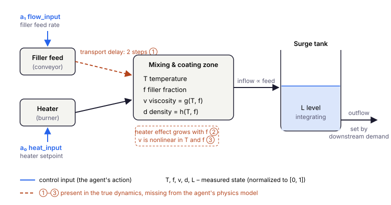

# Chapter 10: Industrial Applications

> *"The gap between a working benchmark result and a working industrial deployment is not a gap in algorithms — it is a gap in understanding the data."*

---

## From Benchmarks to Industry

The preceding nine chapters (Chapters 1–9) built a complete toolbox: behavioral cloning, CQL, IQL, MOPO, MOReL, physics-informed reward shaping, hybrid dynamics models, and Lagrangian constraint enforcement. Each algorithm was validated on `ThermalProcessEnv`, the toy version of the coating line introduced in Chapter 1: three state variables (temperature, filler fraction, viscosity), two control inputs and clean first-order dynamics — designed to make the algorithmic ideas visible.

Real industrial processes differ from that environment in every dimension that matters.

**More variables, more coupling.** A realistic coating process has dozens of sensor readings. Even a simplified model has temperature, filler fraction, viscosity, bulk density, and a surge tank level — five variables with physical dependencies between all of them. The level is an integrating state that drifts without active control; viscosity is a nonlinear function of temperature and filler that the agent cannot observe independently of its inputs.

**Non-uniform data coverage.** Industrial logs are not random exploration data. A process runs near its operating setpoint for 60% of the time, makes occasional planned setpoint changes, and occasionally experiences disturbances — blown bearings, feed composition shifts, ambient temperature swings. The dataset is dense near the nominal operating point and thin everywhere else. An agent that performs well on the dense region and fails on the sparse regions is useless in practice.

**Lag and delay.** In the model, the filler equation uses $u_{f,t-2}$: the flow action at time $t$ affects the filler fraction at time $t+2$ (a two-step transport lag for $\Delta t = 1$). A pure first-order model that ignores this delay will have systematic prediction errors whenever the feed rate changes.

**Hard physical constraints.** Operating limits are not preferences — they are equipment ratings, regulatory requirements, or safety boundaries. A policy that violates viscosity bounds may cause pump cavitation. A policy that lets the surge tank overflow wastes material and triggers an automatic shutdown.

This chapter works through a complete case study on an anonymized five-variable coating process. The goal is not to introduce new algorithms — everything used here has been developed in Chapters 1–9. The goal is to show how they compose in a realistic setting, and what industrial-specific decisions appear along the way. The process is a teaching example; for comparisons with the literature there are open testbeds for the same regime: the Industrial Benchmark ([Hein et al., 2017](https://arxiv.org/abs/1709.09480)) for delayed, partially observed industrial control, NeoRL ([Qin et al., 2022](https://arxiv.org/abs/2102.00714)) for narrow logs from conservative controllers, and DSRL ([Liu et al., 2024](https://arxiv.org/abs/2306.09303)) for offline RL under explicit constraint costs.

> 📄 Full code: [`chapter10.py`](https://github.com/corba777/offline-rl-book/blob/main/code/chapter10.py)

---

## The Coating Process

### Environment

The `CoatingProcessEnv` models a continuous thermal coating line with five state variables and two control inputs.



The agent acts through two inputs (blue): the filler feed rate and the heater setpoint. Filler reaches the coating zone with a delay, the zone's temperature and filler fraction determine viscosity and density, and the blend flows into a surge tank whose level integrates the imbalance between inflow and outflow. The three effects marked ①–③ appear in the true dynamics below but not in the agent's physics model.

**State** $s \in \mathbb{R}^5$ (all normalized to $[0,1]$):

| Index | Variable | Physical meaning |
|---|---|---|
| $s_0$ | `temperature` | Process temperature in the coating zone |
| $s_1$ | `filler_fraction` | Fraction of filler material in the blend |
| $s_2$ | `viscosity` | Blend viscosity — nonlinear function of $T$ and filler |
| $s_3$ | `density` | Bulk material density |
| $s_4$ | `level` | Surge tank fill level — integrating dynamics |

**Actions** $a \in [-1,1]^2$:

| Index | Action | Effect |
|---|---|---|
| $a_0$ | `heat_input` | Heater command in $[-1, 1]$ (absolute, not a change) |
| $a_1$ | `flow_input` | Filler feed command in $[-1, 1]$ (absolute, not a change) |

**True dynamics** (unknown to the agent):

$$T_{t+1} = \left(1 - \frac{\Delta t}{\tau_T}\right)T_t + \frac{\Delta t}{\tau_T} K_T u_T + \underbrace{0.03 \cdot f_t \cdot u_T}_{\text{cross-coupling}} + \epsilon_T$$

$$f_{t+1} = \left(1 - \frac{\Delta t}{\tau_f}\right)f_t + \frac{\Delta t}{\tau_f} K_f \cdot \underbrace{u_{f,t-2}}_{\text{delay}} + \epsilon_f$$

$$v_{t+1} = 0.75 - 0.45\,T_{t+1} + 0.38\,f_{t+1} + 0.12\,f_{t+1}(1-T_{t+1}) + \epsilon_v$$

$$d_{t+1} = 0.55 + 0.25\,f_{t+1} - 0.10\,T_{t+1} + \epsilon_d \quad \text{(density, algebraic from $T$ and $f$)}$$

$$L_{t+1} = L_t + \Delta t\left(\underbrace{0.4\,u_{f}}_{\text{inflow}} - \underbrace{Q_{out}}_{\text{downstream demand}}\right) + \epsilon_L, \qquad Q_{out} = \frac{0.4\, f^*}{K_f} \approx 0.222$$

Parameters: $\tau_T = 12$, $K_T = 0.85$, $\tau_f = 8$, $K_f = 0.90$, $\Delta t = 1$. In code, control inputs are $a[0]$ (heat, mapped to $u_{T,t}$) and $a[1]$ (flow, mapped to $u_f$), both rescaled from $[-1, 1]$ to $[0, 1]$. The downstream demand $Q_{out}$ does not depend on the level, so nothing pulls $L$ back by itself; it is set so that inflow balances outflow when the filler loop sits at its setpoint.

Three things are deliberately hidden from the agent's physics model:
1. The cross-coupling term $0.03 f_t u_T$ in the temperature equation
2. The two-step transport delay in the filler equation
3. The quadratic term $0.12 f(1-T)$ in the viscosity relationship

These represent the gap between first-principles engineering knowledge and reality.

**Reward** function targets temperature, filler fraction, and level stability:

$$r(s, a) = -2(T - T^*)^2 - 2(f - f^*)^2 - 0.5(L - L^*)^2 - 0.05\|a\|^2$$

with setpoints $T^*=0.60$, $f^*=0.50$, $L^*=0.50$.

**Hard constraints** (violation = irreversible equipment damage or shutdown):

| Variable | Lower | Upper |
|---|---|---|
| temperature | 0.35 | 0.85 |
| filler fraction | 0.20 | 0.75 |
| viscosity | 0.10 | 0.90 |
| density | 0.30 | 0.80 |
| level | 0.15 | 0.85 |

```python
class CoatingProcessEnv:
    STATE_DIM  = 5
    ACTION_DIM = 2

    T_TARGET     = 0.60
    F_TARGET     = 0.50
    LEVEL_TARGET = 0.50

    BOUNDS = [
        (0.35, 0.85),  # temperature
        (0.20, 0.75),  # filler_fraction
        (0.10, 0.90),  # viscosity
        (0.30, 0.80),  # density
        (0.15, 0.85),  # level
    ]

    TAU_T, TAU_F = 12.0, 8.0
    K_T,   K_F   = 0.85, 0.90
    DT           = 1.0
    Q_OUT        = 0.4 * F_TARGET / K_F   # downstream demand; balances inflow at f*
```

### Self-Regulating and Integrating Variables

Temperature and filler fraction are **self-regulating**: each relaxes toward a value set by its input, and viscosity and density follow them algebraically. The level is **integrating**: it has no equilibrium of its own and drifts in the direction of the net flow imbalance for as long as the imbalance lasts. It also shares its only actuator with the filler fraction — the feed rate that corrects $f$ also changes the inflow — so the agent cannot fix both independently and must trade them off over time. Controlling an integrating state requires predicting the sign and size of one's own long-term effect, which is exactly what offline RL struggles with when data near the constraint boundaries are sparse.

This is not a contrived difficulty. Surge tanks, buffer silos, and intermediate storage vessels are integrating elements in nearly every continuous manufacturing process.

### Is the State Markov?

Not quite, and it matters for every method in this chapter. The filler fraction at $t+1$ depends on the feed command from $t-2$, which is not among the five measured variables. Two histories with the same $s_t$ but different recent feed commands lead to different futures, so $P(s_{t+1} \mid s_t, a_t)$ is not a well-defined Markov transition: BC, CQL and the dynamics model all see a partially observed process. The standard remedy is to add the commands still in transit, $\tilde s_t = (s_t, u_{f,t-2}, u_{f,t-1})$, which makes the state Markov again; a recurrent policy or a history encoder is the general alternative. The benchmark below is run both ways: on the five variables as an operator's historian would log them, and on the augmented state (`--lagged-flow`).

Episodes end on a time limit, not in a terminal state, so the dataset does not mark their last transitions as terminal and the TD targets keep bootstrapping there. Marking a time limit as a terminal state is a common bug: with time absent from the state, it teaches the critic that some ordinary transitions end the world.

---

## The Dataset: Operating Regimes

Industrial data is not uniformly distributed. `collect_industrial_dataset` simulates three operating regimes that appear in real historical logs:

**Normal operation (60% of episodes):** The process runs near its setpoints. The behavior policy is a pair of proportional operators with exploration noise: one adjusts the heater from the temperature error; the other adjusts the feed from the filler error and also nudges it to keep the tank from draining or overflowing. Proportional control leaves steady-state offsets — in the logs the level averages about 0.40 instead of 0.50 and the temperature about 0.56 instead of 0.60 — which gives offline RL something real to improve. This is the bulk of the data.

**Setpoint transitions (25%):** Episodes start away from the nominal operating point. Higher noise, shifted initial states. These transitions stress-test the agent's ability to drive the process back to setpoint rather than just maintaining it.

**Disturbances (15%):** Unusual initial conditions — specifically, level disturbances where the surge tank starts far below normal. These are the episodes where constraint violations are most likely and where the physics model is most valuable.

```python
dataset = collect_industrial_dataset(
    n_episodes=400,
    episode_len=100,
    noise_scale=0.30,
    regime_split=(0.60, 0.25, 0.15),
)
```

This distribution creates the characteristic industrial imbalance: the trained agents will encounter disturbance scenarios rarely during evaluation but must handle them correctly. An agent that learned only from normal-operation data will be systematically undertrained for the 15% of situations that matter most. With 400 episodes of 100 steps the dataset holds 40,000 transitions; about 1.5% of the logged states lie outside a bound, all of them level excursions in disturbed episodes.

---

## Evaluation: Industrial Metrics

Episode return alone hides what operators care about. `IndustrialEvaluator` reports per-episode metrics for temperature, filler fraction and level, and evaluates every policy on two kinds of starts: half of the evaluation episodes begin near the setpoints, the other half begin disturbed — a low tank level and shifted temperature and filler, like the disturbance regime in the logs. Constraints are really tested only in the second half.

### Directional Accuracy Outside the Noise Band

Directional accuracy (DA) asks whether a variable moved toward its setpoint:

$$\text{DA}_x = \frac{\sum_t \mathbf{1}\!\left[\Delta x_t\,(x^* - x_{t-1}) > 0\right] \cdot \mathbf{1}\!\left[|x^* - x_{t-1}| > b\right]}{\sum_t \mathbf{1}\!\left[|x^* - x_{t-1}| > b\right]}$$

The second indicator matters. Near the setpoint the sign of the error is decided by measurement noise, so counting those steps would give even a perfect regulator about 50%. DA therefore counts only steps whose error exceeds a band $b$ — here twice the noise standard deviation, $b = 0.03$. Even so, DA is a coarse signal: it ignores how far the variable moved, and a policy that rushes past the setpoint can still score well. Two more metrics cover that:

- **IAE** — the mean absolute error from the setpoint per step, the standard integral measure of tracking quality;
- **overshoot** — the fraction of out-of-band steps on which the variable crosses the setpoint and lands more than one band beyond it.

### Constraint Violations

The violation rate is the fraction of steps on which any state variable lies outside its hard bounds; severity is the mean violation size when one occurs:

$$\text{severity} = \frac{\sum_t \max(0,\, g(s_t))}{\sum_t \mathbf{1}[g(s_t) > 0]}$$

```python
class IndustrialEvaluator:
    """Per episode: return; IAE and RMSE for T, f, L; DA and overshoot outside a
    noise band; violation rate and severity. Odd-numbered episodes start disturbed."""

    def _episode(self, agent, seed, disturbed=False):
        obs = self.env.reset(seed=seed)
        if disturbed:
            ...                                          # low tank, shifted T and f
        while not done:
            prev = {k: obs[idx[k]] for k in ('T', 'f')}
            act  = agent.policy.act(normalize(obs), deterministic=True)
            obs, r, done, info = self.env.step(act)
            for k in ('T', 'f'):
                e_prev, e_new = tgt[k] - prev[k], tgt[k] - obs[idx[k]]
                if abs(e_prev) > self.band:              # skip steps inside the noise band
                    da[k].append((obs[idx[k]] - prev[k]) * e_prev > 0)
                    over[k].append(e_new * e_prev < 0 and abs(e_new) > self.band)
```

Results are aggregated over ten seeds; each seed draws a new logged dataset, a new network initialization and new evaluation episodes. The intervals are 95% Student-$t$ intervals over the ten per-seed means, so they reflect seed-to-seed variation — usually the larger source of uncertainty; with this few seeds a percentile bootstrap would undercover. Because every method sees the same dataset within a seed, methods are also compared by their *paired* per-seed differences, which remove the variation they share. Two cautions on reading the numbers. Half of the evaluation starts are disturbed, against 15% of the logged episodes, so the overall averages describe a stress test, not expected production performance; the nominal and disturbed starts are reported separately. And a violation rate of zero over 200 evaluation episodes is an observation, not a proof of safety.

---

## The Physics Model

The known physics for the coating process is encoded in `coating_physics_fn`. It implements the first-order responses and the mass balance exactly, but omits the cross-coupling, transport delay, and viscosity nonlinearity:

```python
def coating_physics_fn(state: torch.Tensor,
                        action: torch.Tensor) -> torch.Tensor:
    T, f, L = state[:, 0], state[:, 1], state[:, 4]
    heat_in  = action[:, 0] * 0.5 + 0.5    # actions stay in [-1, 1]; they are not normalized
    flow_in  = action[:, 1] * 0.5 + 0.5
    lagged   = state.shape[1] > 5           # 7 columns: (..., u_f(t-2), u_f(t-1))
    feed_f   = state[:, 5] if lagged else flow_in   # the feed that reaches the zone now

    T_new = (1 - DT/TAU_T) * T + (DT/TAU_T) * K_T * heat_in
    f_new = (1 - DT/TAU_F) * f + (DT/TAU_F) * K_F * feed_f

    # Linearized viscosity (true is nonlinear)
    v_new = (0.75 - 0.45*T_new + 0.38*f_new).clamp(0.0, 1.0)
    d_new = (0.55 + 0.25*f_new - 0.10*T_new).clamp(0.0, 1.0)

    # Mass balance: inflow from the feed, outflow set by downstream demand
    inflow  = flow_in * 0.4
    L_new   = (L + DT * (inflow - Q_OUT)).clamp(0.0, 1.0)

    out = [T_new, f_new, v_new, d_new, L_new]
    if lagged:                               # shift the feed commands in transit
        out += [state[:, 6], flow_in]
    return torch.stack(out, dim=1)
```

The level still responds to the current command — the tank fills as soon as the feed changes — while the filler fraction in the coating zone responds to the command issued two steps earlier. With the lagged columns the function also advances the two-step shift register, so multi-step rollouts of the hybrid model stay consistent.

Before training the hybrid ensemble, run `diagnose_physics_coverage` to see where the physics model actually helps:

```python
ensemble.diagnose_physics_coverage(norm_dataset)

# Variance of s' - s explained by physics, mean over ten seeds [range]:
#                         5 variables              with lagged feed commands
#   temperature           47.9%  [47.3, 48.4]      47.9%  [47.3, 48.4]
#   filler_fraction      -50.4%  [-51.9, -49.1]    64.3%  [63.9, 64.6]
#   viscosity              6.8%  [5.4, 8.2]        55.3%  [54.5, 56.1]
#   density              -34.6%  [-36.0, -33.0]    64.2%  [63.7, 64.5]
#   level                 98.7%  [98.7, 98.8]      98.7%  [98.7, 98.8]
```

The diagnostic measures skill on increments (Chapter 9), and it tells a sharper story than a "fraction of variance of $s'$" would. The mass balance is essentially exact for the level. For temperature the physics explains about half of the step-to-step change; much of the rest is measurement noise, which no model can explain. On the five logged variables the filler fraction scores negative: a first-order model that has no access to the feed command in transit predicts the increments *worse than predicting no change at all*, because it reacts to the current command two steps too early. Density, computed from the filler fraction, inherits the problem, and viscosity sits near zero. With the two lagged commands in the state, the same physics applies the delay exactly and the filler, density and viscosity scores turn clearly positive. In the five-variable case the residual network cannot repair this either: the command that drives the filler is not among its inputs. And, as Chapter 9 warns, the ensemble's uncertainty cannot see that the shared physics is wrong there.

---

## Algorithm 1: Behavioral Cloning

BC is the baseline: clone the behavior policy directly. Its failure mode on industrial data is predictable — compounding error during setpoint transitions and disturbances, where the agent encounters states it never saw during training.

```python
bc = CQLBCAgent(STATE_DIM, ACTION_DIM, device=device)
train_bc(bc, loader, n_epochs=60)
```

BC also inherits the behavior's steady-state offsets. In the results it tracks temperature worse than CQL and keeps the level farther from its setpoint, although it rarely violates a bound, because the logged operators rarely did.

---

## Algorithm 2: CQL

CQL (Chapter 4) adds conservatism via the penalty on out-of-distribution Q-values. Here it uses the reward to remove the steady-state offsets that the proportional operators left behind, which BC cannot do.

```python
cql = CQLAgent(STATE_DIM, ACTION_DIM, alpha_cql=1.0, device=device)
train_cql_agent(cql, loader, n_epochs=80)
```

CQL has no explicit notion of the operating limits: it avoids them only insofar as the reward and the logged data steer it away.

---

## Algorithm 3: CQL + Constraint Penalty

`PhysicsInformedCQL` wraps `CQLAgent` and subtracts a constraint penalty from the reward before every update; the CQL algorithm itself is unchanged. Only one constraint is used: leaving the hard operating bounds. The first-order consistency checks of Chapter 9 are left out on purpose — they test a dynamics *model*, and applied to real logs they would penalize exactly the transitions in which the true, unmodeled delay and coupling show up.

```python
units = Units(s_mean, s_std, r_std)                   # normalized <-> physical units
penalty, lam = make_bounds_penalty(dataset, units)    # λ from Chapter 9's rule

class PhysicsInformedCQL:
    def update(self, batch):
        s, a, r, s2, d = [x.to(self.device) for x in batch]
        with torch.no_grad():
            pen = self.penalty(s, a, s2)              # bounds checked in physical units
        return self.cql.update((s, a, r - pen, s2, d))
```

Two details decide whether this works at all. First, the agents train on normalized states and rewards, while the bounds (0.35–0.85 for temperature, and so on) are physical. The penalty therefore de-normalizes the next state before checking the bounds and divides the result by the reward scale; evaluating physical bounds on normalized states would produce a penalty that fires on nearly every transition. Second, $\lambda$ comes from `calibrate_lambda` (Chapter 9), so that a violation as large as the worst one in the logs costs ten average steps of reward.

---

## Algorithm 4: HybridMOReL

`HybridMOReL` combines MOReL (Chapter 8) with the hybrid dynamics ensemble of Chapter 9. Training has two phases.

**Phase 1 — dynamics.** The ensemble predicts physics plus a learned residual. Like the penalty above, the physics must run in physical units, so the ensemble receives a wrapped `physics_fn` that de-normalizes its input and re-normalizes its output. After training, the HALT threshold $\epsilon$ is set to the 80th percentile of the ensemble's uncertainty on dataset transitions.

```python
units = Units(s_mean, s_std, r_std)
kappa = max(100.0, 2 * max_abs_normalized_reward / (1 - 0.99))   # HALT must deter (Chapter 8)
hm = HybridMOReL(STATE_DIM, ACTION_DIM, units, kappa=kappa, n_ensemble=4)
hm.train_dynamics(norm_dataset, n_epochs=30)    # coverage diagnosis, training, epsilon
```

**Phase 2 — policy.** SAC is trained on a mix of real and P-MDP transitions, with the coating reward computed from the model's predicted next state. Rewards here are non-positive, so $\kappa$ is set from the data to exceed the value of staying forever in the worst-rewarded state — about 1,900–2,600 in normalized units across seeds. A smaller $\kappa$ could make halting attractive.

```python
train_morel(agent=hm.morel_agent, dataset=norm_dataset, env=env,
            n_outer_iters=15, sac_steps_per_iter=300,
            eval_every=16)    # no evaluation on the real process during training
```

The budgets differ and should be stated with the results. With 40,000 transitions and batches of 256, BC takes about 9,400 gradient steps and each CQL variant about 12,500, while HybridMOReL trains its ensemble for 30 epochs and then takes 4,500 SAC steps on mixed real and model data. No hyperparameters were tuned per method; all use the values shown. The obvious worry — that HybridMOReL simply gets too few policy updates — is answered by the oracle ablation below: with the same 4,500 SAC steps and the true dynamics, the same agent beats CQL, so the budget is not what holds the hybrid version back.

---

## Results

`python code/chapter10.py` runs all four algorithms on ten seeds and writes `code/results/ch10_benchmark.json`; `python code/chapter10.py --lagged-flow` repeats the benchmark on the augmented state and writes `ch10_benchmark_lagged.json`. Each takes about an hour on a laptop CPU; the oracle ablation below has its own flag. The numbers below come from those files: the mean over seeds with a 95% $t$-interval.

**State as logged (five variables):**

| Metric | BC | CQL | CQL+Physics | HybridMOReL |
|---|---|---|---|---|
| Return (200 steps) | −2.7 [−2.9, −2.5] | −1.4 [−1.5, −1.4] | −1.4 [−1.5, −1.3] | −5.6 [−10.2, −1.1] |
| Return, nominal / disturbed starts | −2.5 / −2.9 | −1.3 / −1.6 | −1.3 / −1.5 | −5.6 / −5.6 |
| Temperature IAE | 0.042 [0.040, 0.044] | 0.027 [0.026, 0.029] | 0.027 [0.026, 0.028] | 0.052 [0.031, 0.073] |
| Filler IAE | 0.024 [0.023, 0.025] | 0.026 [0.025, 0.026] | 0.026 [0.025, 0.026] | 0.028 [0.026, 0.029] |
| Level IAE | 0.093 [0.084, 0.102] | 0.036 [0.030, 0.042] | 0.031 [0.026, 0.036] | 0.150 [0.087, 0.212] |
| DA temperature | 57.8% [57.0, 58.7] | 65.7% [64.4, 67.0] | 65.8% [64.4, 67.3] | 57.6% [54.0, 61.2] |
| DA filler | 68.0% [67.2, 68.8] | 66.5% [65.8, 67.2] | 66.3% [65.5, 67.2] | 65.2% [64.2, 66.2] |
| Violations, disturbed starts | 0.1% | 0.0% | 0.0% | 6.2% (one seed 62%, nine 0%) |
| Largest bound excursion | 0.021 | 0 | 0 | 0.015 |

**State with the two feed commands in transit:**

| Metric | BC | CQL | CQL+Physics | HybridMOReL |
|---|---|---|---|---|
| Return (200 steps) | −2.8 [−2.9, −2.7] | −1.4 [−1.5, −1.4] | −1.4 [−1.4, −1.3] | −3.3 [−4.0, −2.6] |
| Level IAE | 0.095 [0.092, 0.098] | 0.027 [0.023, 0.032] | 0.025 [0.021, 0.029] | 0.103 [0.072, 0.134] |
| Violations, disturbed starts | 0.1% | 0.0% | 0.0% | 0.0% |

**Paired per-seed differences** (95% $t$-interval; positive return and negative IAE are improvements):

| Comparison | Return, 5 variables | Return, with lags | Level IAE, 5 variables |
|---|---|---|---|
| CQL − BC | +1.25 [+1.06, +1.44] | +1.37 [+1.26, +1.48] | −0.057 [−0.069, −0.046] |
| CQL+Physics − CQL | +0.05 [−0.02, +0.11] | +0.07 [+0.03, +0.10] | −0.005 [−0.013, +0.003] |
| HybridMOReL − BC | −2.9 [−7.5, +1.7] | −0.5 [−1.2, +0.2] | +0.057 [−0.007, +0.121] |

Overshoot was negligible for every method (at most 0.1% of steps): these first-order processes are slow enough that none of the policies drives a variable through its setpoint.

### Oracle Ablation: Is the Model the Bottleneck?

HybridMOReL could fall short because its model is wrong or because its policy optimization — few SAC updates on short synthetic rollouts — is weak. To separate the two, `python code/chapter10.py --oracle-ablation` trains the same MOReL agent twice on each seed's Markov-state dataset: once with the hybrid ensemble, once with the true noise-free dynamics in its place (zero uncertainty, so it never halts). Everything else — SAC, rollout horizon, reward, budget, policy initialization — is identical. Results are in `ch10_benchmark_oracle.json`.

| Metric (ten seeds) | HybridMOReL | MOReL, true dynamics |
|---|---|---|
| Return (200 steps) | −7.6 [−13.5, −1.7] | −1.2 [−1.3, −1.2] |
| Level IAE | 0.175 [0.070, 0.281] | 0.013 [0.011, 0.015] |
| Temperature IAE | 0.043 [0.036, 0.050] | 0.019 [0.019, 0.020] |
| Seeds with violations from disturbed starts | 3 of 10 (100%, 77%, 11% of steps) | 0 of 10 |

With the true dynamics the same optimizer becomes the best method in the chapter: paired by seed it beats HybridMOReL by +6.4 [+0.5, +12.3] and CQL on the same datasets by +0.19 [+0.15, +0.24], with a level error half of CQL's. The bottleneck is the learned model, not the policy optimization. The hybrid run also revises the previous table: on the same Markov-state datasets, with a different random initialization, two of ten seeds failed (returns −26.6 and −18.0). The first Markov-state run simply had no failure; across the twenty Markov-state runs there were two.

The oracle also measures something MOReL relies on and never checks: whether the ensemble's uncertainty $u$ predicts its actual error. Error is the distance between the ensemble's predicted next state and the true noise-free one, over the five process variables in normalized units, on 4,000 states per seed:

| Actions | Spearman($u$, error) | Error, lowest / highest 20% of $u$ | Error, KNOWN / UNKNOWN | Share KNOWN |
|---|---|---|---|---|
| Logged | 0.42 | 0.018 / 0.036 | 0.020 / 0.036 | 80% |
| Trained policy | 0.41 | 0.017 / 0.033 | 0.019 / 0.036 | 85% |
| Uniformly random | 0.40 | 0.021 / 0.041 | 0.024 / 0.036 | 64% |

The uncertainty is informative but weak. The quintile with the highest $u$ has about twice the error of the lowest, and random actions are labelled UNKNOWN more often than logged ones; but the rank correlation is only about 0.4, and the KNOWN set keeps more than half the error rate of the UNKNOWN one. One-step errors are also small on average, so the failures come from where the policy steers the model over several steps — classic model exploitation, which an uncertainty this loosely tied to the error cannot prevent. These are one-step measurements on dataset states; errors along the policy's own multi-step rollouts are not measured here.

### Reading the Results

**CQL improves clearly on the logging policy and on BC**, with or without the lagged commands. It removes the steady-state offsets that the proportional operators left behind: the temperature error falls by about a third and the level stays two to three times closer to its setpoint, which accounts for most of the difference in return. BC reproduces the operators, offsets included. The gain is not free on every axis: CQL tracks the filler fraction slightly worse than BC (IAE 0.026 against 0.024, a small but consistent paired difference). The reward trades filler against level, and with one actuator for both, CQL leans toward the level.

**The constraint penalty helped a little, and only a paired comparison shows it.** Side by side, the CQL+Physics and CQL intervals overlap on every metric, and neither violated a bound even from disturbed starts. Paired by seed, the penalty raises the return by about 0.05–0.07 (3–5%): clearly on the Markov state, within noise on the logged one, and with level tracking slightly better but not significantly so. A plausible mechanism, not tested here: the penalty makes the logged low-level excursions more costly, which pushes the policy to keep the tank fuller, closer to its setpoint. With a dozen paired comparisons in the table, one should expect a borderline result or two by chance, so treat this one as suggestive. It is still a useful lesson about method: overlapping intervals of two means are not evidence of no difference.

**HybridMOReL was unstable on both versions of the state.** With five variables, nine seeds landed between −2.1 and −5.7, and one drove the level out of bounds in 62% of steps from disturbed starts. With the lagged commands, where the physics prior is no longer wrong on the filler loop, the first run had no failing seed, but the oracle ablation repeated it on the same datasets with a different initialization and two of ten seeds failed. Fixing the prior improved the model a great deal on the filler loop, and the stable runs got better, but it did not make the method reliable; one failure in ten runs against two in twenty is far too little data to say whether the failure rate changed. The oracle ablation locates the problem: with exact dynamics the same optimizer is the best method in the chapter, so what holds HybridMOReL back is the learned model and an uncertainty that only loosely tracks its error.

**The calibrated $\lambda$ is about 2.2 on every seed**, because the largest logged violation is always the same 0.15: the level hits zero, its physical floor, 0.15 below the lower bound. An earlier version of `calibrate_lambda` looked only at the first 2,000 transitions. The logs are ordered by regime, normal operation first, so that prefix held only the occasional small violation, and $\lambda$ swung from 2 to 73 across seeds depending on which one happened to fall into it. Two lessons follow. Compute calibration statistics on the whole dataset, or on a random sample of it, never on a prefix of logs that are sorted by anything. And a reference that comes out identical on every seed deserves a look: here it measures a saturation of the plant, not the typical size of a violation, which is why a high quantile of the violations (`quantile=0.95`) or an engineering cost is often the better reference.

### What This Case Study Shows

One might expect the model-based method with a physics prior to win on reward and the penalized method to win on safety. Measured over ten seeds, with intervals and paired comparisons, the picture is less tidy and more useful: the simple conservative method won among the methods that learn from data alone; the penalty added a small gain that only a paired comparison could detect; the hybrid model stayed unreliable even after its prior and its state accounted for the transport delay; and the oracle ablation showed that with a perfect model the same model-based optimizer would have beaten everything else. A good model is worth a lot — and an ensemble's uncertainty is a poor guarantee that you have one. Before trusting a comparison like this one, check four things: that the state is Markov, or that you know what it is missing; that physical quantities are computed in physical units; that the physics model beats persistence on the variables that matter; and that the result survives several seeds when compared pairwise.

---

## Engineering Decisions Revisited

Working through this case study surfaces several decisions that do not appear in benchmark papers.

### The Transport Delay Problem

The filler equation has a two-step delay: the agent's flow input at time $t$ affects the filler fraction at time $t+2$, not $t+1$. The physics model ignores this delay — it predicts an immediate first-order response.

It is tempting to leave the delay to the hybrid ensemble's residual network, but on the five logged variables the residual cannot learn it: the command that reaches the filler now was issued two steps ago, and it is not among the network's inputs. The tell-tale sign of a delay mismatch is a systematic residual that is positive when `flow_input` recently increased and negative when it recently decreased. In this case study the coverage diagnostic shows the problem plainly: the filler dimension scores about −50%, worse than the trivial no-change model. A negative score on a variable whose physics you trust is the signature of a timing error such as an unmodeled delay.

The fix is explicit: augment the state with the last $k$ flow inputs and let the physics model use them. Here $k = 2$ turned the filler score from −50% to +64%. It did not by itself make HybridMOReL reliable (see the oracle ablation), which is a reminder that a better one-step model is necessary but not sufficient. The engineering knowledge required is only the approximate delay length; if it is uncertain, include a few more lags than you think you need and let the residual learn which ones matter.

### Constraint Calibration

`make_bounds_penalty` calibrates $\lambda$ with `calibrate_lambda`. Check the result on the training data before training an agent:

```python
pen = penalty(s_norm, a, s2_norm)                  # normalized-reward units
active = pen > 0
print(f"λ={lam:.2f} | penalized transitions: {active.float().mean():.1%} | "
      f"mean penalty when active: {pen[active].mean():.3f} | mean |r|: {r_norm.abs().mean():.3f}")
```

If the penalty fires on a large share of transitions, the bounds or the units are wrong — evaluating physical bounds on normalized states produces exactly that. If it is active but tiny compared with the reward, the agent will ignore it. And compute it on the whole dataset: calibrating on a prefix of regime-ordered logs once made $\lambda$ vary thirtyfold across seeds in this chapter.

### Normalizing the 5D State

Five variables with different physical scales and variances require per-dimension normalization. The provided `normalize_dataset` normalizes states to zero mean and unit variance per dimension. The reward is scaled by its standard deviation but not centered — the reward is structurally non-positive (a sum of negative squared errors), so zero marks a meaningful "perfect" anchor; with variable episode lengths, a constant offset would also accumulate differently across episodes.

### Physics Lives in Physical Units

Normalization sets a trap that is easy to fall into and silent when it happens. The agents see normalized states, but bounds, physics models and the reward are written in physical units. Any function that encodes physical knowledge must be applied to de-normalized states, and its output re-normalized or rescaled before it reaches the agent. The `Units` helper in `chapter10.py` does this for the bounds penalty, the hybrid model's physics and the model reward.

---

## Safe RL, Drift Detection, and Fallback

Deploying an offline RL policy in production is not a one-time event. The process changes over time; the policy was trained on a fixed dataset and has no built-in way to adapt. This section outlines three industrial practices that close the gap: **safe RL** (constraints and safety critics), **drift detection** (when to distrust the policy), and **fallback** (what to do when you do).

### Safe RL in Deployment

Chapters 9 and 10 already use **physics-informed constraint penalties** and hard bounds: the policy is trained to avoid regions where constraints are violated. That gives *expected* constraint satisfaction — violations are rare but not provably zero.

For higher assurance, two directions are relevant in industry:

- **Safety critics** (see Chapter 13): Train a separate safety Q-function that estimates the risk of future constraint violation. The policy is then constrained to keep the estimated risk below a threshold, $Q_c(s,a) \leq d$ (e.g. Conservative Safety Critics; CVPO instead budgets the expected cumulative cost — see Chapter 13). This yields assumption-dependent, probabilistic safety estimates rather than ad hoc penalties.
- **Action masking / safe sets:** At runtime, before applying the RL action, check whether it would push the state toward a constraint boundary. If the predicted next state (from a physics or hybrid model) violates a bound, replace the action with a safe alternative: e.g. clip to a conservative set, or switch to a PID that only corrects toward setpoint without aggressive moves. This is especially useful when the primary policy is model-based (HybridMOReL): the same ensemble that generates rollouts can predict $s'$ and flag unsafe actions.

Neither approach removes the need for the constraint calibration described earlier; they add a second layer of checks at deployment.

### Drift Detection

**Distribution shift** is the main reason an offline policy degrades: the live distribution of states (and possibly rewards) drifts away from the training distribution. Equipment wear, feed composition, seasonality, or new operating modes can cause this. The policy has no mechanism to detect it — you must add one.

**Simple drift signals:**

- **State statistics:** Track mean and covariance of the state (or of a low-dimensional embedding) over a sliding window (e.g. last 24 hours). Compare to the same statistics on the training dataset. If the live mean shifts by more than a few standard deviations, or the Mahalanobis distance from the training distribution exceeds a threshold, flag drift.
- **Density / OOD score:** Fit a density model (e.g. Gaussian mixture, normalizing flow, or leave-one-out kernel density) on training states. At runtime, compute the log-density of the current state (or a short trajectory). If the score drops below a chosen quantile of the training scores, treat the situation as out-of-distribution.
- **Ensemble disagreement:** If you use a dynamics ensemble (e.g. HybridMOReL), high prediction variance indicates epistemic uncertainty — the model has not seen similar states. Use the same rule as MOReL's HALT threshold $\epsilon$: when uncertainty is above it, consider the state as drifted relative to what the model was trained on.

**What to do when drift is detected:** Reduce confidence in the RL policy. Options include: (1) switch to a **fallback policy** (see below); (2) scale down the RL action (blend with a safe baseline); (3) trigger a human review or alert; (4) schedule a **retrain** on historical + recent deployment data. There is no universal trigger for retraining: choose the threshold on the drift score from process risk and from how quickly the plant changes, and revisit it as you learn how drift shows up in your data.

### Fallback Offline RL

A **fallback policy** is a safe default used when the primary RL policy is deemed unreliable: after drift is detected, when a constraint violation is predicted or observed, or when uncertainty is above threshold.

**Choosing the fallback:**

- **Behavioral cloning (BC)** on the same dataset is a natural choice: it stays close to the historical behavior that generated the data and tends to avoid extreme actions. Its weakness is compounding error in OOD states — but if the fallback is only used when the state is already flagged as OOD or uncertain, BC’s conservatism is often acceptable.
- **PID or rule-based controller:** A hand-tuned PID that only corrects toward setpoint, or a small set of safety rules (e.g. “if level &gt; 0.8, reduce flow”), gives interpretable, predictable behavior. It does not improve on the behavior policy but avoids catastrophic RL extrapolation.
- **Conservative offline RL:** A policy trained with strong conservatism (e.g. CQL with high $\alpha$, or IQL with a narrow advantage filter) can serve as fallback: lower reward than the primary policy but safer when the primary is uncertain.

**Switching logic (example):**

1. Every step: compute drift score and (if available) ensemble uncertainty.
2. If drift score &lt; threshold **and** uncertainty &lt; threshold: use **primary policy** (e.g. CQL or CQL+Physics).
3. Else: use **fallback policy** (BC or PID).
4. Optionally: if a constraint violation is observed, force fallback for the next $K$ steps or until the state returns to a safe region.

This way, the system uses the best policy when the distribution matches training and automatically retreats to a safe, offline-trained or classical policy when it does not. Together with periodic retraining (Chapter 13), drift detection and fallback make offline RL deployable in industrial settings where the process evolves and safety is non-negotiable.

---

## Summary

This chapter translated the tools from Chapters 1–9 into an industrial pipeline. The coating process added two challenges absent from the toy environment — an integrating level that shares its actuator with the filler loop, and a transport delay that makes the five measured variables a non-Markov state — and an evaluation that starts half of its episodes disturbed.

| Algorithm | Relies on | In this case study (ten seeds) |
|---|---|---|
| BC | Imitating the logs | Reproduces the operators, steady-state offsets included |
| CQL | Conservative Q-values | Best return together with CQL+Physics; removes the offsets; no violations observed |
| CQL+Physics | CQL + bounds penalty | A small paired gain over CQL (3–5% in return, clear on the Markov state); no violations observed |
| HybridMOReL | Model-based, hybrid dynamics | Unreliable on both versions of the state (failing seeds in 1 of 10 and 2 of 20 runs); with the true dynamics the same optimizer is the best method |

The practical recommendation: **start with a conservative model-free method such as CQL**, check what the state is missing, measure whether the policy approaches the operating limits from realistic disturbed starts, and add a constraint penalty if it does. Add a learned or hybrid dynamics model only after the physics prior beats persistence on the variables that matter, and check that its uncertainty actually tracks its error — and judge every step across several seeds, comparing methods pairwise.

Chapter 11 turns to explainability: how to interrogate a trained agent's Q-function, policy, and dynamics model with SHAP so an operator can understand — and an auditor can certify — why the agent chose a given action.

---

## References

- Hein, D., Depeweg, S., Tokic, M., Udluft, S., Hentschel, A., Runkler, T. A., et al. (2017). *A Benchmark Environment Motivated by Industrial Control Problems (Industrial Benchmark).* IEEE SSCI. [arXiv:1709.09480](https://arxiv.org/abs/1709.09480).
- Qin, R., Gao, S., Zhang, X., Xu, Z., Huang, S., Li, Z., et al. (2022). *NeoRL: A Near Real-World Benchmark for Offline Reinforcement Learning.* NeurIPS Datasets and Benchmarks. [arXiv:2102.00714](https://arxiv.org/abs/2102.00714).
- Liu, Z., Guo, Z., Lin, H., Yao, Y., Zhu, J., Cen, Z., et al. (2024). *Datasets and Benchmarks for Offline Safe Reinforcement Learning (DSRL).* Journal of Data-centric Machine Learning Research. [arXiv:2306.09303](https://arxiv.org/abs/2306.09303).
- All references from Chapters 1–9 apply to the algorithms used here.
- Åström, K.J., & Wittenmark, B. (2013). *Computer-Controlled Systems.* Dover. *(PID baseline, first-order process models)*
- Seborg, D.E., Edgar, T.F., Mellichamp, D.A., & Doyle, F.J. (2016). *Process Dynamics and Control.* Wiley. *(industrial process control, transport delay)*
- Rawlings, J.B., Mayne, D.Q., & Diehl, M. (2017). *Model Predictive Control.* Nob Hill. *(MPC for comparison context)*
