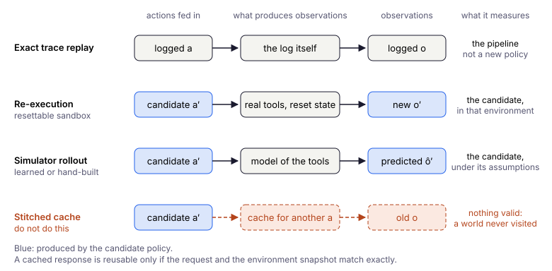

# Chapter 12: Offline RL for Tool-Using LLM Agents

> *Agentic AI turns language-model usage into sequential decision-making; offline RL turns logged agent traces into a training substrate for safer policy improvement.*

---

## Why This Chapter Exists

Most current LLM agent training is still closer to **SFT**, **DPO**, **rejection sampling**, or **online RL** than to classical offline RL. That is not a criticism — those pipelines work well when pairwise preferences, live feedback, or cheap rollouts are available.

However, once agent execution traces are logged as **state–action–reward trajectories**, the problem becomes naturally compatible with the offline RL framing from Chapters 1–3:

```text
task → context/observation → thought/plan → tool call/action → tool result → next state → reward/outcome
```

The difference from classical control benchmarks such as MuJoCo or the D4RL offline datasets is not conceptual but practical:

| RL object | Classical control | Agentic LLM |
|-----------|-------------------|-------------|
| **State** | Low-dim vector | Context, history, memory, tool observations |
| **Action** | Continuous / discrete control | Text, tool call, API request, plan step |
| **Reward** | Environment return | Task success, verifier score, human rating, cost/safety penalty |
| **Episode** | Fixed horizon rollout | Multi-turn interaction |
| **Policy** | MLP / actor network | LLM or LLM router over tools |

States are high-dimensional and partially observed; the action space is enormous and structured; rewards are often **sparse** and **delayed**; credit assignment spans many reasoning and tool steps. These are the same failure modes as offline deep RL — extrapolation, distribution shift, and overoptimistic value estimates — but with messier observations and weaker simulators.

This chapter maps the **ideas** from the rest of the book onto agentic AI. It does **not** claim that CQL, IQL, or TD3+BC drop into LangChain unchanged. It explains what transfers, what must be adapted, and what infrastructure (logging, verifiers, replay) must exist first.

---

## Agent Traces as Offline RL Data

An agent trace is a trajectory $\tau = (s_0, a_0, r_0, s_1, \ldots, s_T)$ where each step may include:

- the user goal and conversation history,
- retrieved documents or memory,
- an explicit plan, rationale summary, or structured scratchpad if exposed by the agent design; **hidden chain-of-thought should generally not be required or stored** as part of the RL dataset,
- a structured tool call or free-form generation,
- environment / tool feedback,
- scalar or programmatic reward signals.

**Behavioral cloning on successful traces** (SFT on ReAct-style demonstrations) is the default baseline — analogous to Chapter 1. Frameworks such as [AgentGym](https://agentgym.github.io/) ([Xi et al., 2024](https://arxiv.org/abs/2406.04151)) collect multi-turn trajectories across web, embodied, and tool-using tasks and use them to bootstrap generally capable agents. AgentTraj-style datasets are BC fuel, not yet offline RL — but they are the **substrate** offline RL needs.

The applied prerequisite is a **replayable trace schema**: without consistent logging of state snapshots, actions, observations, rewards, and behavior-policy metadata, later OPE, reward relabeling, and conservative policy improvement are impossible.

---

## MDP / POMDP Formulation

Treat each LLM call (or each tool step) as one decision in an MDP:

- **State** $s_t$: everything the policy conditions on at step $t$ — system prompt, user goal, conversation, tool outputs, memory, retrieved context. This is usually a **POMDP** view: the true environment state is hidden; the agent sees a context window.
- **Action** $a_t$: the model output — a tool call JSON, SQL query, browser action, or text plan.
- **Transition** $s_{t+1}$: the context update is often deterministic given $(s_t, a_t, o_t)$, but the observation $o_t$ may come from **stochastic, non-stationary, or versioned** tools and environments.
- **Reward** $r_t$: often **0** until task completion; then success/failure, verifier score, human rating, or shaped process reward (format valid, tool succeeded, cost penalty).

[Agent Lightning](https://microsoft.github.io/agent-lightning/latest/) ([Luo et al., 2025](https://arxiv.org/abs/2508.03680)) makes this explicit: agent execution is an MDP where state is an execution snapshot and action is an LLM output; trajectories decompose into transitions `(state, action, reward)` for training. Agent Lightning is **not** an offline RL method in the narrow CQL/IQL sense; it is better viewed as **infrastructure** that turns agent execution into RL-compatible transitions, which can support online, off-policy, or potentially offline training regimes.

The bridge for practitioners:

```text
Agent observability / tracing → trajectories → offline or off-policy RL dataset
```

LangChain-, AutoGen-, or OpenAI Agents-style logs are not merely debugging artifacts — they are potential **RL training data** once rewards and state boundaries are defined.

---

## The Policy Interface Determines the Training Method

Specify which policy is being updated before choosing a loss. A structured classifier is still a policy $\pi(a\mid s)$, even when it uses an LLM encoder; it need not generate language.

| Policy interface | Action space | Baseline | Candidate methods |
|------------------|--------------|----------|-------------------|
| Token-generating LLM | Token sequences / serialized tool calls | SFT on demonstrations | ILQL-style token values; DPO on preference pairs; trajectory methods with compatible action probabilities |
| Action classifier | Finite set of tool/action labels | Cross-entropy BC on action logits | Discrete CQL, IQL with a categorical actor, support-constrained value learning |
| Router / orchestrator | Agent, tool, handoff or scheduling decisions | BC on routing decisions | Offline RL on the routing process, with its own observations, rewards and support constraints |

DPO is preference optimization, not a replacement for trajectory-level credit assignment. Token-level ILQL and language-model SFT require a token policy and an LM head; a classifier instead learns through its action logits. Text retrospection can supply annotations or features, but a text-generation loss cannot directly train a classifier without a compatible output head and targets.

The orchestrator row already has a worked example at realistic scale. HarnessMDP ([Yi & Song, 2026](https://arxiv.org/abs/2607.05458)) keeps the LLM executor frozen and trains only a small controller that chooses among seven structural operations: observe, retrieve, call a tool, draft, check, revise and submit. The controller is fitted by advantage-weighted regression on trajectories from existing harnesses. The gains are real but modest: averaged over six controlled domains task success rises by 2.8%, accuracy improves clearly on coding (+10 points under the authors' calibrated verifier), and in several other domains the change in accuracy is negligible or slightly negative. Its authors state the limit plainly: the controller can amplify patterns already present in the buffer, but cannot learn strategies outside its support, and its gains depend on the quality and coverage of the logs. The same lesson emerges from the calculator below, on a much smaller stage.

The calculator example below implements the **tabular** stage; a classifier and then an LLM are possible extensions. Changing the model does not remove the need to define action support; changing the interface can require a different training objective.

---

## BC / SFT as the Baseline

**Supervised fine-tuning (SFT)** on expert or filtered successful trajectories is behavioral cloning in disguise. It is strong when:

- the behavior policy is already good,
- tasks are single-turn or short-horizon,
- failure modes in logs are rare.

It fails in the same way as BC (Chapter 1): **compounding error** on long horizons, no use of reward beyond filtering, and no way to combine good segments from mixed-quality episodes.

For multi-step tool use, SFT also **cannot assign credit** across steps: a trajectory may fail at step 8 while steps 1–7 were sound. Offline RL and advantage-weighted methods exist precisely to exploit partial progress — when rewards and coverage support it.

---

## Offline RL Beyond SFT

### DPO vs trajectory-level offline RL

**DPO** optimizes a **sequence-level** log-likelihood ratio (a sum of per-token log-probs relative to a reference model), supervised by a pairwise preference label. As a result, it provides **weak step-level credit assignment** for multi-turn reasoning and tool use.

[OREO](https://github.com/jwhj/OREO) — *Offline Reinforcement Learning for LLM Multi-Step Reasoning* ([Wang et al., 2024/2025](https://arxiv.org/abs/2412.16145), [ACL Findings 2025](https://aclanthology.org/2025.findings-acl.464/)) — is a useful anchor: it jointly trains an LLM policy and **value function** via a soft Bellman-style objective, motivated by sparse rewards and credit assignment across reasoning steps. Empirically it improves over DPO-style baselines on math reasoning (GSM8K, MATH) and embodied control (ALFWorld).

A direct precursor is **ILQL** (Implicit Language Q-Learning; [Snell et al., 2023](https://arxiv.org/abs/2206.11871)) — IQL (Chapter 5) adapted to language generation: an expectile value function plus an implicit dataset-support constraint, with the policy realized by advantage-reweighting the base model's token logits. It is the most direct bridge from this book's value-pessimism chapters to LLM policies.

The conceptual contrast:

| Approach | Data | Credit assignment |
|----------|------|-------------------|
| **DPO / preference learning** | Pairwise chosen vs rejected | Sequence-level preference signal |
| **Offline RL (OREO-style)** | Full trajectories + rewards | Value function + Bellman backup across steps |

### Mapping classical offline RL ideas

Let $\pi_b$ denote the policy that collected the logs and $\pi_{\mathrm{ref}}$ the frozen reference model. Two acronyms recur below. RLHF (reinforcement learning from human feedback) fine-tunes a model against a learned reward, usually with a KL penalty to the reference. GRPO (Group Relative Policy Optimization) is an online policy-gradient method that scores each sampled answer against others drawn for the same prompt. TD3+BC fits actions actually observed in the dataset; [DPO](https://arxiv.org/abs/2305.18290) instead compares sequence probabilities relative to $\pi_{\mathrm{ref}}$. They may be close when the same SFT checkpoint collected the data with matching prompts and sampling, but mixtures of checkpoints, filtering and changed decoding break that correspondence. A reference penalty does not itself establish dataset support. DPO encodes reference regularization through its preference objective; the presence, coefficient and role of an explicit KL penalty in GRPO depend on the implementation.

Do **not** read this table as “drop in CQL unchanged.” Read it as **design vocabulary**:

| Classical offline RL (this book) | Agentic AI analogue |
|-----------------------------------|---------------------|
| **BC** | SFT on successful traces |
| **Dataset-action constraint (TD3+BC, Ch. 6)** | Penalize distance to logged actions; this constrains deviation from dataset behavior |
| **Reference-policy regularization** | KL to a frozen reference in KL-regularized RLHF; DPO uses policy/reference log-probability ratios; GRPO variants differ |
| **AWR / AWAC / IQL-style extraction** | Weight steps or trajectories by advantage, verifier score, or process reward (**ILQL** applies IQL directly to token-level language generation) |
| **CQL / pessimism** | Penalize unsupported tool calls, plans, or API invocations |
| **FQE / learned Q** | Critic over agent states and actions (text or structured) |
| **Decision Transformer** | Condition generation on desired return / success label |
| **Model-based offline RL** | Simulator, verifier, or world model for tool outcomes |
| **OPE (Ch. 3)** | Environment re-execution / action-conditioned simulation / learned value model; distinguish direct evaluation from fixed-data OPE |

Agent Lightning’s **LightningRL** adds hierarchical credit assignment: allocate trajectory-level return to individual LLM calls, then apply standard single-turn RL updates — a practical pattern when episodes are long but each call is trainable. Treat this as an **off-policy RL bridge**, not a drop-in replacement for CQL or IQL on fixed logs.

---

## Credit Assignment in Reasoning and Tool Use

Multi-turn agents combine **language generation** with **externalized actions**. Rewards often arrive only at episode end (task solved or not). Offline RL methods that maintain a **value function** — OREO, goal-conditioned critics, or FQE-style models — address the same problem as TD learning in control: which intermediate step contributed?

**Online agentic RL** highlights how hard this is. [RAGEN](https://arxiv.org/abs/2504.20073) ([Wang et al., 2025](https://arxiv.org/abs/2504.20073)) studies multi-turn LLM agent RL (StarPO) and reports instability: reward variance cliffs, **Echo Trap** dynamics, and shallow or hallucinated reasoning without fine-grained rewards. [RAGEN-2](https://arxiv.org/abs/2604.06268) ([Wang et al., 2026](https://arxiv.org/abs/2604.06268)) analyzes **template collapse** — fluent but input-agnostic reasoning — and proposes SNR-aware filtering. These are **online** results, but the caveats transfer directly to offline training: if online agentic RL is unstable, offline agentic RL depends even more on **data coverage**, **reward quality**, and **evaluator fidelity**.

For offline settings, prefer:

- **process rewards** (tool succeeded, format valid, constraint satisfied) where terminal reward is sparse,
- **step-level value targets** when trajectories include both successes and failures,
- **verifier-backed labels** instead of pure LLM-as-judge when possible.

A single terminal label is not automatically a statistical dead end, but what the objective is matters. Ren and Xie ([2026](https://arxiv.org/abs/2606.18531)) study offline RL when each trajectory carries one outcome label, and propose OPAC, a pessimistic actor-critic that learns a latent per-step reward together with the value function. When the objective is the usual sum of per-step rewards and only the total is observed, OPAC's sample complexity is polynomial in the horizon. The barrier appears when the objective itself is trajectory-level: under an all-success objective, where an episode counts only if every step succeeds, the outcome is informative on an exponentially small set of trajectories, and any learner can need on the order of $2^H$ episodes to come close to the optimal policy. Process rewards help precisely there: they return to the data the information that a single all-or-nothing bit discards. A recent survey of credit assignment for LLM agents ([Zhang, 2026](https://arxiv.org/abs/2604.09459)) adds a second caution: when the log holds only text histories and an earlier state cannot be restored, even the sign of a step's credit may be unidentifiable.

---

## OPE for Agents

Chapter 3’s OPE toolbox applies, but agent environments rarely offer a faithful closed-form simulator.

Practical evaluation layers:

1. **Environment re-execution / action-conditioned simulation** — execute candidate actions in a resettable sandbox, or simulate their outcomes under explicit model assumptions; cached responses require matching actions and environment snapshots.
2. **Verifiers** — unit tests, SQL result checks, retrieval precision, code execution outcomes.
3. **Learned critics** — FQE-style $Q(s,a)$ or goal-conditioned value models trained on logs. *Planning without Search* ([Hong et al., 2025](https://arxiv.org/abs/2505.18098)) — uses offline goal-conditioned values as a **natural-language critic** at inference without fine-tuning the base LLM.
4. **Human or A/B review** — expensive but necessary for high-stakes deploy.

Offline RL for agents fails quietly when OPE measures **format quality** instead of **task success**. Align metrics with deployment risk, as in Chapter 3’s coverage warnings.

### Replay Is Not Counterfactual Evaluation

Distinguish three operations before interpreting an evaluation score:

1. **Exact trace replay** feeds the same recorded actions and observations through the pipeline. It tests parsing, state reconstruction and regressions, but cannot measure the return of a policy that chooses different actions.
2. **Environment re-execution** executes the candidate's actual actions in a resettable sandbox. It estimates performance in that environment; transfer depends on sandbox fidelity, tool versions and representative initial tasks. It is direct interaction with a test environment, rather than evaluation from a fixed dataset alone.
3. **Simulator rollout** generates observations conditioned on each new action and the current simulated state. A learned simulator adds model bias, especially outside logged support; validate it separately and report uncertainty.



A cached response may be reused only when the complete request and relevant environment state match: arguments, authentication scope, document/database snapshot, tool version and any random inputs that affect the result. Determinism alone is insufficient if the snapshot changed. A cache miss must trigger sandbox execution, a validated simulation, or an explicit unsupported outcome; never silently substitute a response from another action.

For example, a recorded `open_pdf(page=42)` result cannot become the observation after `open_pdf(page=43)`. Even the same page number is insufficient if the underlying filing changed. Reusing the old observation hides the consequences of the candidate's decision and creates an invalid counterfactual.

Report which operation produced each metric. Exact replay can establish that a pipeline reproduces a logged run; it cannot establish that a new policy improves task success. For unavailable environments, use supported statistical OPE or learned value estimates with their assumptions and coverage limitations, rather than treating cached transcripts as new rollouts.

Recent work gives this warning a measurement. In *The Replay Gap* ([Gonuguntla, 2026](https://arxiv.org/abs/2608.08239)), a workshop study on SWE-bench Verified, agent trajectories are forked midway and continued with a different model. The switch rewrites 61–94% of the subsequent actions, and an evaluator that stitches logged outputs together mispredicts all five cases in which success actually changed. The sample is small, yet the direction is clear: a stitched log scores a world the new policy would never visit. A learned simulator is the constructive alternative. ADWM ([Liu et al., 2026](https://arxiv.org/abs/2606.05558)) models each transition of a multi-turn agent with a latent diffusion world model trained on logged trajectories; on HotpotQA, ScienceWorld, ALFWorld and WebShop it ranks candidate policies more reliably than the direct method, FQE, importance sampling and doubly robust estimators. The authors are careful about scope: the experiments do not cover fully out-of-support policies, and rank correlation says nothing about the calibration of absolute values.

### Evaluation Contract for an Agent Policy

OPE methods tell you *how* to estimate return; they do not define *what counts as improvement*. For tool-using agents, a policy can raise task success while increasing cost, latency, redundant tool calls, or safety violations. Before comparing offline-trained candidates, write a short **evaluation contract** — a spec stakeholders can execute without re-debating metrics after every training run.

**Baselines (always report against both):**

1. **Current deployed agent** — the behavior policy in production (or the best available shadow of it).
2. **SFT / BC on successful traces** — imitation on filtered wins; the honest “no RL” ceiling when logs are good but sparse on reward structure.

**Metric groups (do not collapse to one number):**

| Group | What to measure | Typical role |
|-------|-----------------|--------------|
| **Task success** | Verifier pass rate, task completion, human accept rate | **Primary** — the metric you want to improve |
| **Cost / latency** | USD per episode, tokens, p95 wall-clock per task | **Guardrail** |
| **Tool-call efficiency** | Calls per episode, duplicate lookups, empty retries | **Guardrail** |
| **Safety / constraints** | Forbidden tools, PII leaks, policy violations, out-of-allowlist APIs | **Guardrail** |

**Evaluation set:** Use a **held-out** task suite — never tasks seen during training or prompt tuning. Stratify by **task type** (search, code, CRM, etc.) and **difficulty** (single-hop vs multi-hop). Report per-stratum tables, not only a global average. Chapter 3’s coverage warnings apply: OPE on logs is not a substitute for held-out task eval when deploy states differ from the log.

**Acceptance rule (example template):**

Accept candidate policy $\pi$ over baseline $b$ only if:

- **Primary:** $\text{success}(\pi) \geq \text{success}(b) + \Delta_{\min}$ on the held-out suite, with a **confidence interval** (bootstrap over tasks, or A/B in shadow mode) that excludes zero uplift.
- **Guardrails:** for each guardrail metric $g$, $\; g(\pi) \leq g(b) + \tau_g\;$ where $\tau_g$ is a **pre-registered tolerance** (e.g. cost +5%, p95 latency +10%, zero tolerance on hard safety violations).

If primary improves but a guardrail breaks tolerance, the answer is **not** to ship with caveats by default — iterate on reward shaping, constraints, or support filtering until the contract is satisfied or the candidate is rejected.

**Illustrative comparison (fictional numbers):**

| Policy | Success (held-out) | Cost / task | Tool calls / task | Safety violations |
|--------|-------------------|-------------|-------------------|-------------------|
| Deployed agent | 62% | $0.041 | 4.2 | 0.3% |
| SFT / BC | 68% | $0.038 | 3.9 | 0.2% |
| Offline RL candidate | **71% ± 2%** | $0.044 | 4.0 | 0.2% |

With tolerances $\tau_{\text{cost}} = +5\%$ and $\tau_{\text{calls}} = +10\%$, the candidate **passes** success and safety but **fails** cost ($0.044 > 1.05 \times 0.041$). The contract rejects deployment until cost is brought down — even though success beat both baselines.

This contract is the agentic analogue of Chapter 13’s **Industrial Deployment: Gated Readiness**: offline metrics and OPE inform Gate 2; the evaluation contract is what Gate 3 (shadow) and Gate 4 (limited rollout) must verify on live tasks.

---

## LLMs as Annotators, Generators, and Critics

LLMs appear in agentic offline pipelines in several roles — not only as the policy. KALM and TEDUO are **LLM-assisted offline RL** lines (language-conditioned or rollout-augmented control), not always narrow “tool-using chat agents” — but the data-layer pattern transfers:

| Role | Example | Offline RL connection |
|------|---------|------------------------|
| **Trajectory generator** | [KALM](https://arxiv.org/abs/2404.09248) ([Pang et al., NeurIPS 2024](https://arxiv.org/abs/2404.09248)) — LLM imaginary rollouts merged with real data, then standard offline RL | Expands coverage; watch semantic gap between text and low-level actions |
| **Dataset labeler** | [TEDUO](https://arxiv.org/abs/2412.06877) — hindsight labeling and state abstraction on unlabeled logs, then offline RL + SFT | LLM as annotator before RL |
| **Inference-time critic** | *Planning without Search* ([arXiv:2505.18098](https://arxiv.org/abs/2505.18098)) — goal-conditioned value function guides plan refinement | Offline RL trains critic; base LLM may stay frozen |
| **Reward model** | LLM-as-judge scores | Cheap but gameable; combine with verifiers |

KALM grounds the LLM on environment dynamics before generating rollouts — addressing the **semantic gap** between tokens and numerical state. TEDUO shows LLMs can enrich **unlabeled** interaction logs so offline RL has goals and abstract states to condition on.

---

## Failure Modes

Agentic offline RL inherits classical offline RL failures and adds agent-specific ones:

- **Reward hacking** — optimizing verifier shortcuts instead of task intent.
- **Spurious tool use** — calling tools to look productive without information gain.
- **Template collapse** — diverse-looking text that ignores input (see RAGEN-2).
- **Unsupported tool calls** — analog of OOD actions: APIs or arguments never seen in logs.
- **Overconfident critics** — FQE-style models extrapolate on long contexts like Q-functions extrapolate on OOD actions.
- **Non-stationary tools and APIs** — training logs from GPT-4.1-era tools may not match deploy-time behavior.
- **Cost and safety** — reward must encode latency, spend, and policy violations, not only success rate.

Conservative methods (CQL-style pessimism, support constraints, rejection of low-coverage tool branches) are conceptually appropriate but require defining **action support** in structured action spaces — an open engineering problem.

---

## Toy Example: Offline RL for a Calculator Agent

This example **intentionally removes language modeling complexity**. The policy does not generate free text; it chooses among structured tool calls. That isolates the offline RL question: can we improve over logged behavior using value learning and support constraints?

> 📄 Full code: [`agentic_offline_rl_toy.py`](https://github.com/corba777/offline-rl-book/blob/main/code/agentic_offline_rl_toy.py)

### Environment

The agent solves `x + y`, `x - y`, or `x * y` but never sees `x` and `y` directly. It must call tools:

| Action | Effect |
|--------|--------|
| `lookup_x` | observe hidden $x$ |
| `lookup_y` | observe hidden $y$ |
| `add` / `sub` / `mul` | compute on known values |
| `final` | submit answer (verifier checks against true task) |

Rewards: **+1** correct final answer, **−1** wrong final or invalid tool, **−0.02** per step (latency/cost proxy).

This mirrors an LLM agent trace:

| Real agent | Toy analogue |
|------------|--------------|
| Context window | Discrete state tuple |
| Tool-call JSON | Discrete action |
| Tool output | Observation update |
| Final answer | `final` action |
| Verifier | Exact arithmetic checker |
| Agent trace | Offline RL transition |

The tabular state key is `(task, x, y, result)`, with `None` for values not yet observed. Keeping the observed operands as well as the result prevents correct and incorrect outcomes from sharing a key. The policy never receives hidden operands before lookup.

### Four policies on two datasets

| Policy | Role |
|--------|------|
| **Behavior** | Stochastic logger (sometimes wrong op) |
| **BC** | Majority action per state in logs (SFT-on-traces) |
| **Naive FQI** | Tabular fitted Q with greedy improvement over **valid** actions |
| **Support-constrained FQI** | Same, but argmax restricted to logged actions at each state; abstains if none are supported (support mask, not the CQL objective) |

Two data regimes:

1. **Good coverage** — `mul` appears in logs when the task is multiplication.
2. **Coverage gap** — on `mul` tasks, behavior logs only `add` / `sub`, never `mul`.

An unknown state or an empty valid support set makes the constrained policy abstain (`None`); evaluation counts this as an unsuccessful termination.

Run: `python code/agentic_offline_rl_toy.py`

Example output (deterministic for the default seed; other seeds give slightly different numbers):

```text
Dataset: good coverage (mul in logs)
  mul-task op support (x,y known): ['add', 'mul', 'sub']
  Behavior success (all tasks):    0.72
  BC success:                    0.99
  Naive FQI success:             1.00
  Support-constrained FQI:       1.00

Dataset: no multiplication support
  mul-task op support (x,y known): ['add', 'sub']
  Behavior success (all tasks):    0.52
  BC success:                    0.67
  Naive FQI success:             1.00
  Support-constrained FQI:       0.72
  --- mul tasks only ---
  BC / naive FQI / constrained:  0.01 / 1.00 / 0.02
```

### What this demonstrates

1. **BC** clones the behavior policy. It improves over raw logging when the majority action at a state is good, but cannot invent unsupported tools.
2. **Naive FQI** can stitch successful sub-trajectories (`lookup_x → lookup_y → correct op → final`) when coverage exists.
3. **Without `mul` in the logs**, support-constrained FQI never selects multiplication. It may still succeed when a supported operation happens to give the same answer. That is the conservative behavior you want offline.
4. **Naive FQI on mul tasks** may still pick `mul` even though it was absent from behavior logs at that state: Q-values for unseen actions default to 0, which can beat negative Q on logged wrong ops — an **extrapolation / OOD action** effect. In the toy simulator `mul` succeeds; in deployment that would be a policy with no evidential support.

**Thesis (same as classical offline RL):** improvement is possible **inside** the action/state support of the dataset; conservative methods refuse unsupported gains; unconstrained value learning can overtrust unvisited actions.

Start with this tabular agent before LLM confounders (stochastic decoding, prompt drift, missing log-probs, expensive OPE). A natural next step is replacing the tabular policy with a small classifier over trace states, then an LLM that proposes tool calls filtered by a support or critic model.

---

## From Agentic Offline RL to Offline MARL

Everything so far has assumed a single tool-using agent. When several agents act in one episode, that assumption fails for a specific reason. If the other agents' policies are held fixed, each agent still faces a (PO)MDP: its teammates are part of the environment. Offline training, however, changes several policies at once, so the dynamics each agent experiences shift with its teammates' behavior, and logs collected under the old teammate policies no longer describe the new environment. The appropriate model is a stochastic (Markov) game; with local observations and a shared team reward, a Dec-POMDP. Concatenating all agents' turns into one transcript discards who observed what and who chose which action, which is exactly the information needed to estimate support and assign credit.

**Notation.** With $N$ agents, let $s_t$ be the joint state (shared workspace or ticket state), $o_t^i$ the local observation of agent $i$ (its prompt, tools and private memory), and

$$a_t = (a_t^1,\ldots,a_t^N)$$

the joint action, where $a_t^i$ is a message, a tool call or a plan step. Rewards can be shared by the team ($r_t$), individual ($r_t^i$), or a mix of both. A usable log therefore records per-agent observations and actions, not only the merged conversation.

Single-agent offline RL does not address three problems that arise here:

1. **Joint-action coverage.** Support is defined over tuples $(a^1,\ldots,a^N)$, not over each agent's actions separately. Logs can contain "agent A searches" and "agent B edits" in different episodes and never the combination needed at deployment. If each agent is constrained only to its own logged actions, the team can still execute a joint action that never appears in the data.
2. **Credit assignment across agents.** A team success does not indicate which agent's step produced it. Separating an agent's contribution from luck and from teammates' work requires agent- or role-level returns, counterfactual baselines or process rewards.
3. **Coordination conventions.** Multi-agent logs encode who speaks when, which role owns which tool and how handoffs work. Improving each agent's policy separately can break the conventions that made the logged episodes succeed.

LLM stacks often conflate two learning problems:

| Level | What is learned | Typical offline data |
|-------|-----------------|----------------------|
| **Shared LLM (post-training)** | One base model used by several roles or prompts | Preference pairs, successful multi-agent traces for SFT, optionally per-agent credit |
| **Orchestration policy** | Who acts next, when to hand off, how to route tools and messages | Logs of routers, schedulers or Autogen/LangGraph graphs, treated as a separate decision process |

Fine-tuning the shared LLM on role-conditioned traces (DPO, SFT or single-agent offline RL) updates a different policy from the orchestration policy that chooses joint actions. State which of the two a method updates; otherwise multi-agent failure modes enter under the label of agent fine-tuning.

**Example.** Two agents act at the same step without seeing each other's choice: agent 1 picks a query $m \in \{A, B\}$ while agent 2, working in parallel, picks a tool $u \in \{a, b\}$. The team receives $r = 1$ only for the pairs $(A, a)$ and $(B, b)$. Under a uniformly random behavior policy, every individual query and every individual tool succeeds in half of the logged episodes, so per-agent action values are all equal and carry no signal; only the value of the pair separates good from bad behavior. Agents that learn their own values from these logs — independent learners — have nothing to break the tie, choose independently, and end up at a mismatched pair such as $(A, b)$ half of the time. The example depends on the moves being simultaneous. If agent 2 observed $m$ before choosing, the problem would reduce to a two-step MDP that ordinary dynamic programming on the concatenated transcript solves exactly; credit assignment across agents becomes hard when an agent cannot see what it has to coordinate with. Offline MARL methods model the joint action explicitly for this reason.

Classical offline MARL already offers tools for this. MACCA ([Wang et al., 2025](https://arxiv.org/abs/2312.03644)) represents the offline data as a dynamic Bayesian network and identifies each agent's causal contribution to the reward. For LLM agents the nearest work is still online. LangMARL ([Yao et al., 2026](https://aclanthology.org/2026.emnlp-main.1837/)) uses a centralized language critic to assign credit to each agent and rewrites the agents' natural-language policies, their instructions and exemplars, rather than model weights, collecting fresh rollouts at every iteration. Carrying such agent-level credit over to fixed logs remains an open problem.

This chapter deliberately stays with a single agent. If your product is multi-agent, the evaluation practices above and the logging schema below still apply; the schema includes a multi-agent extension. Single-agent conservative RL does not carry over directly: its support constraints and credit assignment must first be redefined for joint actions and team rewards.

---

## Practical Logging Schema

For applied work, a consistent JSON (or parquet) schema matters as much as algorithm choice:

```json
{
  "episode_id": "task_001",
  "t": 3,
  "task": "Find quarterly revenue in uploaded 10-K",
  "state": {
    "user_goal": "...",
    "conversation_history": "...",
    "available_tools": ["search", "open_pdf", "calculator"],
    "memory": "...",
    "retrieved_context": "..."
  },
  "action": {
    "type": "tool_call",
    "tool": "open_pdf",
    "arguments": {"page": 42}
  },
  "observation": {
    "tool_result": "...",
    "error": null
  },
  "reward": 0.0,
  "done": false,
  "prompt_version": "agent_prompt_v12",
  "tool_schema_version": "tools_2026_06_20",
  "environment_version": "sandbox_v3",
  "action_logprobs": null,
  "reward_components": {
    "task_success": 0.0,
    "format_valid": 1.0,
    "tool_error_penalty": 0.0,
    "cost_penalty": -0.0031
  },
  "reward_source": "verifier_v2",
  "verifier_version": "sec_filing_checker_2026_06",
  "task_family_id": "sec_revenue_extraction_filing_001",
  "source_hash": "sha256:<source-snapshot-digest>",
  "collection_window": {"start": "2026-06-01", "end": "2026-06-30"},
  "split": "train",
  "metadata": {
    "behavior_policy": "gpt-4.1-agent-v3",
    "temperature": 0.2,
    "latency_ms": 1400,
    "cost_usd": 0.0031,
    "safety_flags": []
  }
}
```

Design choices:

- **`state`** should be reconstructible at train and eval time — version prompts (`prompt_version`), tool schemas (`tool_schema_version`), and sandboxes (`environment_version`).
- **`action`** should be structured (JSON schema) when possible — easier for support estimation than free text.
- **`reward`** can be relabeled offline (verifier, human, LLM critic) — store `reward_components`, `reward_source`, and `verifier_version` separately from the scalar `reward`.
- **`action_logprobs`** (or token/tool-call log-probabilities) are valuable for off-policy evaluation and filtering; log them when the behavior policy exposes them.
- **`metadata.behavior_policy`** is necessary for **dataset provenance**. Importance-weighted OPE additionally requires comparable action representations and behavior/target action probabilities — often **unavailable** for free-form LLM actions unless log-probs were recorded at collection time.

### Multi-agent extension

Attach this record to each acting agent's transition; the parent record holds its action and episode identifier.

```json
{
  "multi_agent_extension": {
    "joint_step_id": "task_001:3",
    "turn_id": 7,
    "agent_id": "reader_1",
    "role": "document_reader",
    "recipient_ids": ["analyst_1"],
    "local_observation": {
      "visible_document": "filing_snapshot_v1",
      "message": "Read page 42"
    },
    "policy_checkpoint": "reader_policy_v3",
    "team_reward": {
      "value": 0.0,
      "source": "task_verifier_v2"
    },
    "individual_reward": {
      "value": 0.0,
      "source": "tool_validity_v1"
    },
    "credit_label": {
      "value": null,
      "source": null
    }
  }
}
```

Use `joint_step_id` to link actions and messages belonging to one environment decision; `turn_id` preserves order within it. Record each agent's local observation, recipients and checkpoint here; the probability of its actual sampled action under the collection-time policy, including sampling settings, goes in the parent record's `action_logprobs`, so it is not duplicated. A null probability means unknown, not zero.

A flat transcript does not preserve private observations, simultaneous decisions or policy provenance. Team reward, individual reward and later credit annotations have different meanings and sources; a credit label is not an observed counterfactual. These records enable reconstruction but do not identify counterfactual contributions without additional assumptions or interventions.

### Dataset Splits and Leakage

Assign splits **before extracting transitions**, keeping whole episodes together. Group related episodes by task family and source document: variants, shared cached outputs and near-duplicate sources must not cross splits. Record `task_family_id`, `source_hash` (of the source snapshot) and `collection_window`; a hash alone does not detect semantic duplicates.

Define the grouping granularity first: `task_family_id` identifies a base task and its related variants, not a broad category such as all revenue-extraction tasks. Hold out independent task groups and source documents within the intended task categories to test new instances. Holding out entire categories instead tests transfer to unseen task families; label that result separately. Add a temporal/version holdout collected later or under changed prompts, tools or environments, and report it separately because version changes also test robustness.

Leakage checklist:

- Keep all steps and multi-agent turns of an episode in one split.
- Group task variants and duplicated or overlapping sources before assigning splits.
- Fit reward models, normalization and verifier calibration on training data; tune prompts and select candidates on validation data.
- Freeze the test set and evaluation protocol; never tune on test outcomes.
- Audit cache provenance and collection windows, and report task-family counts alongside transition counts.

---

## Limitations and Honest Scope

This is a **rapidly moving** research area, not a settled production stack. Most deployed agents still train via SFT + online RLHF/GRPO loops. Offline RL for agents is strongest when:

- traces are abundant and replayable,
- rewards (or verifiers) are reliable,
- deployment cannot tolerate exploratory online learning,
- you need to improve over a fixed behavior policy without full re-collection.

When those conditions fail, invest in **logging**, **BC baselines**, and **OPE** before value-based offline RL.

See the [Appendix: Algorithm Selection Guide](/offline-rl-book/en/appendix.html) for classical method anchors. [Chapter 13](/offline-rl-book/en/chapter13.html) concludes the book.

---

## References

- Wang, H., Hao, S., Dong, H., et al. (2024). *Offline Reinforcement Learning for LLM Multi-Step Reasoning (OREO).* [arXiv:2412.16145](https://arxiv.org/abs/2412.16145), [ACL Findings 2025](https://aclanthology.org/2025.findings-acl.464/), [code](https://github.com/jwhj/OREO).
- Snell, C., Kostrikov, I., Su, Y., Yang, M., & Levine, S. (2023). *Offline RL for Natural Language Generation with Implicit Language Q-Learning (ILQL).* ICLR. [arXiv:2206.11871](https://arxiv.org/abs/2206.11871).
- Xi et al. (2024). *AgentGym: Evolving LLM-based Agents across Diverse Environments.* [arXiv:2406.04151](https://arxiv.org/abs/2406.04151), [project](https://agentgym.github.io/).
- Luo et al. (2025). *Agent Lightning: Train ANY AI Agents with Reinforcement Learning.* [arXiv:2508.03680](https://arxiv.org/abs/2508.03680), [docs](https://microsoft.github.io/agent-lightning/latest/).
- Pang et al. (2024). *KALM: Knowledgeable Agents by Offline RL from LLM Rollouts.* [arXiv:2404.09248](https://arxiv.org/abs/2404.09248), [project](https://kalmneurips2024.github.io/).
- Pouplin, T., Kobalczyk, K., Sun, H., & van der Schaar, M. (2024). *The Synergy of LLMs & RL Unlocks Offline Learning of Generalizable Language-Conditioned Policies (TEDUO).* ICML 2025. [arXiv:2412.06877](https://arxiv.org/abs/2412.06877).
- Hong, J., Dragan, A., & Levine, S. (2025). *Planning without Search: Refining Frontier LLMs with Offline Goal-Conditioned RL.* NeurIPS 2025. [arXiv:2505.18098](https://arxiv.org/abs/2505.18098).
- Wang et al. (2025). *RAGEN: Understanding Self-Evolution in LLM Agents via Multi-Turn RL.* [arXiv:2504.20073](https://arxiv.org/abs/2504.20073).
- Wang et al. (2026). *RAGEN-2: Reasoning Collapse in Agentic RL.* [arXiv:2604.06268](https://arxiv.org/abs/2604.06268), [project](https://ragen-ai.github.io/v2/).
- Yi, H., & Song, X. (2026). *HarnessMDP: Learning to Control LLM Agent Harnesses with Offline Reinforcement Learning.* [arXiv:2607.05458](https://arxiv.org/abs/2607.05458).
- Ren, X., & Xie, T. (2026). *When Does Trajectory-Level Supervision Permit Efficient Offline Reinforcement Learning?* [arXiv:2606.18531](https://arxiv.org/abs/2606.18531).
- Zhang, C. (2026). *From Reasoning to Agentic: Credit Assignment in Reinforcement Learning for Large Language Models.* [arXiv:2604.09459](https://arxiv.org/abs/2604.09459).
- Gonuguntla, A. (2026). *The Replay Gap: Static Evaluation of Model Switching in LLM Agents Scores the Wrong World.* Efficient Reasoning Workshop, COLM. [arXiv:2608.08239](https://arxiv.org/abs/2608.08239).
- Liu, K., Xiong, G., Zhang, W., & Tang, S. (2026). *Autoregressive Diffusion World Models for Off-Policy Evaluation of LLM Agents (ADWM).* [arXiv:2606.05558](https://arxiv.org/abs/2606.05558).
- Wang, Z., Du, Y., Zhang, Y., Fang, M., & Huang, B. (2025). *MACCA: Offline Multi-agent Reinforcement Learning with Causal Credit Assignment.* TMLR. [arXiv:2312.03644](https://arxiv.org/abs/2312.03644).
- Yao, H., Da, L., Liu, X., Fleming, C., Chen, T., & Wei, H. (2026). *LangMARL: Natural Language Multi-Agent Reinforcement Learning via Semantic Credit Assignment.* EMNLP. [ACL Anthology](https://aclanthology.org/2026.emnlp-main.1837/), [arXiv:2604.00722](https://arxiv.org/abs/2604.00722).
