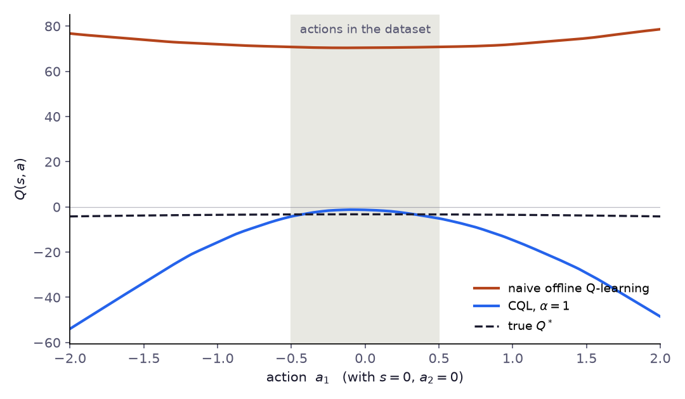

# Chapter 4: Conservative Q-Learning (CQL)

> *"Don't trust values you haven't seen. And if you haven't seen them, push them down."*

---

## The Problem, Restated

In Chapter 2 we saw that standard Q-learning on offline data produces catastrophically overoptimistic Q-values for out-of-distribution (OOD) actions. The greedy policy then exploits these inflated values, selecting actions the dataset never covered — and failing in deployment.

The root cause: the Bellman backup uses $\max_{a'} Q(s', a')$, which ranges over all actions including those never seen. For unseen actions, the Q-function generalizes optimistically.

**Conservative Q-Learning (CQL)** — Kumar et al., NeurIPS 2020 — fixes this with a single elegant idea: **add a regularization term that explicitly penalizes Q-values on actions not in the dataset**.

The result: a Q-function that is pessimistic about OOD actions by construction. The greedy policy, facing lower values outside the dataset, naturally stays close to the behavior policy — without explicitly constraining it.

---

## The Idea

Standard TD training minimizes:

$$\mathcal{L}_{TD}(\theta) = \mathbb{E}_{(s,a,r,s') \sim \mathcal{D}} \left[ \left( r + \gamma \max_{a'} Q_{\bar\theta}(s', a') - Q_\theta(s, a) \right)^2 \right]$$

CQL adds two terms to this objective:

$$\mathcal{L}_{CQL}(\theta) = \mathcal{L}_{TD}(\theta) + \alpha \cdot \underbrace{\left( \mathbb{E}_{s \sim \mathcal{D},\, a \sim \mu} \left[ Q_\theta(s, a) \right] - \mathbb{E}_{(s,a) \sim \mathcal{D}} \left[ Q_\theta(s, a) \right] \right)}_{\text{conservative penalty}}$$

where:
- $\mu$ is some distribution over actions (typically uniform, or the current policy)
- $\alpha > 0$ is a hyperparameter controlling the strength of conservatism
- The first expectation **pushes Q-values down** for actions sampled from $\mu$
- The second expectation **pushes Q-values up** for actions in the dataset

In words: **minimize Q-values everywhere, but maximize them at dataset actions**. The gap between the two terms is what CQL minimizes — it makes dataset actions look better than OOD actions, which is exactly what we want.

---

## Formalization

### The CQL Objective

More precisely, CQL minimizes the following regularized Bellman error:

$$\min_\theta \, \alpha \left( \mathbb{E}_{s \sim \mathcal{D}} \left[ \log \sum_a \exp Q_\theta(s, a) \right] - \mathbb{E}_{(s,a) \sim \mathcal{D}} \left[ Q_\theta(s, a) \right] \right) + \frac{1}{2} \mathcal{L}_{TD}(\theta)$$

The first term is the **log-sum-exp** over all actions — a smooth approximation of $\max_a Q(s,a)$. It pushes the entire Q-surface down. The second term lifts Q-values specifically at dataset points.

This can be written compactly. Define:

$$\mathcal{R}_{CQL}(\theta) = \mathbb{E}_{s \sim \mathcal{D}} \left[ \log \sum_a \exp Q_\theta(s, a) \right] - \mathbb{E}_{(s,a) \sim \mathcal{D}} \left[ Q_\theta(s, a) \right]$$

Then: $\mathcal{L}_{CQL}(\theta) = \mathcal{L}_{TD}(\theta) + \alpha \cdot \mathcal{R}_{CQL}(\theta)$

> **Note on the $\frac{1}{2}$ factor.** The original CQL paper writes $\frac{1}{2}\mathcal{L}_{TD}$ to match their derivation conventions. In practice the factor is absorbed into the learning rate and $\alpha$, so implementations (including ours) omit it without loss of generality.

### Why Log-Sum-Exp?

The logsumexp term is the softmax-temperature approximation:

$$\log \sum_a \exp Q(s, a) = \max_a Q(s, a) + \log \sum_a \exp(Q(s,a) - \max_a Q(s,a))$$

As temperature → 0, this converges to $\max_a Q(s,a)$. At finite temperature it is differentiable and penalizes the entire distribution of Q-values, not just the maximum.

For continuous action spaces, we cannot enumerate all $a$. CQL approximates the logsumexp by importance sampling:

$$\log \sum_a \exp Q(s, a) \approx \log \mathbb{E}_{a \sim \mu(a|s)} \left[ \frac{\exp Q(s,a)}{\mu(a|s)} \right]$$

where $\mu$ is a proposal distribution. In practice, $\mu$ is either uniform over the action space, or the current policy $\pi_\theta$.

**Why subtract $\log \mu(a|s)$ in the code?** When $\mu = \pi_\theta$, the importance-sampled estimate becomes:

$$\log \mathbb{E}_{a \sim \pi_\theta} \left[ \frac{\exp Q(s,a)}{\pi_\theta(a|s)} \right] \approx \log \frac{1}{N} \sum_{i=1}^N \frac{\exp Q(s, a_i)}{\pi_\theta(a_i|s)} = \text{logsumexp}_i \left[ Q(s, a_i) - \log \pi_\theta(a_i|s) \right] + \text{const}$$

This is why the code subtracts `log_pi` from `q_pi` before the logsumexp: subtracting $\log \pi_\theta(a|s)$ implements the importance weight correction. Without it, we would be approximating $\mathbb{E}_{\pi_\theta}[Q]$ (a plain Monte Carlo average), not $\log \sum_a \exp Q$ (the soft-maximum that CQL requires). The uniform samples need the same correction. Their density on $[-1,1]^d$ is $2^{-d}$, so the code adds $d \log 2$ to their Q-values. A constant shift would be harmless if uniform samples were used alone, but here the two proposals are averaged: without the correction the uniform term estimates $\log \int e^{Q}\,da - d \log 2$ while the policy term estimates $\log \int e^{Q}\,da$, which silently changes their relative weight. The unit tests in `code/test_cql_td3bc.py` check the estimator against a closed-form integral.

### The Theoretical Guarantee

Kumar et al. (2020) prove two related lower bounds, and the difference between them matters.

**Theorem 3.1 (push-down term only).** If the penalty contains only $\mathbb{E}_{a \sim \mu}[Q]$, for any $\mu$ whose support lies inside that of $\hat\pi_\beta$, the learned $\hat{Q}^\pi$ is a *pointwise* lower bound: $\hat{Q}^\pi(s, a) \leq Q^\pi(s, a)$ for all $s \in \mathcal{D}$ and all $a$, provided $\alpha$ is large enough.

**Theorem 3.2 (full CQL objective).** With the data term $-\mathbb{E}_{a \sim \hat\pi_\beta}[Q]$ included and $\mu = \pi$, the Q-values are no longer a pointwise bound — actions that are frequent in the data can even be overestimated — but the value of the policy is:

$$\hat{V}^\pi(s) = \mathbb{E}_{a \sim \pi(\cdot \mid s)}\bigl[\hat{Q}^\pi(s, a)\bigr] \leq V^\pi(s) \quad \forall s \in \mathcal{D}$$

This is the tighter of the two bounds. Three of its conditions are easy to forget:

- $\alpha$ must exceed a threshold that grows with the sampling error of the empirical Bellman operator, roughly $C\,R_{max} / \bigl((1-\gamma)\sqrt{|\mathcal{D}(s)|}\bigr)$ times a factor depending on how far $\pi$ is from $\hat\pi_\beta$. Only when the backup is exact does any $\alpha > 0$ suffice.
- The bound holds with probability at least $1 - \delta$ over the dataset, and only for states that appear in it.
- The analysis concerns the fixed point of exact policy evaluation without function approximation (the appendix extends it to linear and NTK-style models). A neural network trained for a finite number of gradient steps inherits the motivation, not the guarantee.

So the theorem says that CQL's *objective* is conservative in expectation. It does not certify that a particular neural implementation underestimates every Q-value, or that the resulting policy is safe.

**Safe policy improvement (Theorem 3.6).** Let $\pi^*$ be the policy obtained by optimizing against the CQL Q-function, and $\hat M$ the empirical MDP defined by the data. With probability at least $1 - \delta$,

$$\begin{aligned} J(\pi^*) &\geq J(\hat\pi_\beta) - \zeta, \\ \zeta &= \underbrace{2\Bigl(\tfrac{C_{r,\delta}}{1-\gamma} + \tfrac{\gamma R_{max} C_{T,\delta}}{(1-\gamma)^2}\Bigr) \mathbb{E}_{s \sim d^{\pi^*}_{\hat M}}\!\left[\tfrac{\sqrt{|\mathcal{A}|}}{\sqrt{|\mathcal{D}(s)|}} \sqrt{D_{CQL}(\pi^*, \hat\pi_\beta)(s) + 1}\right]}_{\text{loss from sampling error}} \\ &\quad -  \underbrace{\bigl(J(\pi^*, \hat M) - J(\hat\pi_\beta, \hat M)\bigr)}_{\geq\ \frac{\alpha}{1-\gamma} \mathbb{E}_{s \sim d^{\pi^*}_{\hat M}}[D_{CQL}(\pi^*, \hat\pi_\beta)(s)]} \end{aligned}$$

where $D_{CQL}$ measures how far $\pi^*$ moves from the behavior policy. The divergence appears on both sides. Moving away from the data increases the improvement CQL can claim in the empirical MDP, but also the sampling-error term, which shrinks only as the state counts $|\mathcal{D}(s)|$ grow. With enough data and a suitable $\alpha$, the CQL policy is guaranteed not to be much worse than the behavior policy, and it can be better.

---

## Implementation

> 📄 Full code: [`cql.py`](https://github.com/corba777/offline-rl-book/blob/main/code/cql.py)

### Networks

CQL is usually built on top of **Soft Actor-Critic (SAC)** (Haarnoja et al., 2018), an off-policy actor-critic algorithm whose stochastic policy maximizes reward plus an entropy bonus that keeps it from collapsing too early onto a single action. A SAC-style architecture has two Q-networks (to reduce overestimation via double-Q), a stochastic actor, and entropy regularization.

```python
import math
import torch
import torch.nn as nn
import torch.nn.functional as F
from copy import deepcopy

class QNetwork(nn.Module):
    """Double-Q network for CQL."""
    def __init__(self, state_dim, action_dim, hidden_dim=256):
        super().__init__()
        self.net = nn.Sequential(
            nn.Linear(state_dim + action_dim, hidden_dim), nn.ReLU(),
            nn.Linear(hidden_dim, hidden_dim),              nn.ReLU(),
            nn.Linear(hidden_dim, 1),
        )
    def forward(self, state, action):
        return self.net(torch.cat([state, action], dim=-1)).squeeze(-1)


class GaussianPolicy(nn.Module):
    """Stochastic actor with reparameterization trick."""
    def __init__(self, state_dim, action_dim, hidden_dim=256):
        super().__init__()
        self.trunk = nn.Sequential(
            nn.Linear(state_dim, hidden_dim), nn.ReLU(),
            nn.Linear(hidden_dim, hidden_dim), nn.ReLU(),
        )
        self.mean_head    = nn.Linear(hidden_dim, action_dim)
        self.log_std_head = nn.Linear(hidden_dim, action_dim)

    def forward(self, state):
        h = self.trunk(state)
        mean    = self.mean_head(h)
        log_std = self.log_std_head(h).clamp(-4, 2)
        return mean, log_std

    def sample(self, state):
        """Sample action with reparameterization; return (action, log_prob)."""
        mean, log_std = self.forward(state)
        std  = log_std.exp()
        eps  = torch.randn_like(mean)
        raw  = mean + std * eps                        # reparameterization
        action   = torch.tanh(raw)                    # squash to [-1, 1]
        log_prob = (
            torch.distributions.Normal(mean, std).log_prob(raw)
            - torch.log(1 - action.pow(2) + 1e-6)    # tanh correction
        ).sum(-1)
        return action, log_prob

    def act(self, state, deterministic=False):
        mean, log_std = self.forward(state)
        if deterministic:
            return torch.tanh(mean)
        return self.sample(state)[0]
```

### The CQL Loss

This is the core: the standard TD loss plus the CQL penalty.

```python
def importance_sampled_logsumexp(q_rand, q_pi, log_pi, action_dim):
    """
    Monte Carlo estimate of log ∫ exp Q(s,a) da over [-1, 1]^d (Kumar et al., App. F):
        log( 1/2 E_Unif[exp Q / Unif(a)] + 1/2 E_pi[exp Q / pi(a|s)] )
    Each proposal is divided by its own density; Unif(a) = 2^{-d}.
    """
    n = q_rand.shape[1]
    log_unif = -action_dim * math.log(2.0)
    weighted = torch.cat([q_rand - log_unif, q_pi - log_pi], dim=1)   # (B, 2N)
    # One logsumexp over all 2N samples, divided by 2N, equals the 1/2–1/2 mixture.
    return torch.logsumexp(weighted, dim=1) - math.log(2 * n)


def compute_cql_loss(Q, Q_other, Q_tgt, Q_other_tgt, policy,
                     states, actions, rewards, next_states, dones,
                     alpha_cql=1.0, alpha_ent=0.1, gamma=0.99, n_samples=10):
    """
    CQL loss = TD_loss + alpha_cql * CQL_penalty.
    Call twice for Q1 and Q2 (swap Q/Q_other and targets for the second call).
    """
    B = states.shape[0]
    dev = states.device

    with torch.no_grad():
        a_next, lp_next = policy.sample(next_states)
        v_next = (torch.min(Q_tgt(next_states, a_next), Q_other_tgt(next_states, a_next))
                  - alpha_ent * lp_next)
        td_target = rewards + gamma * (1 - dones) * v_next

    q_data  = Q(states, actions)
    td_loss = F.mse_loss(q_data, td_target)

    s_rep  = states.unsqueeze(1).expand(-1, n_samples, -1).reshape(B * n_samples, -1)
    a_rand = torch.FloatTensor(B * n_samples, actions.shape[-1]).uniform_(-1, 1).to(dev)
    a_pi, lp_pi = policy.sample(s_rep)
    q_rand = Q(s_rep, a_rand).reshape(B, n_samples)
    q_pi   = Q(s_rep, a_pi).reshape(B, n_samples)
    lse = importance_sampled_logsumexp(q_rand, q_pi,
                                       lp_pi.detach().reshape(B, n_samples),
                                       actions.shape[-1])
    cql_penalty = (lse - q_data).mean()

    loss = td_loss + alpha_cql * cql_penalty
    return loss, {'td_loss': td_loss.item(), 'cql_penalty': cql_penalty.item(),
                  'q_data': q_data.mean().item(), 'q_ood': lse.mean().item()}
```

### Training Loop

```python
import torch.optim as optim

class CQLAgent:
    def __init__(self, state_dim, action_dim, alpha_cql=1.0, alpha_ent=0.1,
                 gamma=0.99, tau=0.005, device='cpu'):
        self.device = device
        self.alpha_cql = alpha_cql
        self.alpha_ent = alpha_ent
        self.gamma = gamma
        self.tau = tau

        self.Q1 = QNetwork(state_dim, action_dim).to(device)
        self.Q2 = QNetwork(state_dim, action_dim).to(device)
        self.Q1_tgt = deepcopy(self.Q1)
        self.Q2_tgt = deepcopy(self.Q2)
        self.policy = GaussianPolicy(state_dim, action_dim).to(device)

        self.q_opt  = optim.Adam(
            list(self.Q1.parameters()) + list(self.Q2.parameters()), lr=3e-4)
        self.pi_opt = optim.Adam(self.policy.parameters(), lr=3e-4)

    def update(self, batch):
        s, a, r, s2, d = [x.to(self.device) for x in batch]

        l1, i1 = compute_cql_loss(self.Q1, self.Q2, self.Q1_tgt, self.Q2_tgt,
                                  self.policy, s, a, r, s2, d,
                                  self.alpha_cql, self.alpha_ent, self.gamma)
        l2, i2 = compute_cql_loss(self.Q2, self.Q1, self.Q2_tgt, self.Q1_tgt,
                                  self.policy, s, a, r, s2, d,
                                  self.alpha_cql, self.alpha_ent, self.gamma)
        self.q_opt.zero_grad()
        (l1 + l2).backward()
        nn.utils.clip_grad_norm_(list(self.Q1.parameters()) +
                                 list(self.Q2.parameters()), 1.0)
        self.q_opt.step()

        a_pi, lp = self.policy.sample(s)
        q_pi = torch.min(self.Q1(s, a_pi), self.Q2(s, a_pi))
        lpi  = (self.alpha_ent * lp - q_pi).mean()
        self.pi_opt.zero_grad(); lpi.backward(); self.pi_opt.step()

        for p, pt in zip(self.Q1.parameters(), self.Q1_tgt.parameters()):
            pt.data.mul_(1 - self.tau).add_(self.tau * p.data)
        for p, pt in zip(self.Q2.parameters(), self.Q2_tgt.parameters()):
            pt.data.mul_(1 - self.tau).add_(self.tau * p.data)

        return {'td_loss': (i1['td_loss']+i2['td_loss'])/2,
                'cql_penalty': (i1['cql_penalty']+i2['cql_penalty'])/2,
                'policy_loss': lpi.item()}
```

---

## The alpha Hyperparameter

$\alpha$ is the most important hyperparameter in CQL. It controls the trade-off between conservatism and performance:

| $\alpha$ | Behavior |
|---|---|
| $\alpha = 0$ | Standard SAC — no conservatism, OOD exploitation |
| $\alpha$ small (0.1–1.0) | Mild conservatism — allows some policy improvement |
| $\alpha$ large (5–10) | Strong conservatism — policy stays close to $\pi_\beta$ |
| $\alpha \to \infty$ | Equivalent to Behavioral Cloning |

**Automated $\alpha$ tuning.** CQL can tune $\alpha$ automatically using a Lagrangian approach. We want the CQL penalty to be at most some target threshold $\tau$:

$$\min_\theta \max_{\alpha \geq 0} \; \mathcal{L}_{TD}(\theta) + \alpha \left( \mathcal{R}_{CQL}(\theta) - \tau \right)$$

This is a constrained optimization: minimize the Bellman error subject to keeping the CQL penalty below $\tau$. In practice:

```python
# Automatic alpha tuning via dual gradient descent
log_alpha_cql = torch.zeros(1, requires_grad=True, device=device)
alpha_opt = optim.Adam([log_alpha_cql], lr=1e-4)
target_cql = 0.14   # τ: the penalty observed with a fixed α (see below)

# In the update step:
alpha_cql = log_alpha_cql.exp().item()
# ... compute cql_penalty ...
alpha_loss = -log_alpha_cql * (cql_penalty - target_cql)
alpha_opt.zero_grad()
alpha_loss.backward()
alpha_opt.step()
with torch.no_grad():
    log_alpha_cql.clamp_(np.log(1e-3), np.log(1e3))   # keep α in a sane range
```

**What $\tau$ means, and why it is easy to get wrong.** The penalty is the log-integral of $\exp Q$ over the action box minus $Q$ on the logged actions. For a $Q$ that does not depend on the action it equals $d \log 2$ ($1.39$ for $d = 2$); values below that mean $Q$ already peaks at the logged actions. Two consequences follow. First, $\tau$ has no scale-free meaning: it depends on the action dimension, on the reward scale and on how sharply the true $Q$ varies with the action. Thresholds from papers do not transfer either: the reference implementation multiplies the penalty by `min_q_weight` $w$ and omits the $-\log N$ normalization over its $N = 30$ samples, so its $\tau_{\text{ref}}$ corresponds to $\tau_{\text{ref}}/w - \log 30$ here — its AntMaze setting $\tau_{\text{ref}} = 5$, $w = 5$ becomes about $-2.4$. Second, and more important, a target is reachable only if it lies in the range the penalty actually covers as $\alpha$ varies, and that range can be narrow.

On the thermal task it is very narrow. Over 40 epochs, with $\alpha$ fixed at 1 the penalty settles at $0.14$; the same agent with auto-tuning reaches $0.13$ when $\alpha$ climbs to $3.4$ and $0.16$ when $\alpha$ falls to $0.3$, and after 120 epochs with $\alpha \approx 0.02$ it is still only $0.19$. The likely reason is that the true $Q$ here already varies with the action, so that variation, rather than conservatism, sets most of the penalty. Any target below about $0.13$ — including the formerly default $-2$ — makes $\alpha$ rise for the whole run; a target above about $0.16$ makes it fall towards plain SAC, at least within any training run of practical length. Neither is an equilibrium. Because Adam takes steps of roughly constant size, $\alpha$ then moves at a fixed rate in $\log \alpha$, and its final value is set by the length of training, not by the data. Returns barely differed in this experiment ($-1.9$ to $-2.1$ on one seed), which is itself a warning: the tuning looked harmless while doing nothing.

The practical rule: run CQL with a fixed $\alpha$ first, take $\tau$ from the penalty it reaches, and plot $\alpha$ during the tuned run. If $\alpha$ settles, the constraint is active; if it drifts in one direction for the whole run, treat the result as a schedule and fall back to a fixed $\alpha$ chosen by OPE (Chapter 3). `cql.py` follows this rule in its demo and refuses `auto_alpha=True` without an explicit `target_cql`.

**A note on the entropy coefficient.** The code uses a fixed `alpha_ent = 0.1` for the SAC entropy term. In production CQL this coefficient is also tuned automatically, targeting a desired policy entropy $\mathcal{H}^* = -\dim(\mathcal{A})$ (one nat of entropy per action dimension):

```python
# Automatic entropy tuning (SAC-style)
log_alpha_ent = torch.zeros(1, requires_grad=True, device=device)
ent_opt       = optim.Adam([log_alpha_ent], lr=3e-4)
target_entropy = -action_dim   # H* = -dim(A)

# In the policy update step:
alpha_ent  = log_alpha_ent.exp().item()
loss_pi    = (alpha_ent * log_probs - q_pi).mean()
# ...
ent_loss   = -(log_alpha_ent * (log_probs + target_entropy).detach()).mean()
ent_opt.zero_grad()
ent_loss.backward()
ent_opt.step()
```

The fixed `0.1` in our implementation works for the thermal control environment but may need adjustment for other tasks. When in doubt, use automatic tuning.

---

## Intuition: The Q-Landscape

Think of the Q-function as a landscape over the state-action space. Standard Q-learning shapes this landscape using only data points as anchors — in between, the landscape is unconstrained and tends to rise due to optimistic generalization.

CQL adds gravity: it pulls the entire landscape down, while the TD loss anchors it at data points. The result is a landscape that is high at dataset actions and low everywhere else.

The policy, acting greedily on this landscape, prefers dataset actions — not because it was explicitly constrained, but because the landscape naturally guides it there.

The figure below shows this on the toy problem of Chapter 2, produced by `code/chapter2_4_figures.py`. With the same data and the same TD target, adding the CQL penalty with $\alpha = 1$ keeps Q close to the true value inside the data (about $-5$ to $-1$, against $-3.3$) and pushes it far down outside, exactly where the naive network rated actions highest. CQL errs on the pessimistic side by design: the true $Q^*$ barely drops toward the edges, while the CQL estimate falls to about $-50$ there.



---

## How to Choose α

The right value of $\alpha$ depends on dataset quality, reward scale, and how much you trust the behavior policy.

### Step 1 — Sanity-check the penalty

The penalty is the gap between the soft maximum over all actions and $Q$ at dataset actions, and it is exactly what CQL minimizes. So before tuning, check its direction: train a few hundred updates at two values of $\alpha$. The larger $\alpha$ should give the smaller penalty. If it does not, the OOD sampling or the importance weights are broken.

### Step 2 — Grid search over one log-scale pass

```python
for alpha in [0.1, 0.5, 1.0, 5.0, 10.0]:
    agent = CQLAgent(..., alpha_cql=alpha)
    train_agent(agent, loader, n_epochs=80)
    res = evaluate(agent, env, ...)
    print(f"alpha={alpha:.1f}  reward={res['reward_mean']:.2f}")
```

Five runs give a coarse map of the reward–conservatism tradeoff.

### Step 3 — Read the diagnostics

| Symptom | Diagnosis | Fix |
|---|---|---|
| Policy ≈ BC, no improvement | $\alpha$ too large — Q suppressed everywhere | Reduce by 5–10× |
| Q-values diverge | $\alpha$ too small — OOD not controlled | Increase by 2–5× |
| CQL penalty near zero or negative | Conservatism saturated: out-of-data values already sit below the data | Do not raise $\alpha$; if the policy ≈ BC, lower it |
| CQL penalty >> TD loss | $\alpha$ too large or reward scale issue | Normalize rewards; reduce $\alpha$ |

### Typical values by data type

These are rules of thumb for where to start a search, not results: they come from common practice rather than from a derivation or a benchmark in this book, and the right $\alpha$ depends on the reward scale and the action dimension. Select the final value by OPE (Chapter 3).

| Dataset type | Starting $\alpha$ | Rationale |
|---|---|---|
| Expert-only (near-optimal) | 0.1 – 0.5 | Behavior policy is good; heavy conservatism hurts |
| Mixed quality (expert + random) | 1.0 – 2.0 | Safe default |
| Random / noisy operator data | 2.0 – 5.0 | High noise → more OOD risk → more conservatism |
| Multi-regime industrial logs | 1.0; auto-$\alpha$ only if it settles | One fixed $\alpha$ may not suit every regime, but check that tuning actually converges |

### When to use automatic tuning

Use `auto_alpha=True` when: (a) the policy will be deployed in a real system and safety matters more than performance, or (b) the dataset covers multiple operating regimes with different reward scales. Choose `target_cql` ($\tau$) from the penalty observed with a fixed $\alpha$, as described above: $\alpha$ grows while the penalty exceeds $\tau$ and shrinks once it falls below, and only a $\tau$ inside the range the penalty actually reaches lets it settle.

Keep fixed $\alpha$ when: you are doing offline evaluation and want reproducible experiments, or you have already found a good value via grid search.

---

## CQL vs TD3+BC: A Comparison

TD3+BC (Fujimoto & Gu, 2021) is a simpler alternative that adds a BC term directly to the policy loss:

$$\pi^* = \arg\max_\pi \mathbb{E}_{(s,a) \sim \mathcal{D}} \left[ \lambda Q(s, \pi(s)) - (\pi(s) - a)^2 \right]$$

It normalizes Q-values and constrains the policy output to stay close to dataset actions.

| | CQL | TD3+BC |
|---|---|---|
| Where pessimism lives | Q-function | Policy objective |
| OOD Q-values | Explicitly pushed down | Not modified |
| Theoretical guarantee | Yes (lower bound) | No |
| Hyperparameters | $\alpha$ | $\lambda$ |
| Implementation complexity | Medium | Low |
| Performance on noisy data | Better | More sensitive |

TD3+BC is a good starting point for deterministic policies. CQL is more principled and generally stronger on complex tasks.

---

## Practical Tips

**Normalize observations.** CQL is sensitive to scale. Always normalize states to zero mean and unit variance using statistics from the dataset.

**Start with $\alpha = 1.0$.** This is a safe default. If the policy is too conservative (performance similar to BC), reduce $\alpha$. If Q-values diverge, increase it.

**Use Double-Q.** Always use two Q-networks and take the minimum. This reduces overestimation independent of CQL — they complement each other.

**Monitor the CQL penalty.** Log the gap between the soft maximum over actions and $Q$ at dataset actions. A large or growing gap means some actions outside the data still look better than the data, and $\alpha$ may be too small. A gap near zero or below means out-of-data values are already pushed under the data; raising $\alpha$ further mostly makes the policy more BC-like.

**Industrial data tip.** If your dataset has multiple operating regimes (e.g., stopped/slow/fast in a coating process), consider training separate CQL agents per regime or adding regime as a state feature. A single CQL agent averaging over regimes will be conservative in all of them and may underperform in each.

---

## Limitations

**Requires reward labels.** Unlike BC, CQL needs $(s, a, r, s')$ tuples. If your dataset only has $(s, a, s')$, you need to define a reward function.

**Sensitive to reward scale.** The balance between the TD loss and CQL penalty depends on the reward magnitude. If rewards are large (e.g., in the thousands), the TD loss dominates and CQL has little effect. Normalize rewards to $[-1, 1]$ or $[0, 1]$.

**Conservative by design.** CQL will not outperform the behavior policy by a large margin in regions with sparse data. It is designed to be safe, not to extrapolate aggressively. For tasks requiring significant extrapolation beyond the dataset, model-based methods (Chapter 8) are more appropriate.

**Continuous action spaces need sampling.** The logsumexp over actions requires sampling — typically 10 uniform + 10 policy samples per state. Each sample is divided by the density of the distribution it came from ($2^{-d}$ for uniform actions, $\pi(a|s)$ for policy actions); after that, one logsumexp over all 20 weighted samples minus $\log 20$ is exactly the half-and-half mixture estimate of $\log \int e^{Q}\,da$ used by Kumar et al. The variance of this estimate grows with the action dimension, which is why the paper finds the policy-based variant more stable in high-dimensional action spaces. Sampling also adds computational overhead compared to BC or TD3+BC.

---

## Summary

| Property | CQL |
|---|---|
| Data required | $(s, a, r, s')$ transitions with rewards |
| Training objective | TD loss + CQL penalty (logsumexp − dataset Q) |
| OOD handling | Explicit: Q-values pushed down for OOD actions |
| Theoretical guarantee | Lower bound on the policy's value at dataset states (under the paper's assumptions) |
| Key hyperparameter | $\alpha$ (conservatism strength) |
| Implementation complexity | Medium |

CQL closes the gap between behavioral cloning and full offline RL. It uses reward information to improve over the behavior policy, while pessimism about OOD actions prevents the catastrophic failures of standard Q-learning.

The remaining limitation: CQL is **model-free**. It learns from the data as-is, with no model of how the system transitions. Chapter 5 (IQL) refines the value pessimism idea. Chapter 8 (MOPO) shows how learning a world model enables generating synthetic data — extending the effective dataset beyond what was collected.

---

## References

- Kumar, A., Zhou, A., Tucker, G., & Levine, S. (2020). *Conservative Q-Learning for Offline Reinforcement Learning.* NeurIPS. [arXiv:2006.04779](https://arxiv.org/abs/2006.04779).
- Fujimoto, S., & Gu, S. (2021). *A Minimalist Approach to Offline Reinforcement Learning (TD3+BC).* NeurIPS. [arXiv:2106.06860](https://arxiv.org/abs/2106.06860).
- Haarnoja, T. et al. (2018). *Soft Actor-Critic: Off-Policy Maximum Entropy Deep RL.* ICML. [arXiv:1801.01290](https://arxiv.org/abs/1801.01290). *(SAC foundation for CQL)*
- Levine, S. et al. (2020). *Offline Reinforcement Learning: Tutorial, Review, and Perspectives.* [arXiv:2005.01643](https://arxiv.org/abs/2005.01643).
