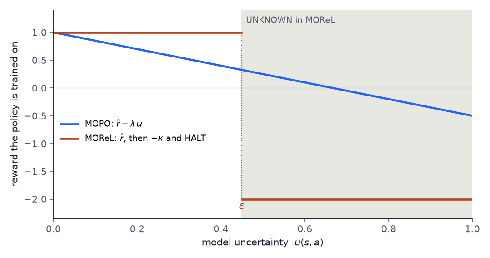

# Chapter 8: Model-Based Offline RL (MOPO, MOReL)

> *"If you can't run new experiments, build a simulator from the data you have — and experiment inside it. But remember: the simulator lies in the places you've never been."*

---

## Beyond Model-Free

The model-free methods of Chapters 4–7 attacked offline RL in different ways. CQL pushes Q-values down for OOD actions; IQL never queries them; TD3+BC and AWAC keep the actor close to the data; Decision Transformers drop the value function altogether.

All of them share a fundamental limitation: **they can only use the transitions the behavior policy collected**. If critical regions of the state-action space are simply absent from the dataset, model-free methods have nothing to learn from.

Model-based offline RL takes a different approach: **learn the dynamics of the system**, then generate synthetic transitions in your head. Instead of constraining yourself to existing data, you construct a mental model and *imagine* what would happen under new actions.

This is powerful — but dangerous. The model is wrong wherever the data is sparse, and a policy that exploits model errors will fail as catastrophically as one that exploits Q-function errors. The two algorithms in this chapter solve this differently:

- **MOPO** (Yu et al., NeurIPS 2020) — penalize synthetic rewards by model uncertainty. Let the policy range freely but make uncertain regions unattractive.
- **MOReL** (Kidambi et al., NeurIPS 2020) — construct an explicit boundary. Inside well-modeled regions the agent optimizes normally; outside it receives a large fixed penalty.

Same goal, different geometry of pessimism.

---

## Part I: MOPO

### The Idea

**Model-Based Offline Policy Optimization (MOPO)** works in three phases:

1. **Learn a dynamics model** $\hat{T}(s' | s, a)$ from the offline dataset using an **ensemble** of neural networks. Each model in the ensemble makes slightly different predictions. Where they agree, the model is confident. Where they disagree, the model is uncertain.

2. **Generate synthetic rollouts** by branching from real states. Start at a real state $s \in \mathcal{D}$, choose an action, predict $s'$ with the model, repeat for $h$ steps. After each step, **penalize the reward** by the model's uncertainty:

$$\tilde{r}(s, a) = \hat{r}(s, a) - \lambda \cdot u(s, a)$$

3. **Train a standard RL algorithm** (SAC) on the combined real + synthetic data. The penalty ensures the agent avoids regions where the model is unreliable.

The result: many more transitions to train on than the original dataset holds — how many depends on rollout length and frequency — with a built-in safeguard against exploiting model errors.

### Formalization

#### The Dynamics Ensemble

We train an ensemble of $N$ probabilistic models $\{\hat{T}_i\}_{i=1}^N$, each outputting a Gaussian over next states:

$$\hat{T}_i(s' | s, a) = \mathcal{N}\left(s + \mu_{\theta_i}(s, a), \; \sigma^2_{\theta_i}(s, a)\right)$$

Key design choices:

- **Residual prediction**: predict $\Delta s = s' - s$ rather than $s'$ directly. This gives the network an identity baseline — predicting "nothing changes" costs zero, and the network only needs to learn the correction.
- **NLL training**: minimizing negative log-likelihood $-\log \hat{T}_i(s' | s, a)$ trains both the mean (accuracy) and variance (calibrated uncertainty).
- **Bootstrap sampling**: each model is trained on its own bootstrap sample — 80% of the dataset size, drawn with replacement — which forces diversity across ensemble members.

#### Uncertainty Estimation

Given $(s, a)$, each model predicts a mean $\hat{s}'_i$. The **epistemic uncertainty** — "how much do the models disagree?" — is:

$$u(s, a) = \left\| \text{Std}_{i=1}^N \left[ \hat{s}'_i \right] \right\|_2$$

This is the standard deviation of predictions across ensemble members, collapsed to a scalar via L2 norm.

**Why ensemble disagreement works**: if all models saw similar data near $(s, a)$, they converge to similar predictions — low $u$. If the data is sparse, bootstrap resampling makes each model learn different spurious patterns — high $u$. This is the key mechanism: uncertainty is high exactly where the data is absent.

#### The MOPO Objective

MOPO constructs a **pessimistic MDP** $\tilde{\mathcal{M}}$ with penalized rewards and then optimizes the policy in this MDP:

$$\tilde{r}(s, a) = \hat{r}(s, a) - \lambda \cdot u(s, a)$$

$$\pi^* = \arg\max_\pi \; \mathbb{E}_{\tilde{\mathcal{M}}} \left[ \sum_t \gamma^t \tilde{r}(s_t, a_t) \right]$$

The theory behind MOPO (Yu et al., 2020) rests on one assumption. Call $u$ an **admissible** error estimator if it upper-bounds the model's error at every $(s, a)$ — the distance between the predicted and the true next-state distributions, scaled so that $\lambda u$ bounds the resulting error in value. Under that assumption the penalized MDP is conservative: its return is itself a lower bound on the true return,

$$J(\pi) \geq J_{\tilde{\mathcal{M}}}(\pi) \quad \text{for every policy } \pi,$$

and the policy $\hat\pi$ that MOPO finds is nearly as good as any policy that stays where the model is accurate:

$$J(\hat\pi) \geq \sup_{\pi} \bigl\{ J(\pi) - 2\lambda\, \epsilon_u(\pi) \bigr\}, \qquad \epsilon_u(\pi) = \mathbb{E}_{(s,a) \sim \rho^{\pi}_{\hat T}}\bigl[u(s, a)\bigr],$$

where $\rho^{\pi}_{\hat T}$ is the discounted occupancy of $\pi$ in the learned model — the same object as $d^\pi$ in Chapter 2, written for $\hat M$ instead of the real MDP. Taking $\pi$ to be the behavior policy, whose model uncertainty should be small, MOPO is expected to do at least about as well as the data it learned from.

The caveat is the assumption itself. Nothing guarantees that an ensemble's spread upper-bounds the true model error: ensemble members can agree and still be wrong, especially far from the data. The guarantee is only as good as the uncertainty estimate. *Note:* the original paper uses as $u$ the maximum over the ensemble of the norm of the learned (aleatoric) standard deviation; this book uses **ensemble disagreement** (the standard deviation of predicted means), a common reimplementation choice closer to MOReL's USAD. Neither is guaranteed to be admissible. For a probabilistic ensemble the two kinds of uncertainty separate cleanly: the total predictive variance is $\operatorname{Var}(s') = \mathbb{E}_m[\operatorname{Var}(s' \mid m)] + \operatorname{Var}_m(\mathbb{E}[s' \mid m])$, where the first term is the process noise each model has learned (aleatoric) and the second the disagreement between models (epistemic). Only the second shrinks with more data, and only the second says anything about being far from the data. Whichever is used, check it against reality: on held-out transitions, and on transitions from a shifted regime, the uncertainty should rise and fall with the actual prediction error. Disagreement can only flag errors on which the members differ. Members that share structure — the same physics prior, the same input features, the same gaps in the data — make correlated errors, and their agreement then reads as confidence exactly where it should not. Chapter 10 shows this concretely: every member of a hybrid ensemble used the same physics, which ignored a transport delay, and the ensemble's uncertainty did not flag the resulting errors on the filler loop. One way around an untrustworthy $u$ is not to need it. COMBO ([Yu et al., 2021](https://arxiv.org/abs/2102.08363)) keeps the model rollouts but drops the uncertainty penalty: it trains a CQL-style critic on a mix of real and model-generated transitions, pushing Q-values down on the model's state-action pairs and up on the logged ones. A model error then makes the affected synthetic transitions less valuable instead of relying on the ensemble to notice it — at the price of the usual CQL conservatism and its $\alpha$ to tune.

#### Branched Rollouts

Rather than rolling out entire episodes from scratch, MOPO uses **branched rollouts**:

1. Sample a starting state $s_0$ uniformly from the real dataset $\mathcal{D}$.
2. Roll out for $h$ steps using the model and current policy.
3. Each synthetic transition $(s_t, a_t, \tilde{r}_t, s_{t+1})$ is added to a synthetic buffer.

Starting from real states ensures the rollout begins in a well-modeled region. The short horizon $h$ limits error compounding. The penalized reward discourages visiting poorly modeled regions within the rollout.

### Implementation

> 📄 Full code: [`mopo.py`](https://github.com/corba777/offline-rl-book/blob/main/code/mopo.py)

#### Probabilistic Dynamics Model

Each member of the ensemble outputs mean and log-variance for next-state residuals:

```python
class ProbabilisticDynamicsNet(nn.Module):
    """
    Single probabilistic dynamics model: (s, a) -> (mean, log_var) of s'.

    Outputs a Gaussian over next-state *residuals*:
        s'_pred ~ N(s + mean(s,a), exp(log_var(s,a)))

    Residual prediction is critical for stability — the identity baseline
    makes it easier to learn small corrections.

    Trained with NLL — not MSE — so the network learns its own uncertainty.
    """
    def __init__(self, state_dim, action_dim, hidden_dim=256):
        super().__init__()
        inp_dim = state_dim + action_dim
        self.trunk = nn.Sequential(
            nn.Linear(inp_dim, hidden_dim), nn.SiLU(),
            nn.Linear(hidden_dim, hidden_dim), nn.SiLU(),
            nn.Linear(hidden_dim, hidden_dim), nn.SiLU(),
        )
        self.mean_head    = nn.Linear(hidden_dim, state_dim)
        self.log_var_head = nn.Linear(hidden_dim, state_dim)
        # Learnable bounds on log_var to prevent numerical issues
        self.min_log_var = nn.Parameter(-10.0 * torch.ones(state_dim))
        self.max_log_var = nn.Parameter(0.5  * torch.ones(state_dim))

    def forward(self, state, action):
        """Returns the predicted residual s' - s (mean) and its log-variance."""
        h       = self.trunk(torch.cat([state, action], -1))
        mean    = self.mean_head(h)
        log_var = self.log_var_head(h)
        # Soft clamp between the learnable bounds; without it they would do nothing
        log_var = self.max_log_var - F.softplus(self.max_log_var - log_var)
        log_var = self.min_log_var + F.softplus(log_var - self.min_log_var)
        return mean, log_var
```

The `SiLU` activation (swish) outperforms ReLU for dynamics models — smoother gradients help fit smooth physical transitions. The learnable log-variance bounds prevent the model from collapsing variance to zero (overconfidence) or infinity.

#### NLL Training

```python
    def nll_loss(self, state, action, next_state):
        mean, log_var = self.forward(state, action)
        residual = next_state - state            # true Δs
        var      = log_var.exp()
        # NLL = 0.5 * [ log_var + (residual - mean)² / var ]
        nll      = 0.5 * (log_var + (residual - mean).pow(2) / var)
        loss     = nll.sum(-1).mean()
        # Regularize variance bounds (from PETS, Chua et al. 2018)
        bound_reg = 0.01 * (self.max_log_var.sum() - self.min_log_var.sum())
        return loss + bound_reg
```

Training with NLL rather than MSE is essential. MSE trains only the mean, leaving the variance unconstrained. NLL jointly trains mean (minimize prediction error) and variance (calibrate confidence) — making the learned $\sigma^2$ meaningful as an uncertainty proxy.

#### Synthetic Rollouts with Uncertainty Penalty

```python
    def generate_synthetic_data(self, real_states):
        state = real_states[random_idx]  # branch from real data

        for step in range(self.rollout_horizon):
            action, _   = self.policy.sample(state)
            next_state, uncertainty = self.ensemble.predict_with_uncertainty(
                state, action)
            reward = self._model_reward(state, action, next_state)

            # THE key line: penalize reward by epistemic uncertainty
            penalized_reward = reward - self.lam * uncertainty

            # store (state, action, penalized_reward, next_state)
            state = next_state  # continue rollout
```

The single subtraction `reward - self.lam * uncertainty` is what turns naive model-based RL (easily exploited) into MOPO (far harder to exploit). Without it, the agent exploits model errors wherever the model erroneously predicts high reward. With it, uncertain predictions are automatically penalized — pushing the policy back toward data-supported regions.

#### Policy Training on Mixed Data

```python
    def update(self, real_batch, synthetic):
        # Combine real + synthetic at specified ratio
        s  = torch.cat([s_real,  s_synthetic],  dim=0)
        a  = torch.cat([a_real,  a_synthetic],  dim=0)
        r  = torch.cat([r_real,  r_synthetic],  dim=0)
        # Standard SAC TD update on combined data
        with torch.no_grad():
            a2, lp2 = self.policy.sample(s2)
            q_next  = torch.min(Q1_tgt(s2, a2), Q2_tgt(s2, a2))
            target  = r + gamma * (1 - d) * (q_next - alpha_ent * lp2)
        q_loss = F.mse_loss(Q1(s, a), target) + F.mse_loss(Q2(s, a), target)
```

The `real_ratio` parameter (default 0.5) controls the mix. At `real_ratio=1.0` this reduces to pure model-free on real data. At `real_ratio=0.0` the agent trains entirely on synthetic data — rarely safe. Keeping 50–70% real data provides the best balance.

---

## Part II: MOReL

### A Different Geometry of Pessimism

MOPO uses a **continuous** penalty: the further from the data, the larger the subtracted cost. The policy can still venture into uncertain regions — it just finds them less attractive.

MOReL takes a **discrete** approach: partition the state-action space into "known" and "unknown" regions, and impose a **hard penalty** $\kappa$ in the unknown region. This creates a sharp boundary rather than a gradient.

The figure contrasts the two rewards as functions of model uncertainty (`code/chapter1_5_8_figures.py`). MOPO's reward slides down steadily as uncertainty grows, so a large enough predicted gain can still lure the policy into uncertain regions. MOReL leaves the reward untouched up to the threshold $\varepsilon$ and then replaces it with a fixed $-\kappa$ and a halt: no gain can compensate.



**Model-Based Offline Reinforcement Learning (MOReL)** — Kidambi et al., NeurIPS 2020 — constructs a **Pessimistic MDP (P-MDP)** directly from the offline data, with a built-in absorbing failure state for OOD transitions.

### The P-MDP Construction

Let $\mathcal{D}$ be the offline dataset. MOReL defines a threshold $\epsilon$ on prediction uncertainty and partitions state-action space:

$$\text{KNOWN}  = \{(s,a) : u(s,a) \leq \epsilon\}$$
$$\text{UNKNOWN} = \{(s,a) : u(s,a) > \epsilon\}$$

The **Pessimistic MDP** $\tilde{\mathcal{M}} = (\mathcal{S} \cup \{s_\perp\}, \mathcal{A}, \tilde{T}, \tilde{r}, \gamma)$ is defined as:

$$\tilde{T}(s' | s, a) = \begin{cases} \hat{T}(s' | s, a) & \text{if } (s,a) \in \text{KNOWN} \\ \delta(s_\perp) & \text{if } (s,a) \in \text{UNKNOWN} \end{cases}$$

$$\tilde{r}(s, a) = \begin{cases} \hat{r}(s, a) & \text{if } s \neq s_\perp \\ -\kappa & \text{if } s = s_\perp \end{cases}$$

where $s_\perp$ is an absorbing failure state and $\kappa > 0$ is a large penalty. Once the agent enters the unknown region, it transitions to $s_\perp$ and receives $-\kappa$ at every subsequent step — a strong disincentive. The implementation below realizes the absorbing state as termination instead: the transition into UNKNOWN receives a single $-\kappa$ with `done=True`, so the TD target carries no future value. The two forms give the same value to the unknown transition when the one-time penalty is set accordingly: in the absorbing form the transition earns $\hat r(s,a)$ and then $-\kappa$ from the next step on, worth $\hat r(s,a) - \gamma\kappa/(1-\gamma)$, so a terminal penalty $\kappa' = \gamma\kappa/(1-\gamma) - \hat r(s,a)$ is equivalent. When $\kappa$ dwarfs the rewards, $\kappa' \approx \gamma\kappa/(1-\gamma)$; a terminal $\kappa'$ of about 2,400 at $\gamma=0.99$ corresponds to a per-step $\kappa \approx 24$.

### The Theoretical Guarantee

**Corollary (Kidambi et al., 2020).** Suppose the planner returns a policy $\pi_{out}$ that is $\epsilon_\pi$-suboptimal in the P-MDP, and let $\alpha$ bound the model's total-variation error on the KNOWN region. Then, for the optimal policy $\pi^*$ of the real MDP,

$$J(\pi^*) - J(\pi_{out}) \leq \epsilon_\pi + \frac{4 R_{max}}{1-\gamma}\, D_{TV}(\rho_0, \hat\rho_0) + \frac{4\gamma R_{max}}{(1-\gamma)^2}\, \alpha + \frac{2 R_{max}}{1-\gamma}\, \mathbb{E}\bigl[\gamma^{T^{\pi^*}_U}\bigr],$$

where $T^{\pi^*}_U$ is the time at which the *optimal* policy first enters the UNKNOWN region in the real MDP.

The terms name the sources of suboptimality: imperfect planning, a mismatched start-state distribution, model error inside the KNOWN region, and — the last term — how soon an optimal policy would have to leave the data. If the optimal policy stays within well-covered states, that term vanishes; if it must pass through regions the data never visited, no offline method can find it, and the paper shows the bound is tight in this sense.

Like MOPO's, this guarantee rests on a correct error detector: the KNOWN region must really keep the model's error below $\alpha$. With ensemble disagreement as the detector, that is an assumption, not a fact. The practical difference between the two methods is the shape of the pessimism: MOReL's boundary is hard and requires choosing $\epsilon$ carefully.

### Implementation

> 📄 Full code: [`morel.py`](https://github.com/corba777/offline-rl-book/blob/main/code/morel.py)

MOReL shares the ensemble architecture with MOPO (`ProbabilisticDynamicsNet`, `DynamicsEnsemble`) — see `mopo.py` for those details. The key MOReL-specific additions are:

**Step 1 — Calibrate epsilon from in-distribution data:**

```python
# After training the ensemble, set epsilon at the 80th percentile
# of uncertainty on *actual dataset transitions*.
# This ensures 80% of real data is labelled KNOWN.
epsilon = ensemble.calibrate_epsilon(dataset, percentile=80.0)
```

`calibrate_epsilon()` queries the ensemble on `n_samples` real transitions and returns a quantile of the resulting uncertainty values. Setting `percentile=80` labels 80% of the dataset transitions KNOWN, by construction. That is a statement about the uncertainty score, not about the model: a percentile threshold does not certify that the model is accurate inside the KNOWN region. An error-calibrated threshold would instead pick $\epsilon$ so that, on held-out transitions, the model's actual error stays below a tolerance whenever $u \le \epsilon$ — which is only as good as the held-out data are representative of where the policy will go.

**Step 2 — P-MDP rollouts with hard HALT:**

```python
# Inside MOReLAgent.generate_synthetic_data(), under torch.no_grad():
# rollouts only produce data, nothing is differentiated through them
for step in range(self.rollout_horizon):
    if not active.any():
        break

    s_active = state[active]
    action, _ = self.policy.sample(s_active)
    next_state, uncertainty = self.ensemble.predict_with_uncertainty(
        s_active, action)

    ood = uncertainty > self.epsilon          # (n_active,) bool

    reward = torch.where(
        ood,
        -self.kappa * torch.ones(ood.shape[0], device=self.device),
        self._model_reward(s_active, action, next_state)
    )
    done = ood.float()

    next_state_out = torch.where(
        ood.unsqueeze(-1), s_active, next_state)

    syn_s.append(s_active)
    syn_a.append(action)
    syn_r.append(reward)
    syn_s2.append(next_state_out)
    syn_d.append(done)

    active_indices = active.nonzero(as_tuple=True)[0]
    active[active_indices[ood]] = False
    state[active_indices[~ood]] = next_state[~ood].to(state.dtype)

return {
    'states': torch.cat(syn_s, dim=0),
    'actions': torch.cat(syn_a, dim=0),
    'rewards': torch.cat(syn_r, dim=0),
    'next_states': torch.cat(syn_s2, dim=0),
    'dones': torch.cat(syn_d, dim=0),
}
```

The `ood` mask is the key difference from MOPO. Instead of subtracting a continuous penalty, OOD transitions are terminated immediately with `done=True` and reward $-\kappa$. The Q-learning target then sees zero future value after OOD transitions, which strongly discourages entering the unknown region.

**HALT must actually deter.** When rewards are non-positive, as in the thermal and coating tasks, stopping early can look attractive: HALT cuts off a stream of negative rewards. In the paper's pessimistic MDP the HALT state pays $-R_{max}$ at every step; in the termination form used here, the one-time penalty $\kappa$ must exceed $|r_{min}|/(1-\gamma)$ — the value of staying in the worst-rewarded state forever — or the agent may learn to seek the boundary. With normalized rewards and $\gamma = 0.99$ that is about $100\,|r_{min}|$, which is why the default $\kappa = 100$ in `morel.py` is a lower limit rather than a comfortable margin. The opposite failure is as real. A threshold set at a percentile of the uncertainty on the data halts that share of in-distribution transitions by construction, and a $\kappa$ thousands of times larger than ordinary rewards then dominates the critic's targets. In Chapter 10 this combination, not the learned model, caused MOReL's failures: with HALT switched off the same agent did as well on the learned model as on the true dynamics, on both versions of the state, while a stricter 99th-percentile threshold only turned the failures into a uniformly worse policy. Check the HALT rate on in-distribution rollouts, and the share of the critic's loss that halts account for, before trusting the pessimism.

### Choosing $\epsilon$

The threshold $\epsilon$ controls the known/unknown boundary and is the critical hyperparameter in MOReL:

| $\epsilon$ | Effect |
|---|---|
| Very small | Tiny known region — agent confined near behavior policy (≈ BC) |
| Moderate (default) | Includes well-modeled extrapolations — good balance |
| Very large | Entire space is "known" — reverts to unconstrained MBRL |

**Practical guidance**: a percentile of the in-distribution uncertainty is the common recipe, and the HALT study in Chapter 10 measures what it costs. Before relying on HALT at all, check that $u$ tracks the model's error over the rollout horizon, not just one step ahead — in Chapter 10 its rank correlation with the error fell from 0.4 at the first step to near zero by the tenth. And remember what a percentile threshold does — a threshold at the 80th percentile halts 20% of in-distribution transitions by construction, and together with a large $\kappa$ that can dominate training (Chapter 10). Raising the percentile is not enough on its own: in Chapter 10 a threshold at the 99th percentile removed the catastrophic runs but still left the agent worse than plain behavioral cloning, because $\kappa$ was large enough for 5% of halted rollouts to dominate the critic. Taking $\kappa$ from the data instead — the worst discounted return-to-go in the logs, about a tenth of the worst-case value there — recovered most of that loss, though not all of it. Treat the threshold and $\kappa$ as one design choice, compute the threshold on a random sample of the data, monitor the HALT rate on in-distribution rollouts, and compare against the same agent with HALT switched off.

```python
# Calibrate epsilon from in-distribution data
with torch.no_grad():
    idx   = np.random.default_rng(0).choice(len(dataset['states']), 2000, replace=False)
    s_cal = torch.FloatTensor(dataset['states'][idx]).to(device)   # a random sample,
    a_cal = torch.FloatTensor(dataset['actions'][idx]).to(device)  # never a prefix of sorted logs
    _, u_cal = ensemble.predict_with_uncertainty(s_cal, a_cal)
epsilon = torch.quantile(u_cal, 0.80).item()
print(f"Calibrated epsilon = {epsilon:.4f}")
```

---

## MOPO vs MOReL vs Model-Free

| | CQL | IQL | MOPO | MOReL |
|---|---|---|---|---|
| Uses model | No | No | Yes | Yes |
| OOD handling | Push Q down | Never query OOD | Continuous penalty $-\lambda u$ | Hard boundary + $-\kappa$ |
| Data augmentation | No | No | Yes | Yes |
| Pessimism geometry | Soft (Q penalty) | Structural (V design) | Soft (reward penalty) | Hard (absorbing state) |
| Can extrapolate | Limited | No | Yes (within confidence) | Yes (within known region) |
| Theoretical guarantee | Lower bound on policy value | None formal; in-sample by design | Lower bound on $J(\pi)$ if $u$ is admissible | Suboptimality bound if the KNOWN/UNKNOWN detector is correct |
| Key hyperparameters | $\alpha$ | $\tau, \beta$ | $\lambda, h, N$ | $\epsilon, \kappa, h, N$ |
| Compute cost | Medium | Low | High | High |
| Best for | Dense datasets | Stable training | Sparse, smooth dynamics | A hard boundary on where the model is trusted |

**When to choose MOPO**: the dynamics are smooth and learnable, dataset coverage is uneven but not catastrophically sparse, and you want to maximize performance within a reasonable compute budget.

**When to choose MOReL**: you want a hard boundary on where the model is trusted — at the edge of the data the rollout is stopped rather than merely discouraged — and you can afford careful calibration of $\epsilon$. This is not a safety guarantee in itself: it is only as good as the uncertainty detector.

---

## Hyperparameter Guide

### MOPO: $\lambda$ (uncertainty penalty weight)

| $\lambda$ | Behavior |
|---|---|
| $\lambda = 0$ | No penalty — trust model completely (dangerous) |
| $\lambda = 0.5$ | Light penalty — for high-quality models on simple systems |
| $\lambda = 1.0$ | Default — reasonable pessimism |
| $\lambda = 3.0$+ | Strong penalty — for noisy data or unreliable models |
| $\lambda \to \infty$ | Reverts to model-free on real data only |

**Diagnostic**: plot `mean(uncertainty)` in synthetic rollouts over training. If it increases, the policy drifts into model-uncertain regions — increase $\lambda$.

### Both: $h$ (rollout horizon)

- `h=1`: single-step predictions. Safest, but limited augmentation.
- `h=5`: default. Good balance of augmentation vs error compounding.
- `h=10+`: only if model one-step accuracy is very high.

**Rough guide**: if the model has one-step error $\epsilon_1$, errors after $h$ steps grow at least like $h \cdot \epsilon_1$ (faster when the dynamics amplify them). Choose $h$ so that the accumulated error stays small relative to the state changes that matter for the reward — and check it directly by comparing multi-step model rollouts with held-out logged trajectories.

### Both: $N$ (ensemble size)

- `N=3`: minimum for meaningful uncertainty (not recommended in production).
- `N=5`: default — good uncertainty estimates.
- `N=7–10`: better estimates, proportional compute cost.

---

## Practical Tips

**Normalize everything.** States, actions, rewards — all normalized before training the dynamics model. Dynamics networks approximate smooth functions; inputs in $[-1, 1]$ or $[0, 1]$ help enormously.

**Residual prediction is non-negotiable.** Always predict $\Delta s = s' - s$. For slowly changing systems (most industrial processes), the residual is orders of magnitude smaller than the absolute state, making it much easier to learn.

**Monitor ensemble disagreement.** The ratio `u(OOD) / u(in-distribution)` should be >> 1. If it is close to 1, the ensemble is not diverse enough — try different bootstrap ratios, random seeds, or add spectral normalization.

**Regenerate synthetic data periodically.** As the policy improves, it visits different regions of state space. Rollouts generated by the previous policy become stale. Regenerate every 5–10 SAC epochs.

**Use the model for gradient signal, not accurate prediction.** A 10% one-step prediction error is acceptable if the model correctly distinguishes good from bad actions. Global accuracy is not the goal.

**For industrial applications**: if you have a physics-based simulator (even approximate), train the neural ensemble on residuals between the physics model and real data rather than from scratch. This hybrid approach often requires dramatically less offline data. Chapter 9 develops this idea into a full methodology.

---

## Limitations

**Model errors compound.** Over $h$ steps, one-step errors accumulate. The uncertainty penalty (MOPO) or hard boundary (MOReL) mitigates this, but very long horizons remain risky.

**High-dimensional observations.** Learning $T(s' | s, a)$ from pixels or high-dimensional sensors requires much more data than from compact state representations. For image-based domains, learn a compressed latent dynamics model first.

**Compute cost scales with ensemble size.** Training and inference require $N \times$ the compute of a single model. For large state spaces or ensembles, this is significant.

**Reward model.** In our implementation the reward function is known analytically. In practice, rewards may also need to be learned from data — adding another source of model error and another network to train and calibrate.

**Ensemble diversity is fragile.** If all models converge to the same solution (common with small datasets or high model capacity), uncertainty estimates collapse to near zero — making both MOPO's penalty and MOReL's boundary useless. Bootstrap sampling helps but is not always sufficient.

---

## Summary

| Property | MOPO | MOReL |
|---|---|---|
| Data required | $(s, a, r, s')$ transitions | $(s, a, r, s')$ transitions |
| Core mechanism | Ensemble uncertainty as soft reward penalty | Hard known/unknown partition via uncertainty threshold |
| Pessimism | Continuous: $\tilde{r} = r - \lambda u$ | Discrete: absorbing failure state beyond $\epsilon$ |
| Theoretical guarantee | Lower bound on $J(\pi)$ if $u$ is admissible | Suboptimality bound if the detector is correct |
| Key hyperparameters | $\lambda, h, N$ | $\epsilon, \kappa, h, N$ |
| Best for | Maximizing performance on smooth dynamics | A strict stop at the edge of the data |
| Limitation | Soft penalty can be insufficient for very unreliable models | $\epsilon$ calibration critical; hard boundary can be overly conservative |

Both MOPO and MOReL represent a qualitative shift from model-free offline RL: instead of constraining the policy to stay near the data, we expand the data to cover more of the state-action space. The ensemble keeps this expansion in check — the agent trusts the model mainly where the ensemble agrees, which is only as good as the ensemble's calibration.

The natural next question: can we do better than learning dynamics from scratch? If we know the physics of the system — conservation laws, differential equations, material properties — we can build that knowledge directly into the model and dramatically reduce the data needed. That is the subject of Chapter 9: Physics-Informed Offline RL.

---

## References

- Yu, T., Kumar, A., Rafailov, R., Rajeswaran, A., Levine, S., & Finn, C. (2021). *COMBO: Conservative Offline Model-Based Policy Optimization.* NeurIPS. [arXiv:2102.08363](https://arxiv.org/abs/2102.08363).
- Yu, T., Thomas, G., Yu, L., Ermon, S., Zou, J., Levine, S., Finn, C., & Ma, T. (2020). *MOPO: Model-Based Offline Policy Optimization.* NeurIPS. [arXiv:2005.13239](https://arxiv.org/abs/2005.13239).
- Kidambi, R., Rajeswaran, A., Netrapalli, P., & Kakade, S. (2020). *MOReL: Model-Based Offline Reinforcement Learning.* NeurIPS. [arXiv:2005.05951](https://arxiv.org/abs/2005.05951).
- Janner, M., Fu, J., Zhang, M., & Levine, S. (2019). *When to Trust Your Model: Model-Based Policy Optimization.* NeurIPS. [arXiv:1906.08253](https://arxiv.org/abs/1906.08253). *(MBPO — online model-based RL foundation for MOPO)*
- Chua, K., Calandra, R., McAllister, R., & Levine, S. (2018). *Deep Reinforcement Learning in a Handful of Trials using Probabilistic Dynamics Models.* NeurIPS. [arXiv:1805.12114](https://arxiv.org/abs/1805.12114). *(PETS — ensemble uncertainty; foundation for both MOPO and MOReL)*
- Lakshminarayanan, B., Pritzel, A., & Blundell, C. (2017). *Simple and Scalable Predictive Uncertainty Estimation using Deep Ensembles.* NeurIPS. [arXiv:1612.01474](https://arxiv.org/abs/1612.01474). *(why ensembles work as uncertainty estimators)*
- Levine, S. et al. (2020). *Offline Reinforcement Learning: Tutorial, Review, and Perspectives.* [arXiv:2005.01643](https://arxiv.org/abs/2005.01643).
- Fu, J. et al. (2020). *D4RL: Datasets for Deep Data-Driven Reinforcement Learning.* [arXiv:2004.07219](https://arxiv.org/abs/2004.07219). *(standard benchmark; MOPO and MOReL both evaluated on D4RL)*
