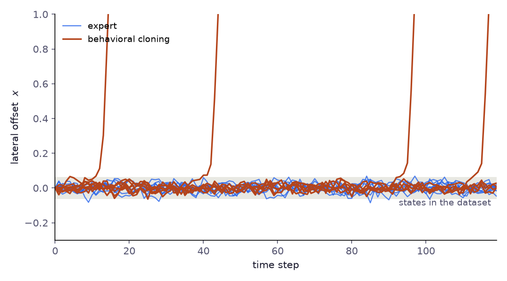

# Глава 1: Поведенческое клонирование

> *«Начнём с самого простого, что может сработать. Понять, почему именно это не работает, — фундамент всего, что будет дальше.»*

---

## Постановка задачи

У вас есть датасет. Кто-то — оператор, контроллер, эксперт — месяцами принимал решения, а система логирования записывала всё: состояние процесса в каждый момент, какое действие было предпринято, что произошло дальше.

```
D = {(sᵢ, aᵢ, s'ᵢ)},  i = 1 … n     (переходы из многих эпизодов; s'ᵢ — состояние после aᵢ)
```

Вы хотите построить политику — функцию π(s) → a — которая ведёт себя не хуже того, кто генерировал данные. Проводить эксперименты нельзя. Исследовать пространство нельзя. Есть только D.

Самая естественная идея: **научиться имитировать**. Если эксперт выбрал действие `a` в состоянии `s`, то ваша политика должна делать то же самое. Это и есть поведенческое клонирование (Behavioral Cloning, BC).

---

## Идея

BC формулирует задачу как **обучение с учителем**. Забудьте о том, что это последовательное принятие решений. Забудьте о наградах. Просто обучите функцию, отображающую состояния в действия:

$$\pi_\theta = \arg\min_\theta \mathbb{E}_{(s,a) \sim \mathcal{D}} \left[ \mathcal{L}(\pi_\theta(s), a) \right]$$

Для **непрерывных действий** (крутящий момент, уставка температуры, частота вращения):

$$\mathcal{L} = \| \pi_\theta(s) - a \|^2 \quad \text{(среднеквадратичная ошибка)}$$

Для **дискретных действий** (открыть/закрыть клапан, выбор режима):

$$\mathcal{L} = -\log \pi_\theta(a \mid s) \quad \text{(перекрёстная энтропия / максимальное правдоподобие)}$$

Вот и всё. Обучаем нейронную сеть. На этапе применения наблюдаем состояние $s$, получаем действие $a = \pi_\theta(s)$.

---

## Формализация

Пусть поведенческая политика, генерировавшая данные, обозначается $\pi_\beta$. Датасет $\mathcal{D}$ состоит из переходов, сэмплированных из **поведенческого распределения**:

$$(s, a) \sim d^{\pi_\beta}(s) \cdot \pi_\beta(a \mid s)$$

где $d^{\pi_\beta}(s)$ — **распределение посещаемости состояний**: как часто поведенческая политика оказывается в каждом состоянии.

BC минимизирует **потерю имитации**:

$$\mathcal{L}_{BC}(\theta) = \mathbb{E}_{(s,a) \sim d^{\pi_\beta}} \left[ -\log \pi_\theta(a \mid s) \right]$$

В интерпретации максимального правдоподобия это эквивалентно минимизации KL-дивергенции между обученной политикой и поведенческой политикой **в состояниях, посещаемых поведенческой политикой**:

$$\mathcal{L}_{BC}(\theta) = \mathbb{E}_{s \sim d^{\pi_\beta}} \left[ D_{KL}\left(\pi_\beta(\cdot \mid s) \,\|\, \pi_\theta(\cdot \mid s)\right) \right] + \text{const}$$

Ключевая фраза: **в состояниях, посещаемых поведенческой политикой**. Именно она станет источником всех проблем.

---

## Реализация

> 📄 Полный код: [`behavioral_cloning.py`](https://github.com/corba777/offline-rl-book/blob/main/code/behavioral_cloning.py)

```python
import torch
import torch.nn as nn
import torch.optim as optim
from torch.utils.data import DataLoader, TensorDataset

class BCPolicy(nn.Module):
    """
    Простая MLP-политика для непрерывных пространств действий.
    Детерминированное отображение: состояние → действие.
    """
    def __init__(self, state_dim: int, action_dim: int, hidden_dim: int = 256):
        super().__init__()
        self.net = nn.Sequential(
            nn.Linear(state_dim, hidden_dim),
            nn.ReLU(),
            nn.Linear(hidden_dim, hidden_dim),
            nn.ReLU(),
            nn.Linear(hidden_dim, action_dim),
        )

    def forward(self, state: torch.Tensor) -> torch.Tensor:
        return self.net(state)

    def act(self, state: torch.Tensor, low: float = -1.0, high: float = 1.0) -> torch.Tensor:
        # Линейная голова не ограничена, а исполнительные механизмы ограничены
        with torch.no_grad():
            return self.forward(state).clamp(low, high)


def train_bc(
    states: torch.Tensor,   # (N, state_dim)
    actions: torch.Tensor,  # (N, action_dim)
    state_dim: int,
    action_dim: int,
    n_epochs: int = 100,
    batch_size: int = 256,
    lr: float = 3e-4,
) -> BCPolicy:
    """Обучение BC-политики через MSE на непрерывных действиях."""

    policy = BCPolicy(state_dim, action_dim)
    optimizer = optim.Adam(policy.parameters(), lr=lr)
    dataset = TensorDataset(states, actions)
    loader = DataLoader(dataset, batch_size=batch_size, shuffle=True)

    for epoch in range(n_epochs):
        epoch_loss = 0.0
        for s_batch, a_batch in loader:
            a_pred = policy(s_batch)
            loss = nn.functional.mse_loss(a_pred, a_batch)

            optimizer.zero_grad()
            loss.backward()
            optimizer.step()
            epoch_loss += loss.item()

        if (epoch + 1) % 20 == 0:
            print(f"Epoch {epoch+1:3d} | Loss: {epoch_loss/len(loader):.5f}")

    return policy
```

**Стохастическая политика** (более устойчивая к шуму) — параметризуем гауссово распределение:

```python
class StochasticBCPolicy(nn.Module):
    """
    Гауссова политика: предсказывает среднее и log_std.
    Обучение: максимизация log-правдоподобия наблюдаемых действий.
    """
    def __init__(self, state_dim: int, action_dim: int, hidden_dim: int = 256):
        super().__init__()
        self.trunk = nn.Sequential(
            nn.Linear(state_dim, hidden_dim), nn.ReLU(),
            nn.Linear(hidden_dim, hidden_dim), nn.ReLU(),
        )
        self.mean_head    = nn.Linear(hidden_dim, action_dim)
        self.log_std_head = nn.Linear(hidden_dim, action_dim)

    def forward(self, state):
        h = self.trunk(state)
        mean    = self.mean_head(h)
        log_std = self.log_std_head(h).clamp(-4, 2)
        return mean, log_std

    def log_prob(self, state, action):
        mean, log_std = self.forward(state)
        std = log_std.exp()
        dist = torch.distributions.Normal(mean, std)
        return dist.log_prob(action).sum(-1)  # суммируем по размерностям действия

    def act(self, state, deterministic=True, low=-1.0, high=1.0):
        # Гауссиана без сжатия может выдать действие за пределами диапазона механизма
        mean, log_std = self.forward(state)
        a = mean if deterministic else torch.distributions.Normal(mean, log_std.exp()).sample()
        return a.clamp(low, high)
```

Ни одна из сетей не ограничивает свой выход: линейная голова или гауссиана без сжатия могут вернуть действие за пределами диапазона исполнительного механизма. Поэтому обе политики обрезают действия в `act()`, как и `behavioral_cloning.py`; альтернатива — гауссиана со сжатием через tanh и поправкой к log-плотности на замену переменных, как в агентах на основе SAC в следующих главах.

---

## Когда BC работает?

BC хорошо работает при двух условиях:

**1. Плотные, высококачественные данные.** Если поведенческая политика близка к оптимальной и датасет покрывает состояния, которые встретятся при развёртывании — BC может работать на удивление хорошо. Эксперименты с робототехникой показывают, что BC с данными от эксперта-человека может превосходить model-free RL.

**2. Короткий горизонт.** Если задача решается за несколько шагов, ошибки не успевают накапливаться.

На практике для коротких задач — десятки шагов, а не сотни — и качественного демонстратора BC — сильный baseline, который стоит попробовать до всего остального. Резкой границы по горизонту нет: важно, как быстро небольшие ошибки уводят агента в незнакомые состояния.

---

## Почему BC не работает: проблема накопления ошибок

Вот в чём суть проблемы. Во время обучения BC видит состояния из $d^{\pi_\beta}$ — распределения состояний, которые посещает *поведенческая политика*. Во время применения обученная политика $\pi_\theta$ посещает *другое* распределение $d^{\pi_\theta}$.

Даже если BC выучила $\pi_\theta \approx \pi_\beta$ в каждом обучающем состоянии, небольшие ошибки в выборе действий отклоняют траекторию в **состояния, которых не было в датасете**. В этих новых состояниях предсказания BC ненадёжны — и ошибки там вызывают ещё большее отклонение.

Это **сдвиг распределения** (distribution shift), и он накапливается со временем.

### Формальная оценка

Ross & Bagnell (2010) доказали следующее. Предположим, что на собственном распределении состояний эксперта BC расходится с ним с вероятностью не больше $\epsilon$ (ошибка имитации 0–1):

$$\mathbb{E}_{s \sim d^{\pi_\beta}} \left[ \mathbf{1}\{\pi_\theta(s) \neq \pi_\beta(s)\} \right] \leq \epsilon$$

Тогда разрыв в производительности между обученной и поведенческой политикой ограничен:

$$J(\pi_\beta) - J(\pi_\theta) \leq \epsilon H^2 \cdot C$$

где:
- $H$ — горизонт задачи (количество шагов)
- $C$ — граница стоимости одного шага (стоимости лежат в $[0, C]$); гладкость динамики не предполагается — одна ошибка может увести куда угодно, поэтому ошибки и накапливаются
- Граница растёт как $\mathcal{O}(H^2)$

**Именно член $H^2$ создаёт проблему.** Для 30-минутного горизонта предсказания с шагом 10 секунд $H = 180$. Даже крошечная ошибка на шаге $\epsilon = 0.01$ даёт оценку $0.01 \times 180^2 = 324$. Это масштаб оценки для худшего случая, а не ожидаемая деградация: теорема предполагает конечный горизонт без дисконтирования, долю расхождений 0–1 на состояниях самого эксперта и ничего не предполагает о динамике, поэтому должна покрывать случай, когда каждая ошибка необратима. Граница на практике нежёсткая, но тренд реален.

### Интуиция: снежный ком

Представьте автомобиль, движущийся по дороге. BC обучает политику управления рулём на примерах эксперта. Если политика делает небольшую ошибку и слегка отклоняется от центра, она оказывается в состоянии, которое эксперт никогда не демонстрировал — чуть сбоку от дороги. Предсказания там ненадёжны, что вызывает ещё большую ошибку коррекции, дальнейшее отклонение — пока автомобиль полностью не съезжает с дороги.

Это называется **ковариатный сдвиг** (covariate shift): распределение входных данных во время применения не совпадает с распределением во время обучения.

```
Обучение:  s₁ → s₂ → s₃   (траектория эксперта, состояния хорошо покрыты)
Применение: s₁ → s₂' → s₃''  (малые ошибки → незнакомые состояния → большие ошибки)
                    ↑
        вне обучающего распределения
```

Рисунок ниже показывает снежный ком на конкретном примере (`code/chapter1_5_8_figures.py`). Одномерное смещение уходит в сторону, если его не корректировать; обратная связь эксперта удерживает его в узкой полосе, а BC — кубический полином, подогнанный к 150 зашумлённым меткам эксперта, — внутри этой полосы ведёт себя как эксперт. Большинство прогонов BC в ней и остаются. Но стоит шуму вынести прогон чуть за край, у клонированной политики уже нет надёжного ответа: её небольшие ошибки уводят смещение всё дальше, и прогон уже не возвращается.



---

## Практические ограничения для промышленных процессов

Через всю книгу проходит один сквозной пример: непрерывная линия нанесения асфальтового покрытия, где операторы регулируют нагрев и подачу наполнителя, чтобы удерживать температуру, долю наполнителя и вязкость у заданных значений. В коде к книге он смоделирован небольшой игрушечной средой `ThermalProcessEnv`, которую используют главы 3–9; в главе 10 её сменяет более богатая пятипеременная версия. Для такого процесса, с переменными состояния (процент наполнителя, температура, вязкость) и горизонтом 30 минут, у BC есть характерные сбои:

**Мультимодальное поведение.** Операторы-люди принимают разные решения в одном и том же состоянии в зависимости от контекста, не отражённого в векторе состояния (предстоящий заказ, график технического обслуживания, усталость). BC усредняет по этим модам, обучая политику, которая субоптимальна во всех из них.

**Пробелы в покрытии.** Операторы редко исследуют граничные случаи. Если возмущение выводит процесс за пределы нормального рабочего диапазона, у BC нет обучающих данных для этих состояний, и поведение становится неопределённым.

**Отсутствие учёта наград.** BC копирует то, что оператор *делал*, а не то, что ему *следовало* делать. Если исторические данные содержат субоптимальные решения (ручные коррекции, консервативные уставки), BC добросовестно воспроизводит эти ошибки.

**Отсутствие контрфактического рассуждения.** BC не может ответить на вопрос «что произошло бы, если бы частота вращения была на 20% выше?». Она предсказывает действие, а не результат.

---

## Мост от BC к RL: DAgger

Теоретическое решение проблемы накопления ошибок — **DAgger** (Dataset Aggregation, Ross et al. 2011):

1. Обучаем $\pi_\theta$ на текущем датасете $\mathcal{D}$
2. Выполняем rollout политики $\pi_\theta$ в среде, посещаем состояния $s \sim d^{\pi_\theta}$
3. **Запрашиваем эксперта** в этих состояниях для получения правильных меток $a = \pi_\beta(s)$
4. Добавляем $(s, a)$ в $\mathcal{D}$, переходим к шагу 1

DAgger достигает оценки $\mathcal{O}(H)$ вместо $\mathcal{O}(H^2)$, потому что политика теперь обучается на состояниях, которые она реально посещает.

Проблема: шаг 3 требует **опроса эксперта в онлайн-режиме**. В промышленных условиях это означает просьбу к оператору размечать состояния во время работы — дорого и зачастую нереализуемо.

Именно поэтому существует **offline RL**: мы хотим улучшить результат сверх BC без дополнительного сбора данных.

---

## Итоги

| Свойство | Поведенческое клонирование |
|---|---|
| Необходимые данные | Переходы $(s, a)$ — награды не нужны |
| Целевая функция | Обучение с учителем (MSE или NLL) |
| Масштабирование по горизонту | Рост ошибки $\mathcal{O}(H^2)$ |
| Обработка OOD | Отсутствует — тихий отказ на незнакомых состояниях |
| Оптимизация наград | Нет — копирует поведение, а не цели |
| Сложность реализации | Низкая |

**BC — правильная отправная точка.** Прежде чем обучать CQL или строить модели мира, всегда обучите базовый вариант BC. Если BC уже достигает приемлемой производительности, более сложные методы могут не понадобиться. Если нет — понимание *почему* (в каких состояниях происходят отказы, как накапливаются ошибки) подскажет, что именно offline RL должен исправить.

---

## Что дальше

BC терпит неудачу, потому что рассматривает задачу как i.i.d. обучение с учителем и игнорирует последовательную структуру. Следующий вопрос: можно ли использовать информацию о наградах для улучшения результата, оставаясь при этом в рамках фиксированного датасета?

Это и есть задача offline RL. Глава 2 формализует её и показывает, почему наивное применение Q-обучения к офлайн-данным даёт катастрофически оптимистичные оценки ценности — проблема **ошибки экстраполяции**, которая мотивирует всё содержание глав 3–9.

---

## Литература

- Ross, S., & Bagnell, D. (2010). *Efficient Reductions for Imitation Learning.* AISTATS.
- Ross, S., Gordon, G., & Bagnell, D. (2011). *A Reduction of Imitation Learning and Structured Prediction to No-Regret Online Learning.* AISTATS. *(DAgger)*
- Pomerleau, D. (1989). *ALVINN: An Autonomous Land Vehicle in a Neural Network.* NeurIPS. *(Оригинальный BC)*
- Levine, S., Kumar, A., Tucker, G., & Fu, J. (2020). *Offline Reinforcement Learning: Tutorial, Review, and Perspectives on Open Problems.* [arXiv:2005.01643](https://arxiv.org/abs/2005.01643).
