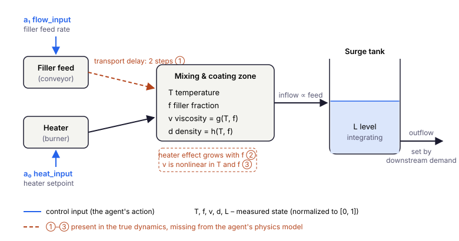

# Глава 10: Промышленные применения

> *«Разрыв между рабочим результатом на эталонной задаче и рабочим промышленным внедрением — это не разрыв в алгоритмах, а разрыв в понимании данных.»*

---

## От эталонов к промышленности

Предыдущие девять глав (главы 1–9) выстроили полный инструментарий: поведенческое клонирование, CQL, IQL, MOPO, MOReL, физическое формирование награды, гибридные динамические модели и Лагранжиан. Каждый алгоритм проверялся на `ThermalProcessEnv` — игрушечной версии линии нанесения покрытия из главы 1: три переменные состояния (температура, доля наполнителя, вязкость), два управляющих входа и чистая динамика первого порядка. Среда спроектирована так, чтобы алгоритмические идеи были наглядными.

Реальные промышленные процессы отличаются от этой среды по всем значимым параметрам.

**Больше переменных, сильнее связи.** В реальном процессе нанесения покрытий десятки датчиков. Даже в упрощённой модели есть температура, доля наполнителя, вязкость, объёмная плотность и уровень в буферном баке — пять переменных с физическими зависимостями между всеми ними. Уровень — интегрирующее состояние, которое дрейфует без активного управления; вязкость — нелинейная функция температуры и наполнителя, которую агент не может наблюдать независимо от своих действий.

**Неравномерное покрытие данных.** Промышленные логи — не данные случайного исследования. Процесс 60% времени работает вблизи рабочей точки, периодически совершает плановые изменения уставок и иногда испытывает возмущения. Датасет плотный вблизи номинального режима и разреженный во всех остальных областях. Агент, хорошо работающий в плотной зоне и плохо — в разреженной, бесполезен на практике.

**Запаздывание и задержки.** В модели уравнение наполнителя использует $u_{f,t-2}$: действие по потоку в момент $t$ влияет на долю наполнителя в момент $t+2$ (двухшаговая транспортная задержка при $\Delta t = 1$). Чистая модель первого порядка, игнорирующая эту задержку, даёт систематические ошибки предсказания при изменении скорости подачи.

**Жёсткие физические ограничения.** Операционные лимиты — не предпочтения, а паспортные характеристики оборудования, регуляторные требования или границы безопасности. Политика, нарушающая границы вязкости, может вызвать кавитацию насоса. Политика, допускающая переполнение буферного бака, расходует материал и запускает автоматическое отключение.

В этой главе разбирается полный кейс на анонимизированном пятипеременном процессе нанесения покрытия. Цель — не ввести новые алгоритмы (всё использованное здесь разработано в главах 1–9), а показать, как они компонуются в реалистичной постановке и какие промышленно-специфичные решения возникают на пути. Процесс — учебный пример; для сравнения с литературой есть открытые стенды для того же режима: Industrial Benchmark ([Hein et al., 2017](https://arxiv.org/abs/1709.09480)) для запаздывающего частично наблюдаемого промышленного управления, NeoRL ([Qin et al., 2022](https://arxiv.org/abs/2102.00714)) для узких логов консервативных регуляторов и DSRL ([Liu et al., 2024](https://arxiv.org/abs/2306.09303)) для offline RL с явными стоимостями нарушений ограничений.

> 📄 Полный код: [`chapter10.py`](https://github.com/corba777/offline-rl-book/blob/main/code/chapter10.py)

---

## Процесс нанесения покрытия

### Среда

`CoatingProcessEnv` моделирует непрерывную термическую линию нанесения покрытия с пятью переменными состояния и двумя управляющими входами.



Агент действует через два входа (синие): скорость подачи наполнителя и уставку нагревателя. Наполнитель приходит в зону нанесения с задержкой, температура и доля наполнителя в зоне определяют вязкость и плотность, а смесь поступает в буферный бак, уровень которого накапливает разницу между притоком и оттоком. Три эффекта, отмеченные ①–③, есть в истинной динамике ниже, но отсутствуют в физической модели агента. Подписи на схеме — на английском, как и названия переменных в коде.

**Состояние** $s \in \mathbb{R}^5$ (все нормированы к $[0,1]$):

| Индекс | Переменная | Физический смысл |
|---|---|---|
| $s_0$ | `temperature` | Температура процесса в зоне нанесения |
| $s_1$ | `filler_fraction` | Доля наполнителя в смеси |
| $s_2$ | `viscosity` | Вязкость смеси — нелинейная функция $T$ и наполнителя |
| $s_3$ | `density` | Объёмная плотность материала |
| $s_4$ | `level` | Уровень в буферном баке — интегрирующая динамика |

**Действия** $a \in [-1,1]^2$:

| Индекс | Действие | Эффект |
|---|---|---|
| $a_0$ | `heat_input` | Команда нагревателю в $[-1, 1]$ (абсолютная, а не приращение) |
| $a_1$ | `flow_input` | Команда подачи наполнителя в $[-1, 1]$ (абсолютная, а не приращение) |

**Истинная динамика** (неизвестна агенту):

$$T_{t+1} = \left(1 - \frac{\Delta t}{\tau_T}\right)T_t + \frac{\Delta t}{\tau_T} K_T u_T + \underbrace{0.03 \cdot f_t \cdot u_T}_{\text{перекрёстная связь}} + \epsilon_T$$

$$f_{t+1} = \left(1 - \frac{\Delta t}{\tau_f}\right)f_t + \frac{\Delta t}{\tau_f} K_f \cdot \underbrace{u_{f,t-2}}_{\text{задержка}} + \epsilon_f$$

$$v_{t+1} = 0.75 - 0.45\,T_{t+1} + 0.38\,f_{t+1} + 0.12\,f_{t+1}(1-T_{t+1}) + \epsilon_v$$

$$d_{t+1} = 0.55 + 0.25\,f_{t+1} - 0.10\,T_{t+1} + \epsilon_d \quad \text{(плотность, алгебраически от $T$ и $f$)}$$

$$L_{t+1} = L_t + \Delta t\left(\underbrace{0.4\,u_{f}}_{\text{приток}} - \underbrace{Q_{out}}_{\text{отбор потребителем}}\right) + \epsilon_L, \qquad Q_{out} = \frac{0.4\, f^*}{K_f} \approx 0.222$$

Параметры: $\tau_T = 12$, $K_T = 0.85$, $\tau_f = 8$, $K_f = 0.90$, $\Delta t = 1$. В коде управляющие входы: $a[0]$ (нагрев, $u_{T,t}$), $a[1]$ (поток, $u_f$); оба пересчитываются из $[-1, 1]$ в $[0, 1]$. Отбор $Q_{out}$ не зависит от уровня, поэтому сам по себе уровень никуда не возвращается; величина отбора подобрана так, чтобы приток и отток уравновешивались, когда контур наполнителя стоит на уставке.

Три вещи намеренно скрыты от физической модели агента:
1. Член перекрёстной связи $0.03 f_t u_T$ в уравнении температуры
2. Двухшаговая транспортная задержка в уравнении наполнителя
3. Квадратичный член $0.12 f(1-T)$ в зависимости вязкости

Так моделируется разрыв между инженерными знаниями из первых принципов и реальностью.

**Функция награды** нацелена на температуру, долю наполнителя и стабильность уровня:

$$r(s, a) = -2(T - T^*)^2 - 2(f - f^*)^2 - 0.5(L - L^*)^2 - 0.05\|a\|^2$$

с уставками $T^*=0.60$, $f^*=0.50$, $L^*=0.50$.

**Жёсткие ограничения** (нарушение = необратимый ущерб оборудованию или аварийная остановка):

| Переменная | Нижняя граница | Верхняя граница |
|---|---|---|
| temperature | 0.35 | 0.85 |
| filler fraction | 0.20 | 0.75 |
| viscosity | 0.10 | 0.90 |
| density | 0.30 | 0.80 |
| level | 0.15 | 0.85 |

```python
class CoatingProcessEnv:
    STATE_DIM  = 5
    ACTION_DIM = 2

    T_TARGET     = 0.60
    F_TARGET     = 0.50
    LEVEL_TARGET = 0.50

    BOUNDS = [
        (0.35, 0.85),  # temperature
        (0.20, 0.75),  # filler_fraction
        (0.10, 0.90),  # viscosity
        (0.30, 0.80),  # density
        (0.15, 0.85),  # level
    ]

    TAU_T, TAU_F = 12.0, 8.0
    K_T,   K_F   = 0.85, 0.90
    DT           = 1.0
    Q_OUT        = 0.4 * F_TARGET / K_F   # отбор потребителем; уравновешивает приток при f*
```

### Саморегулирующиеся и интегрирующие переменные

Температура и доля наполнителя **саморегулируются**: каждая из них стремится к значению, которое задаёт её вход, а вязкость и плотность алгебраически следуют за ними. Уровень **интегрирует**: собственного равновесия у него нет, и он дрейфует в сторону дисбаланса потоков, пока этот дисбаланс держится. Вдобавок у уровня тот же единственный исполнительный механизм, что и у наполнителя: подача, которой исправляют $f$, меняет и приток в бак. Исправить обе величины независимо агент не может — ему приходится искать компромисс во времени. Управлять интегрирующим состоянием значит предсказывать знак и величину собственного долгосрочного эффекта, а именно это даётся offline RL труднее всего, когда данных у границ мало.

Это не надуманная трудность. Буферные баки, промежуточные силосы и накопительные ёмкости — интегрирующие элементы практически в каждом непрерывном производственном процессе.

### Марковское ли состояние?

Не совсем, и это важно для каждого метода главы. Доля наполнителя в момент $t+1$ зависит от команды подачи в момент $t-2$, а её нет среди пяти измеряемых переменных. Две истории с одинаковым $s_t$, но разными недавними командами подачи ведут к разному будущему, поэтому $P(s_{t+1} \mid s_t, a_t)$ не задаёт корректного марковского перехода: и BC, и CQL, и модель динамики видят частично наблюдаемый процесс. Стандартное лекарство — добавить в состояние команды, которые ещё «в пути»: $\tilde s_t = (s_t, u_{f,t-2}, u_{f,t-1})$; с ними состояние снова марковское. Общая альтернатива — рекуррентная политика или кодировщик истории. Бенчмарк ниже прогоняется в обоих вариантах: на пяти переменных, как их записал бы журнал операторов, и на расширенном состоянии (`--lagged-flow`).

Эпизоды заканчиваются по лимиту времени, а не в терминальном состоянии, поэтому в датасете их последние переходы не помечены как терминальные и TD-цели там продолжают bootstrap. Пометить лимит времени как терминальное состояние — частая ошибка: если времени нет в состоянии, критик узнаёт, что некоторые обычные переходы обрывают мир.

---

## Датасет: операционные режимы

Промышленные данные распределены неравномерно. `collect_industrial_dataset` симулирует три режима, характерных для реальных исторических логов:

**Нормальная работа (60% эпизодов):** процесс работает вблизи уставок. Политика поведения — два пропорциональных оператора с исследовательским шумом: один подстраивает нагреватель по ошибке температуры, другой — подачу по ошибке наполнителя, заодно подправляя её, чтобы бак не опустел и не переполнился. Пропорциональное регулирование оставляет статические ошибки: в логах уровень в среднем держится около 0.40 вместо 0.50, а температура — около 0.56 вместо 0.60. Здесь offline RL есть что улучшать. Это основной массив данных.

**Переходы к новой уставной точке (25%):** эпизоды начинаются вдали от номинальной точки. Более высокий шум, смещённые начальные состояния. Эти переходы проверяют способность агента вернуть процесс к уставке, а не просто поддерживать его.

**Возмущения (15%):** необычные начальные условия — в частности, возмущения уровня, когда буферный бак начинается намного ниже нормы. Именно в этих эпизодах наиболее вероятны нарушения ограничений и наиболее ценна физическая модель.

```python
dataset = collect_industrial_dataset(
    n_episodes=400,
    episode_len=100,
    noise_scale=0.30,
    regime_split=(0.60, 0.25, 0.15),
)
```

Такое распределение создаёт характерный промышленный дисбаланс: обученные агенты будут редко сталкиваться со сценариями возмущений при оценке, но должны правильно их обрабатывать. Агент, обученный только на данных нормальной работы, будет систематически недообучен для 15% ситуаций, которые важнее всего. При 400 эпизодах по 100 шагов в датасете 40 000 переходов; около 1.5% залогированных состояний выходят за границы, и все это выбросы уровня в эпизодах с возмущениями.

---

## Оценка: промышленные метрики

Одна суммарная награда скрывает то, что важно операторам. `IndustrialEvaluator` считает метрики по каждому эпизоду для температуры, доли наполнителя и уровня и проверяет политику на стартах двух видов: половина оценочных эпизодов начинается вблизи уставок, другая половина — с возмущения (низкий уровень в баке, сдвинутые температура и наполнитель), как в режиме возмущений в логах. По-настоящему ограничения проверяются только во второй половине.

### Направленная точность вне шумовой полосы

Направленная точность (DA) отвечает на вопрос, сдвинулась ли переменная в сторону уставки:

$$\text{DA}_x = \frac{\sum_t \mathbf{1}\!\left[\Delta x_t\,(x^* - x_{t-1}) > 0\right] \cdot \mathbf{1}\!\left[|x^* - x_{t-1}| > b\right]}{\sum_t \mathbf{1}\!\left[|x^* - x_{t-1}| > b\right]}$$

Второй индикатор здесь главный. Вблизи уставки знак ошибки определяет шум измерений, и, если считать такие шаги, даже идеальный регулятор получит около 50%. Поэтому DA учитывает только шаги, где ошибка больше полосы $b$ — здесь это удвоенное стандартное отклонение шума, $b = 0.03$. Но и в таком виде DA — грубый сигнал: она не видит, насколько сдвинулась переменная, и политика, проскакивающая уставку, тоже может набрать высокий балл. Поэтому есть ещё две метрики:

- **IAE** — средняя абсолютная ошибка относительно уставки за шаг, стандартная интегральная мера качества регулирования;
- **перерегулирование (overshoot)** — доля шагов вне полосы, на которых переменная пересекает уставку и уходит за неё больше чем на ширину полосы.

### Нарушения ограничений

Частота нарушений — доля шагов, на которых хотя бы одна переменная состояния выходит за жёсткие границы; тяжесть — средняя величина нарушения при условии, что оно произошло:

$$\text{severity} = \frac{\sum_t \max(0,\, g(s_t))}{\sum_t \mathbf{1}[g(s_t) > 0]}$$

```python
class IndustrialEvaluator:
    """По каждому эпизоду: награда; IAE и RMSE для T, f, L; DA и overshoot вне
    шумовой полосы; частота и тяжесть нарушений. Нечётные эпизоды стартуют с возмущения."""

    def _episode(self, agent, seed, disturbed=False):
        obs = self.env.reset(seed=seed)
        if disturbed:
            ...                                          # низкий уровень, сдвинутые T и f
        while not done:
            prev = {k: obs[idx[k]] for k in ('T', 'f')}
            act  = agent.policy.act(normalize(obs), deterministic=True)
            obs, r, done, info = self.env.step(act)
            for k in ('T', 'f'):
                e_prev, e_new = tgt[k] - prev[k], tgt[k] - obs[idx[k]]
                if abs(e_prev) > self.band:              # шаги внутри шумовой полосы пропускаем
                    da[k].append((obs[idx[k]] - prev[k]) * e_prev > 0)
                    over[k].append(e_new * e_prev < 0 and abs(e_new) > self.band)
```

Результаты усреднены по десяти seeds; для каждого seed заново генерируются датасет, инициализация сетей и оценочные эпизоды. Интервалы — 95%-ные интервалы Стьюдента по десяти средним значениям seeds, то есть они отражают разброс между seeds — обычно главный источник неопределённости; при таком числе seeds percentile bootstrap занижал бы покрытие. Поскольку внутри одного seed все методы видят один и тот же датасет, методы сравниваются ещё и по *парным* разностям по seeds, которые убирают общую для них вариацию. Две оговорки к чтению чисел. Половина оценочных стартов — с возмущения, а в логах таких эпизодов 15%, поэтому общие средние описывают стресс-тест, а не ожидаемую работу в производстве; номинальные старты и старты с возмущения приводятся отдельно. И нулевая доля нарушений на 200 оценочных эпизодах — это наблюдение, а не доказательство безопасности.

---

## Физическая модель

Известная физика для процесса нанесения покрытия закодирована в `coating_physics_fn`. Она реализует отклики первого порядка и баланс масс в точности, но не включает перекрёстную связь, транспортную задержку и нелинейность вязкости:

```python
def coating_physics_fn(state: torch.Tensor,
                        action: torch.Tensor) -> torch.Tensor:
    T, f, L = state[:, 0], state[:, 1], state[:, 4]
    heat_in  = action[:, 0] * 0.5 + 0.5    # действия остаются в [-1, 1], их не нормируют
    flow_in  = action[:, 1] * 0.5 + 0.5
    lagged   = state.shape[1] > 5           # 7 столбцов: (..., u_f(t-2), u_f(t-1))
    feed_f   = state[:, 5] if lagged else flow_in   # подача, которая доходит до зоны сейчас

    T_new = (1 - DT/TAU_T) * T + (DT/TAU_T) * K_T * heat_in
    f_new = (1 - DT/TAU_F) * f + (DT/TAU_F) * K_F * feed_f

    # Линеаризованная вязкость (истинная — нелинейная)
    v_new = (0.75 - 0.45*T_new + 0.38*f_new).clamp(0.0, 1.0)
    d_new = (0.55 + 0.25*f_new - 0.10*T_new).clamp(0.0, 1.0)

    # Баланс масс: приток от подачи, отток задаёт потребитель
    inflow  = flow_in * 0.4
    L_new   = (L + DT * (inflow - Q_OUT)).clamp(0.0, 1.0)

    out = [T_new, f_new, v_new, d_new, L_new]
    if lagged:                               # сдвигаем команды подачи «в пути»
        out += [state[:, 6], flow_in]
    return torch.stack(out, dim=1)
```

Уровень по-прежнему откликается на текущую команду — бак начинает наполняться сразу, как только меняется подача, — а доля наполнителя в зоне нанесения откликается на команду двухшаговой давности. С лаговыми столбцами функция ещё и сдвигает двухшаговый регистр команд, так что многошаговые rollouts гибридной модели остаются согласованными.

Перед обучением гибридного ансамбля запустите `diagnose_physics_coverage`, чтобы увидеть, где физическая модель действительно помогает:

```python
ensemble.diagnose_physics_coverage(norm_dataset)

# Доля дисперсии s' - s, объяснённая физикой, среднее по десяти seeds [диапазон]:
#                         5 переменных             с лагами команд подачи
#   temperature           47.9%  [47.3, 48.4]      47.9%  [47.3, 48.4]
#   filler_fraction      -50.4%  [-51.9, -49.1]    64.3%  [63.9, 64.6]
#   viscosity              6.8%  [5.4, 8.2]        55.3%  [54.5, 56.1]
#   density              -34.6%  [-36.0, -33.0]    64.2%  [63.7, 64.5]
#   level                 98.7%  [98.7, 98.8]      98.7%  [98.7, 98.8]
```

Диагностика оценивает предсказание приращений (глава 9), и картина получается резче, чем дала бы «доля дисперсии $s'$». Для уровня баланс масс практически точен. Для температуры физика объясняет около половины изменения от шага к шагу; заметная часть остального — шум измерений, который не объяснит никакая модель. На пяти залогированных переменных оценка для доли наполнителя отрицательная: модель первого порядка без доступа к команде подачи, которая ещё в пути, предсказывает приращения *хуже, чем прогноз «ничего не изменится»*, потому что реагирует на текущую команду на два шага раньше. Плотность считается из доли наполнителя и наследует эту проблему, вязкость — около нуля. Когда две запаздывающие команды есть в состоянии, та же физика учитывает задержку точно, и оценки для наполнителя, плотности и вязкости становятся заметно положительными. В варианте с пятью переменными остаточная сеть тоже не может это исправить: команды, от которой зависит наполнитель, нет среди её входов. И, как предупреждает глава 9, неопределённость ансамбля не заметит, что общая для всех моделей физика здесь ошибается. Насколько это важно для итоговой политики — отдельный вопрос, и результаты на него отвечают: меньше, чем подсказывает эта диагностика.

---

## Алгоритм 1: Поведенческое клонирование

BC — это базовый уровень: напрямую клонировать политику поведения. Сбой на промышленных данных предсказуем — накопительная ошибка при смене уставок и возмущениях, когда агент встречает состояния, которых не видел при обучении.

```python
bc = CQLBCAgent(STATE_DIM, ACTION_DIM, device=device)
train_bc(bc, loader, n_epochs=60)
```

BC наследует и статические ошибки политики поведения. В результатах он хуже CQL держит температуру и дальше от уставки удерживает уровень, хотя границы нарушает редко — потому что их редко нарушали и операторы в логах.

---

## Алгоритм 2: CQL

CQL (глава 4) добавляет консерватизм через штраф за значения Q вне распределения. Здесь он с помощью награды убирает статические ошибки, оставленные пропорциональными операторами, чего BC сделать не может.

```python
cql = CQLAgent(STATE_DIM, ACTION_DIM, alpha_cql=1.0, device=device)
train_cql_agent(cql, loader, n_epochs=80)
```

Явного представления об операционных границах у CQL нет: он избегает их лишь постольку, поскольку от них уводят награда и залогированные данные.

---

## Алгоритм 3: CQL + штраф за ограничения

`PhysicsInformedCQL` оборачивает `CQLAgent` и перед каждым обновлением вычитает из награды штраф за ограничения; сам алгоритм CQL не меняется. Ограничение одно — выход за жёсткие операционные границы. Проверки согласованности первого порядка из главы 9 сюда намеренно не включены: они проверяют *модель* динамики, а на реальных логах штрафовали бы как раз те переходы, в которых проявляются настоящие, не учтённые в модели задержка и перекрёстная связь.

```python
units = Units(s_mean, s_std, r_std)                   # нормированные <-> физические единицы
penalty, lam = make_bounds_penalty(dataset, units)    # λ по правилу из главы 9

class PhysicsInformedCQL:
    def update(self, batch):
        s, a, r, s2, d = [x.to(self.device) for x in batch]
        with torch.no_grad():
            pen = self.penalty(s, a, s2)              # границы проверяются в физических единицах
        return self.cql.update((s, a, r - pen, s2, d))
```

Работоспособность здесь решают две детали. Во-первых, агенты обучаются на нормированных состояниях и наградах, а границы (0.35–0.85 для температуры и так далее) заданы в физических единицах. Поэтому штраф сначала возвращает следующее состояние к физическим единицам, проверяет границы и делит результат на масштаб награды; если проверять физические границы на нормированных состояниях, штраф будет срабатывать почти на каждом переходе. Во-вторых, $\lambda$ берётся из `calibrate_lambda` (глава 9): нарушение размером с худшее в логах должно стоить десяти средних шагов награды.

---

## Алгоритм 4: HybridMOReL

`HybridMOReL` объединяет MOReL (глава 8) с гибридным ансамблем динамики из главы 9. Строго говоря, это агент в стиле MOReL, а не сам MOReL: от MOReL взято правило завершения (в терминальной форме из главы 8), но политика обучается в стиле MBPO — SAC на смеси из половины реальных данных и половины коротких rollouts, — а не model-based natural policy gradient, как в MOReL, и неопределённость измеряется стандартным отклонением ансамбля, а не максимальным попарным расхождением. Обучение идёт в две фазы.

**Фаза 1 — динамика.** Ансамбль предсказывает физику плюс выученный остаток. Как и штраф выше, физика должна работать в физических единицах, поэтому ансамбль получает обёрнутую `physics_fn`, которая переводит вход в физические единицы, а выход — обратно в нормированные. После обучения порог HALT $\epsilon$ ставится на 80-й перцентиль неопределённости ансамбля на переходах датасета.

```python
units = Units(s_mean, s_std, r_std)
kappa = max(100.0, 2 * max_abs_normalized_reward / (1 - 0.99))   # HALT должен отпугивать (глава 8)
hm = HybridMOReL(STATE_DIM, ACTION_DIM, units, kappa=kappa, n_ensemble=4)
hm.train_dynamics(norm_dataset, n_epochs=30)    # диагностика покрытия, обучение, epsilon
```

**Фаза 2 — политика.** SAC обучается на смеси реальных переходов и переходов P-MDP; награда процесса считается по предсказанному моделью следующему состоянию. Награды здесь неположительные, поэтому $\kappa$ выбирается по данным так, чтобы превышать ценность вечного пребывания в состоянии с худшей наградой, — по seeds это около 1 900–2 600 в нормированных единицах. При меньшем $\kappa$ остановка могла бы оказаться выгодной; абляция в результатах показывает обратный риск — $\kappa$ настолько большое, что остановки начинают определять обучение.

```python
train_morel(agent=hm.morel_agent, dataset=norm_dataset, env=env,
            n_outer_iters=15, sac_steps_per_iter=300,
            eval_every=16)    # во время обучения политику на реальном процессе не оцениваем
```

Бюджеты обучения различаются, и их нужно указывать вместе с результатами. При 40 000 переходов и батчах по 256 BC делает около 9 400 шагов градиента, каждый вариант CQL — около 12 500, а HybridMOReL обучает ансамбль 30 эпох и затем делает 4 500 шагов SAC на смеси реальных и модельных данных. Гиперпараметры ни для одного метода отдельно не подбирались: везде использованы показанные значения. Очевидное опасение — что HybridMOReL просто получает слишком мало обновлений политики — снимает абляция ниже: с теми же 4 500 шагами SAC тот же агент обгоняет CQL, как только HALT выключен, — и с выученной, и с истинной динамикой, так что сдерживает гибридный вариант не бюджет.

---

## Результаты

`python code/chapter10.py` запускает все четыре алгоритма на десяти seeds и записывает `code/results/ch10_benchmark.json`; `python code/chapter10.py --lagged-flow` повторяет бенчмарк на расширенном состоянии и записывает `ch10_benchmark_lagged.json`. Каждый прогон занимает около часа на CPU ноутбука; для абляции ниже есть свой флаг. Числа ниже взяты из этих файлов: среднее по seeds и 95%-ный $t$-интервал.

**Состояние в том виде, как его пишут логи (пять переменных):**

| Метрика | BC | CQL | CQL+Physics | HybridMOReL |
|---|---|---|---|---|
| Награда (200 шагов) | −2.7 [−2.9, −2.5] | −1.4 [−1.5, −1.4] | −1.4 [−1.5, −1.3] | −5.6 [−10.2, −1.1] |
| Награда, номинальный старт / старт с возмущения | −2.5 / −2.9 | −1.3 / −1.6 | −1.3 / −1.5 | −5.6 / −5.6 |
| IAE температуры | 0.042 [0.040, 0.044] | 0.027 [0.026, 0.029] | 0.027 [0.026, 0.028] | 0.052 [0.031, 0.073] |
| IAE наполнителя | 0.024 [0.023, 0.025] | 0.026 [0.025, 0.026] | 0.026 [0.025, 0.026] | 0.028 [0.026, 0.029] |
| IAE уровня | 0.093 [0.084, 0.102] | 0.036 [0.030, 0.042] | 0.031 [0.026, 0.036] | 0.150 [0.087, 0.212] |
| DA температуры | 57.8% [57.0, 58.7] | 65.7% [64.4, 67.0] | 65.8% [64.4, 67.3] | 57.6% [54.0, 61.2] |
| DA наполнителя | 68.0% [67.2, 68.8] | 66.5% [65.8, 67.2] | 66.3% [65.5, 67.2] | 65.2% [64.2, 66.2] |
| Нарушения, старт с возмущения | 0.1% | 0.0% | 0.0% | 6.2% (один seed 62%, девять — 0%) |
| Наибольший выход за границу | 0.021 | 0 | 0 | 0.015 |

**Состояние с двумя командами подачи «в пути»:**

| Метрика | BC | CQL | CQL+Physics | HybridMOReL |
|---|---|---|---|---|
| Награда (200 шагов) | −2.8 [−2.9, −2.7] | −1.4 [−1.5, −1.4] | −1.4 [−1.4, −1.3] | −3.3 [−4.0, −2.6] |
| IAE уровня | 0.095 [0.092, 0.098] | 0.027 [0.023, 0.032] | 0.025 [0.021, 0.029] | 0.103 [0.072, 0.134] |
| Нарушения, старт с возмущения | 0.1% | 0.0% | 0.0% | 0.0% |

**Парные разности по seeds** (95%-ный $t$-интервал; положительная разность награды и отрицательная разность IAE — улучшения):

| Сравнение | Награда, 5 переменных | Награда, с лагами | IAE уровня, 5 переменных |
|---|---|---|---|
| CQL − BC | +1.25 [+1.06, +1.44] | +1.37 [+1.26, +1.48] | −0.057 [−0.069, −0.046] |
| CQL+Physics − CQL | +0.05 [−0.02, +0.11] | +0.07 [+0.03, +0.10] | −0.005 [−0.013, +0.003] |
| HybridMOReL − BC | −2.9 [−7.5, +1.7] | −0.5 [−1.2, +0.2] | +0.057 [−0.007, +0.121] |

Перерегулирование у всех методов пренебрежимо мало (не больше 0.1% шагов): процессы первого порядка здесь настолько медленные, что ни одна политика не проводит переменную сквозь уставку.

### Абляция: модель или правило остановки?

HybridMOReL может отставать по трём причинам: ошибается его модель; неудачно срабатывает остановка по неопределённости (HALT); слаба оптимизация политики — 4 500 шагов SAC на смеси реальных и синтетических данных. `python code/chapter10.py --oracle-ablation` разделяет их на датасете каждого seed с марковским состоянием по схеме 2×2: один и тот же агент MOReL обучается с выученной гибридной динамикой или с истинной динамикой без шума, и с HALT по неопределённости гибридного ансамбля (порог $\epsilon$ — её 80-й перцентиль на данных, $\kappa$ как выше) или вовсе без HALT. Всё остальное — SAC, горизонт rollouts, награда, бюджет, инициализация политики — одинаково. Результаты — в `ch10_benchmark_oracle.json`.

| Награда, десять seeds | HALT по $u$ ансамбля | Без HALT |
|---|---|---|
| Выученная гибридная динамика | −7.6 [−13.5, −1.7]; 2 seed разваливаются | −1.2 [−1.3, −1.2]; провалов нет |
| Истинная динамика | −25.6 [−75.5, +24.3]; 1 seed разваливается (−224) | −1.2 [−1.3, −1.2]; провалов нет |

Узкое место — правило остановки, а не модель. Обратите внимание, что такое правый столбец: без HALT и без какого-либо штрафа за неопределённость агент — уже не MOReL, а модельный SAC вообще без пессимизма, по сути MBPO с половиной каждого батча из реальных данных. С таким агентом выученная гибридная модель и истинная динамика дают почти одинаковую награду политики в проверенных условиях: парная разность между ними +0.001 [−0.002, +0.004], и обе обгоняют CQL на тех же датасетах на +0.19 [+0.15, +0.23] при вдвое меньшей ошибке по уровню — совпадение, которое, как покажут базовые линии ниже, говорит о модели меньше, чем кажется. С HALT разваливается даже вариант с истинной динамикой. Бюджет тоже ни при чём: тех же 4 500 шагов SAC хватает, когда HALT выключен. Это исправляет и первое прочтение сравнения с оракулом, в котором модель и правило остановки менялись одновременно и вся разница приписывалась модели.

Почему HALT здесь так вредит? Порог — перцентиль, поэтому он по построению помечает UNKNOWN 20% залогированных переходов, а каждая остановка стоит около $\kappa \approx 2\,000$ в нормированной награде при обычных наградах около −1. Пятая часть синтетических переходов несёт штраф на три порядка больше всего остального в данных, и цели критика определяются тем, где оказался порог, а не задачей. $\kappa$, достаточно большое, чтобы отпугнуть от остановки, вместе с порогом, срабатывающим на данных из распределения, превращает пессимизм в главный обучающий сигнал.

Истинная динамика позволяет проверить и саму неопределённость: она даёт фактическую ошибку модели в любой точке. На один шаг вперёд, на 4 000 состояний для каждого seed (ошибка — расстояние между предсказанным и истинным следующим состоянием по пяти переменным процесса, в нормированных единицах):

| Действия | Спирмен($u$, ошибка) | Ошибка, нижние / верхние 20% $u$ | Ошибка, KNOWN / UNKNOWN | Доля KNOWN |
|---|---|---|---|---|
| Залогированные | 0.42 | 0.018 / 0.036 | 0.020 / 0.036 | 80% |
| Обученной политики | 0.41 | 0.017 / 0.033 | 0.019 / 0.036 | 85% |
| Равномерно случайные | 0.40 | 0.021 / 0.041 | 0.024 / 0.036 | 64% |

И на несколько шагов, из 400 случайных начальных состояний на seed. Ошибка на шаге $k$ — среднеквадратичное по начальным состояниям евклидово расстояние между предсказанным и истинным состоянием по пяти переменным процесса; $u$ на шаге $k$ — разногласие ансамбля на предсказанном состоянии этого шага (одношаговая величина, а не накопленная); ни один rollout не останавливается, так что «остановлено к шагу $k$» считает rollouts, у которых $u$ хотя бы раз превысила $\epsilon$ к этому шагу; все значения усреднены по seeds. Без обратной связи модель и истина проходят одну и ту же залогированную последовательность действий; с обратной связью обученная политика действует по собственной траектории в каждой из них, как в синтетических rollouts MOReL (горизонт 5):

| Шаг $k$ | Ошибка, без обратной связи | Ошибка, с обратной связью | Среднее $u$ | Остановлено к шагу $k$ (без / с обр. связью) | Спирмен($u$, ошибка), с обр. связью |
|---|---|---|---|---|---|
| 1 | 0.027 | 0.025 | 0.032 | 20% / 15% | 0.41 |
| 2 | 0.041 | 0.034 | 0.030 | 28% / 17% | 0.34 |
| 5 | 0.075 | 0.047 | 0.027 | 42% / 19% | 0.18 |
| 10 | 0.109 | 0.065 | 0.028 | 55% / 22% | 0.07 |
| 20 | 0.147 | 0.072 | 0.028 | 68% / 26% | 0.05 |

На один шаг вперёд неопределённость информативна, хоть и слабо: у квинтиля с наибольшим $u$ ошибка примерно вдвое больше, чем у наименьшего. На протяжении rollout она почти ничего не говорит. Ошибка модели растёт в пять-шесть раз без обратной связи и примерно втрое с ней, а $u$ остаётся на месте, и её корреляция с ошибкой к шагу 10 падает почти до нуля: одно из возможных объяснений, которое эти измерения не доказывают, — члены ансамбля дрейфуют вместе, поэтому их разногласие не растёт вместе с накопленной ошибкой. HALT поэтому срабатывает в основном на первом шаге, на переходах из данных, и редко там, где модель действительно ушла. С обратной связью ошибка растёт медленнее, чем без неё, а без HALT политика справилась на модели так же, как на истине, так что гипотеза об эксплуатации политикой многошаговых ошибок модели здесь не подтверждается. Но о модели это говорит мало: как покажут базовые линии ниже, политика справилась так же и вовсе без модели.

Можно ли исправить HALT, останавливаясь реже? `--halt-study` сохраняет выученную модель и меняет только правило остановки — порог на 80-м перцентиле, на 99-м или без HALT — на обоих вариантах состояния (`ch10_halt_lagged.json`, `ch10_halt_logged.json`):

| Награда, десять seeds | HALT, 80-й перцентиль | HALT, 99-й перцентиль | Без HALT |
|---|---|---|---|
| Марковское состояние | −7.6 [−13.5, −1.7]; 2 seed разваливаются | −4.6 [−5.6, −3.6]; провалов нет | −1.2 [−1.3, −1.2] |
| Пять залогированных переменных | −6.5 [−10.4, −2.5]; 1 seed разваливается | −4.2 [−5.0, −3.4]; провалов нет | −1.3 [−1.3, −1.2] |
| Доля остановленных шагов rollouts | около 22% | около 5% | 0 |

Более высокий порог убирает катастрофические seeds, но не вред: на 99-м перцентиле агент на марковском состоянии всё ещё отстаёт от варианта без HALT на +3.4 [+2.4, +4.3] и работает хуже BC. Порог — только половина проблемы; другая половина — величина $\kappa$, выбранная так, чтобы отпугивать от остановки в худшем случае, и потому на три порядка больше обычной награды. Четвёртая ветка проверяет это напрямую: тот же порог на 99-м перцентиле, но $\kappa$ взят из данных — модуль самого отрицательного дисконтированного return-to-go в логах, около 200 вместо примерно 2 400. Награда растёт на +2.7 [+1.8, +3.5], до −1.9 [−2.2, −1.7]: это лучше BC на +0.9, но всё ещё хуже CQL на 0.5 [0.2, 0.8] и агента без пессимизма на 0.7 [0.4, 1.0]. Сдерживающий штраф, рассчитанный по тому, что показывают данные, а не по худшему случаю, возвращает большую часть потерь; но на этой задаче ни один проверенный вариант HALT не оказался лучше его отсутствия. А строка с пятью переменными отвечает на вопрос, который прежние результаты оставляли открытым: провалы и там вызывал HALT. Без него гибридная модель — с физикой, предсказывающей наполнитель хуже, чем отсутствие модели, и на немарковском состоянии — всё равно обгоняет CQL на +0.19 [+0.13, +0.26]. То, что ошибка физики, которую показала диагностика покрытия, не навредила итоговой политике, утешает меньше, чем кажется: без HALT политика почти не использует модель, как показывают следующие абзацы.

**Подтверждение на свежих seeds.** Эти конфигурации сравнивались и выводы делались на seeds 0–9, так что сравнение разведочное. Чтобы его проверить, бенчмарк и исследование HALT повторены на десяти новых seeds, 10–19 (`ch10_benchmark_lagged_fresh.json`, `ch10_halt_lagged_fresh.json`). Всё подтвердилось: модельный SAC без пессимизма получил −1.22 [−1.25, −1.19] и обогнал CQL на тех же датасетах на +0.21 [+0.18, +0.24]; HALT на 80-м перцентиле снова развалился на двух seeds; с $\kappa$ из данных — −1.87, снова между BC и CQL; и штраф за границы снова улучшил CQL, на +0.08 [+0.04, +0.11].

**Нужны ли модель и пессимизм вообще?** Совпадение выученной и истинной динамики до третьего знака ставит более простой вопрос: использует ли агент без HALT синтетические данные вообще? `--baselines-study` и `--edge-study` отвечают на него на тех же seeds, датасетах и с той же инициализацией SAC (`ch10_baselines_lagged.json`, `ch10_edge_lagged.json`). HALT нет ни в одной строке; «доля реальных» — доля реальных переходов в каждом батче SAC, бюджет указан относительно 4 500 шагов SAC, а среднее $Q$ — это $\min(Q_1, Q_2)(s, \pi(s))$ по состояниям датасета:

| Динамика | Доля реальных | Бюджет | Награда | vs CQL, парно | Среднее $Q$ на данных |
|---|---|---|---|---|---|
| Выученная гибридная | 50% | 1× | −1.24 [−1.28, −1.20] | +0.19 [+0.15, +0.23] | −10.3 |
| Выученная гибридная | 50% | 3× | −1.24 [−1.28, −1.20] | +0.20 [+0.15, +0.24] | −20.5 |
| Истинная | 50% | 1× | −1.24 [−1.28, −1.20] | +0.19 [+0.15, +0.23] | −10.3 |
| Истинная | 5% | 1× | −1.24 [−1.28, −1.20] | +0.20 [+0.16, +0.23] | −11.0 |
| Истинная | 5% | 3× | −1.23 [−1.26, −1.19] | +0.21 [+0.16, +0.25] | −20.2 |
| Нет: SAC только на реальных данных | 100% | 1× | −1.25 [−1.29, −1.20] | +0.19 [+0.14, +0.23] | −11.9 |

SAC только на реальных переходах — без модели и без пессимизма — не уступает модельному агенту: парная разность +0.005 [−0.013, +0.022]. Более длинный бюджет ничего не меняет, как и сокращение реальных данных до 5% каждого батча на истинной динамике. Эта строка повторяет эксперимент Sims et al. (2024): они заменили выученную модель истинной динамикой в offline-агентах в стиле MBPO на D4RL — с такой же долей реальных данных на HalfCheetah — и обнаружили, что без штрафа за неопределённость агенты разваливаются. Причину они видят в *edge-of-reach* состояниях: тех, что достигаются только на последнем шаге усечённых rollouts, служат целями бутстрепа, но сами никогда не обновляются, так что ошибки критика там растут бесконтрольно. Здесь ничего подобного не происходит: ни один seed не разваливается, а среднее $Q$ остаётся отрицательным и по ходу обучения удаляется от нуля — критики не сошлись, но ошибаются в сторону недообучения, а не безудержного оптимизма.

Меняется и сравнение с CQL. Вес консервативности CQL на тех же датасетах:

| Вес CQL | α = 0.1 | α = 0.3 | α = 1 (выше) | α = 3 | α = 10 |
|---|---|---|---|---|---|
| Награда | −1.26 [−1.31, −1.22] | −1.28 [−1.32, −1.24] | −1.43 [−1.50, −1.37] | −1.73 [−1.84, −1.62] | −2.19 [−2.32, −2.06] |

При α = 1 по умолчанию CQL на этой задаче слишком консервативен; при α = 0.1 отставание от SAC без пессимизма сокращается с 0.19 до 0.02 [0.01, 0.03]. Сетка выбиралась по наградам на оценке, что CQL на руку. Поэтому «обгоняет CQL» в остальных местах главы означает «обгоняет CQL с α по умолчанию».

Почему провал из-за edge-of-reach здесь не появляется? Для него нужны состояния, которых rollouts достигают только на последнем шаге и на которых критик плохо экстраполирует. Здесь логи записаны зашумлёнными операторами в нормальной работе, при смене уставок и при возмущениях, у состояния семь ограниченных измерений, а динамика гладкая и устойчивая, так что пятишаговый rollout из состояния датасета, по-видимому, остаётся рядом с другими состояниями датасета, ценности которых задают реальные переходы. О том же говорит и то, что даже model-free SAC без регуляризации на этих данных не расходится: задача благоприятна для offline-обучения ценностей. Расстояние от состояний rollouts до данных мы не измеряли, так что это объяснение — гипотеза; но следствие из него — нет. Этот кейс не может показать, что даёт пессимизм, — только во что обходится плохо настроенная защита.

Из этого не следует, что пессимизм вообще не нужен. Здесь он был не нужен, и не потому, что модель была хороша: SAC без модели и без регуляризации тоже справился, так что данные покрывали всё, что было нужно политике. В задаче, где политика может уйти туда, где модель сильно ошибается, агент без пессимизма может быть обманут собственной моделью. Исследование показывает другое: механизм пессимизма нужно измерять, как любой другой компонент, а сдерживающий штраф, рассчитанный на худший случай, может стоить дороже ошибки, от которой защищает.

### Интерпретация результатов

**CQL заметно лучше и политики логов, и BC** — с лагами команд и без них; но при α = 1 по умолчанию он для этой задачи всё ещё слишком консервативен: α = 0.1 даёт лучший результат (см. базовые линии выше). Он убирает статические ошибки, оставленные пропорциональными операторами: ошибка по температуре падает примерно на треть, а уровень держится к уставке в два-три раза ближе — это и даёт основную разницу в награде. BC воспроизводит операторов вместе с их статическими ошибками. Выигрыш даётся не по всем осям: долю наполнителя CQL держит чуть хуже BC (IAE 0.026 против 0.024 — небольшая, но устойчивая парная разность). Награда уравновешивает наполнитель и уровень, а исполнительный механизм у них один, и CQL склоняется в сторону уровня.

**Штраф за ограничения немного помог, и увидеть это можно только при парном сравнении.** Если сравнивать бок о бок, интервалы CQL+Physics и CQL перекрываются по всем метрикам, и ни один из них не нарушил границ даже при старте с возмущения. В парах по seeds штраф поднимает награду примерно на 0.05–0.07 (3–5%): уверенно на марковском состоянии и в пределах шума на состоянии из логов; уровень держится чуть лучше, но незначимо. Правдоподобный механизм, который здесь не проверялся: штраф делает залогированные провалы уровня дороже и подталкивает политику держать бак полнее, ближе к уставке. В таблице около дюжины парных сравнений, и пограничный результат-другой можно ожидать просто случайно, так что считайте этот результат указанием, а не доказательством. Но урок о методе полезный: перекрывающиеся интервалы двух средних — не свидетельство отсутствия разницы.

**HybridMOReL был неустойчив на обоих вариантах состояния, и абляция показывает почему.** На пяти переменных девять seeds дали награду от −2.1 до −5.7, а один при старте с возмущения выводил уровень за границы на 62% шагов. С лагами команд в первом прогоне ни один seed не развалился, но абляция повторила его на тех же датасетах с другой инициализацией — и развалились два seed из десяти. Причина — правило остановки в нашей настройке: перцентильный порог, останавливающий пятую часть переходов из данных, со штрафом, достаточно большим, чтобы определять работу критика, — а не гибридная модель: без HALT агент — тогда уже просто модельный SAC — справляется на выученной модели так же, как на истинной динамике, и обгоняет CQL — как и простой SAC только на реальных данных, так что модель в любом случае мало что добавляет. Исследование HALT подтверждает ту же причину и на состоянии из пяти переменных, где физика ошибается в контуре наполнителя: без HALT модельный агент обгоняет CQL и там, а свежие seeds воспроизводят результат.

**Откалиброванное $\lambda$ равно примерно 2.2 на каждом seed**, потому что наибольшее залогированное нарушение всегда одно и то же — 0.15: уровень упирается в ноль, свой физический предел, на 0.15 ниже нижней границы. Прежняя версия `calibrate_lambda` смотрела только на первые 2 000 переходов. Логи упорядочены по режимам, нормальная работа идёт первой, поэтому в этот префикс попадали лишь редкие мелкие нарушения, и $\lambda$ скакало между seeds от 2 до 73 в зависимости от того, какое из них туда попало. Отсюда два урока. Считайте калибровочные статистики по всему датасету или по случайной выборке из него, а не по префиксу логов, упорядоченных по чему бы то ни было. И опорная величина, одинаковая на всех seeds, тоже заслуживает внимания: здесь она измеряет насыщение установки, а не типичную величину нарушения, поэтому высокий квантиль нарушений (`quantile=0.95`) или инженерная цена нарушения часто оказываются лучшей опорой.

### Что показывает этот кейс

Можно было бы ожидать, что модельный метод с физическим априорным знанием выиграет по награде, а метод со штрафом — по безопасности. Измерение на десяти seeds с интервалами и парными сравнениями даёт картину менее стройную, но более полезную: среди методов, которые учатся только на данных, победил простой консервативный метод; штраф добавил небольшой выигрыш, который удалось обнаружить только парным сравнением; гибридный модельный метод в нашей настройке был ненадёжен; а абляции показали, что провалы при всех проверенных настройках вызывала остановка по неопределённости — и с истинной динамикой тоже, не только с выученной. Без HALT агент — модельный SAC без пессимизма, и он обогнал CQL с α по умолчанию на обоих вариантах состояния и на свежих seeds; но так же справился SAC только на реальных данных, и почти так же — CQL с меньшим α. Задача благоприятна для offline-обучения ценностей: ей не нужны были ни модель, ни пессимизм, так что от защиты осталась только её цена. Это утверждение об этой задаче, а не разрешение отказаться от пессимизма. Пессимизм — такой же компонент, как остальные: измеряйте, что он делает, и проверяйте, что неопределённость, на которую он опирается, действительно следит за ошибкой. Прежде чем доверять подобному сравнению, проверьте четыре вещи: состояние марковское или вы знаете, чего в нём не хватает; физические величины считаются в физических единицах; физическая модель обгоняет прогноз «ничего не изменится» на важных переменных; результат держится на нескольких seeds при парном сравнении.

---

## Инженерные решения

Работа с этим кейсом выявляет несколько решений, которые не появляются в статьях по эталонным задачам.

### Проблема транспортной задержки

Уравнение наполнителя имеет двухшаговую задержку: входное воздействие агента в момент $t$ влияет на долю наполнителя в момент $t+2$, а не $t+1$. Физическая модель игнорирует эту задержку — предсказывает немедленный отклик первого порядка.

Задержку хочется оставить остаточной сети гибридного ансамбля, но на пяти залогированных переменных она её выучить не может: команда, которая доходит до наполнителя сейчас, подана два шага назад, и её нет среди входов сети. Признак рассогласования по задержке — систематический остаток, положительный, когда `flow_input` недавно вырос, и отрицательный, когда он недавно упал. В этом кейсе диагностика покрытия показывает проблему наглядно: измерение наполнителя получает около −50%, хуже тривиальной модели «ничего не изменится». Отрицательная оценка на переменной, физике которой вы доверяете, — характерный признак ошибки во времени, например неучтённой задержки.

Решение явное: дополнить состояние последними $k$ значениями flow_input и дать физической модели их использовать. Здесь $k = 2$ превратило оценку для наполнителя из −50% в +64%. Но итоговая политика от этого почти не зависела: без HALT модельный агент справился почти так же и на пяти залогированных переменных (−1.3 против −1.2), а SAC вовсе без модели — не хуже любого из них, так что лаги важны для качества модели, а не для результата на этой задаче. Провалы HybridMOReL в обоих случаях вызывало его правило остановки. Из инженерных знаний нужна только примерная длина задержки; если она неточно известна, добавьте на несколько лагов больше, чем кажется нужным, и пусть остаток выучит, какие из них важны.

### Калибровка ограничений

`make_bounds_penalty` калибрует $\lambda$ через `calibrate_lambda`. Прежде чем обучать агента, проверьте результат на обучающих данных:

```python
pen = penalty(s_norm, a, s2_norm)                  # в единицах нормированной награды
active = pen > 0
print(f"λ={lam:.2f} | переходов со штрафом: {active.float().mean():.1%} | "
      f"средний штраф: {pen[active].mean():.3f} | средний |r|: {r_norm.abs().mean():.3f}")
```

Если штраф срабатывает на большой доле переходов, неверны границы или единицы — именно так выглядит проверка физических границ на нормированных состояниях. Если он срабатывает, но мал по сравнению с наградой, агент его проигнорирует. И считайте его по всему датасету: калибровка по префиксу упорядоченных по режимам логов однажды заставила $\lambda$ в этой главе меняться между seeds в тридцать раз.

### Нормировка 5-мерного состояния

Пять переменных с разными физическими масштабами и дисперсиями требуют нормировки по каждому измерению. Предоставленная функция `normalize_dataset` нормирует состояния к нулевому среднему и единичной дисперсии по каждому измерению. Награда масштабируется по стандартному отклонению, но не центрируется — награда структурно неположительна (сумма отрицательных квадратов ошибок), поэтому ноль — осмысленная «идеальная» отметка; при переменной длине эпизодов постоянное смещение накапливается по-разному.

### Физика живёт в физических единицах

Нормировка расставляет ловушку, в которую легко попасть и которая срабатывает молча. Агенты видят нормированные состояния, а границы, физические модели и награда записаны в физических единицах. Любую функцию, несущую физическое знание, нужно применять к состояниям, возвращённым в физические единицы, а её результат снова нормировать или масштабировать, прежде чем отдавать агенту. В `chapter10.py` это делает вспомогательный класс `Units` — для штрафа за границы, для физики гибридной модели и для награды модели.

---

## Безопасный RL, детекция дрейфа и резервная политика

Внедрение offline RL политики в производство — не разовое событие. Процесс со временем меняется; политика обучена на фиксированном датасете и не умеет адаптироваться. В этом разделе — три промышленные практики, которые закрывают этот разрыв: **безопасный RL** (ограничения и safety critics), **детекция дрейфа** (когда не доверять политике) и **резервная политика (fallback)** (что делать в этом случае).

### Безопасный RL при внедрении

В главах 9 и 10 уже используются **физически обоснованные штрафы за ограничения** и жёсткие границы: политика обучается избегать областей, где ограничения нарушаются. Это даёт *ожидаемое* соблюдение ограничений — нарушения редки, но не гарантированно равны нулю.

Для более высокой уверенности в промышленности релевантны два направления:

- **Safety critics** (см. главу 13): обучают отдельную safety Q-функцию, оценивающую риск будущего нарушения ограничений. Политика затем ограничивается так, чтобы оценённый риск оставался ниже порога, $Q_c(s,a) \leq d$ (например, Conservative Safety Critics; CVPO вместо этого задаёт бюджет на ожидаемую накопленную стоимость — см. главу 13). Это даёт вероятностные оценки безопасности, зависящие от предположений, а не эвристические штрафы.
- **Маскирование действий / безопасные множества:** на каждом шаге перед применением действия RL проверять, не приближает ли оно состояние к границе ограничения. Если предсказанное следующее состояние (по физической или гибридной модели) нарушает границу, заменить действие безопасной альтернативой: например, ограничить консервативным множеством или переключиться на ПИД, который только подводит к уставке без агрессивных шагов. Особенно полезно, когда основная политика модельная (HybridMOReL): тот же ансамбль, что генерирует rollouts, может предсказывать $s'$ и помечать небезопасные действия.

Ни один из этих подходов не отменяет калибровку ограничений выше; они добавляют второй уровень проверок при внедрении.

### Детекция дрейфа

**Сдвиг распределения** — главная причина деградации офлайн-политики: текущее распределение состояний (и возможно наград) уходит от обучающего. Износ оборудования, изменение состава сырья, сезонность или новые режимы работы могут это вызывать. У политики нет механизма детекции — его нужно добавить.

**Простые сигналы дрейфа:**

- **Статистики состояний:** отслеживать среднее и ковариацию состояния (или низкоразмерного представления) по скользящему окну (например, последние 24 часа). Сравнивать с теми же статистиками по обучающему датасету. Если текущее среднее сдвинулось на несколько стандартных отклонений или расстояние Махаланобиса до обучающего распределения превышает порог — помечать дрейф.
- **Плотность / OOD-оценка:** обучить модель плотности (например, гауссовская смесь, normalizing flow или ядерная оценка) на обучающих состояниях. В рантайме вычислять лог-плотность текущего состояния (или короткой траектории). Если оценка падает ниже выбранного квантиля обучающих оценок — считать ситуацию вне распределения.
- **Разброс ансамбля:** при использовании ансамбля динамики (например, HybridMOReL) высокая дисперсия предсказания означает эпистемическую неопределённость — модель не видела похожих состояний. Использовать то же правило, что и для порога HALT $\epsilon$ в MOReL: при неопределённости выше него считать состояние «ушедшим» относительно того, на чём обучалась модель.

**Что делать при детекции дрейфа:** снижать доверие к RL-политике. Варианты: (1) переключиться на **резервную политику** (ниже); (2) масштабировать действие RL (смешивать с безопасным базовым); (3) запустить проверку человеком или алерт; (4) запланировать **переобучение** на исторических и свежих данных внедрения. Универсального порога для переобучения нет: выбирайте порог показателя дрейфа исходя из риска процесса и скорости его изменений и пересматривайте его, по мере того как становится понятно, как дрейф проявляется в ваших данных.

### Резервная offline RL политика (fallback)

**Резервная политика (fallback)** — безопасный вариант по умолчанию, когда основная RL-политика считается ненадёжной: после детекции дрейфа, при предсказанном или наблюдённом нарушении ограничения или при неопределённости выше порога.

**Выбор fallback:**

- **Поведенческое клонирование (BC)** на том же датасете — естественный выбор: остаётся близко к историческому поведению и реже даёт экстремальные действия. Слабость — накопление ошибки в OOD-состояниях; но если fallback используется только когда состояние уже помечено как OOD или неопределённое, консерватизм BC часто приемлем.
- **ПИД или регулятор на правилах:** ручной ПИД, подводящий к уставке, или небольшой набор правил безопасности (например, «если уровень &gt; 0.8 — уменьшить поток») даёт интерпретируемое, предсказуемое поведение. Он не улучшает поведенческую политику, но избегает катастрофической экстраполяции RL.
- **Консервативная offline RL:** политика, обученная с сильной консервативностью (например, CQL с большим $\alpha$ или IQL с узким фильтром преимуществ), может служить fallback: меньшая награда, чем у основной политики, но безопаснее при её ненадёжности.

**Логика переключения (пример):**

1. На каждом шаге: вычислять показатель дрейфа и (при наличии) неопределённость ансамбля.
2. Если показатель дрейфа и неопределённость ниже порогов: использовать **основную политику** (например, CQL или CQL+Physics).
3. Иначе: использовать **резервную политику** (BC или ПИД).
4. Опционально: при наблюдённом нарушении ограничения принудительно использовать fallback следующие $K$ шагов или до возврата в безопасную область.

Так система использует лучшую политику, когда распределение совпадает с обучающим, и автоматически откатывается к безопасной офлайн или классической политике, когда нет. Вместе с периодическим переобучением (глава 13) детекция дрейфа и fallback делают offline RL применимым в промышленности, где процесс эволюционирует, а безопасность не подлежит обсуждению.

---

## Итог

Эта глава перевела инструменты из глав 1–9 в промышленный pipeline. Процесс нанесения покрытия добавил две трудности, которых не было в игрушечной среде, — интегрирующий уровень с общим исполнительным механизмом с контуром наполнителя и транспортную задержку, из-за которой пять измеряемых переменных не образуют марковского состояния, — а оценка запускает половину эпизодов с возмущения.

| Алгоритм | На чём строится | В этом кейсе (десять seeds) |
|---|---|---|
| BC | Имитация логов | Воспроизводит операторов вместе со статическими ошибками |
| CQL | Консервативные Q-значения | Убирает статические ошибки; нарушений не наблюдалось; при α = 1 по умолчанию слишком консервативен — с α = 0.1 почти догоняет лучших агентов |
| CQL+Physics | CQL + штраф за границы | Небольшой парный выигрыш над CQL (3–5% по награде, уверенный на марковском состоянии); нарушений не наблюдалось |
| HybridMOReL | Модельный, гибридная динамика | Ненадёжен в нашей настройке из-за HALT (провальные seeds при пороге на 80-м перцентиле; хуже BC на 99-м); без HALT становится модельным SAC без пессимизма — среди лучших на обоих вариантах состояния и на свежих seeds, но не лучше SAC только на реальных данных |

Практическая рекомендация: **начинайте с консервативного безмодельного метода, например CQL**, проверьте, чего не хватает в состоянии, измерьте, подходит ли политика к операционным границам при реалистичных стартах с возмущения, и добавляйте штраф за ограничения, если подходит. Обученную или гибридную модель динамики добавляйте только после того, как физическая модель обгонит прогноз «ничего не изменится» на важных переменных; проверьте, что её неопределённость действительно следит за ошибкой — на rollouts, а не только на шаг вперёд, — и что построенный на ней пессимизм не начинает определять обучение; и оценивайте каждый шаг на нескольких seeds, сравнивая методы попарно.

Глава 11 переходит к интерпретируемости: как с помощью SHAP исследовать Q-функцию, политику и модель динамики обученного агента, чтобы оператор понимал — а аудитор мог подтвердить — почему агент выбрал то или иное действие.

---

## Литература

- Hein, D., Depeweg, S., Tokic, M., Udluft, S., Hentschel, A., Runkler, T. A., et al. (2017). *A Benchmark Environment Motivated by Industrial Control Problems (Industrial Benchmark).* IEEE SSCI. [arXiv:1709.09480](https://arxiv.org/abs/1709.09480).
- Qin, R.-J., Zhang, X., Gao, S., Chen, X.-H., Li, Z., Zhang, W., & Yu, Y. (2022). *NeoRL: A Near Real-World Benchmark for Offline Reinforcement Learning.* NeurIPS Datasets and Benchmarks. [arXiv:2102.00714](https://arxiv.org/abs/2102.00714).
- Liu, Z., Guo, Z., Lin, H., Yao, Y., Zhu, J., Cen, Z., et al. (2024). *Datasets and Benchmarks for Offline Safe Reinforcement Learning (DSRL).* Journal of Data-centric Machine Learning Research. [arXiv:2306.09303](https://arxiv.org/abs/2306.09303).
- Sims, A., Lu, C., Foerster, J., & Teh, Y.W. (2024). *The Edge-of-Reach Problem in Offline Model-Based Reinforcement Learning.* NeurIPS. [arXiv:2402.12527](https://arxiv.org/abs/2402.12527).
- Все ссылки из глав 1–9 применимы к использованным здесь алгоритмам.
- Åström, K.J., & Wittenmark, B. (2013). *Computer-Controlled Systems.* Dover. *(ПИД-регулятор, модели первого порядка)*
- Seborg, D.E., Edgar, T.F., Mellichamp, D.A., & Doyle, F.J. (2016). *Process Dynamics and Control.* Wiley. *(промышленное управление процессами, транспортная задержка)*
- Rawlings, J.B., Mayne, D.Q., & Diehl, M. (2017). *Model Predictive Control.* Nob Hill. *(MPC как контекст сравнения)*
