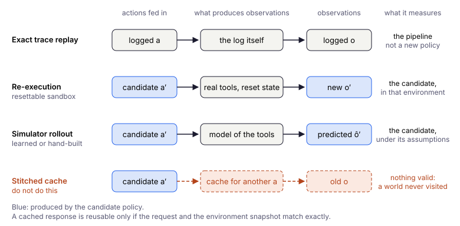

# Глава 12: Offline RL для tool-using LLM-агентов

> *Agentic AI превращает работу языковой модели в последовательное принятие решений, а offline RL превращает залогированные agent traces в материал для более безопасного улучшения политики.*

---

## Зачем эта глава

Сегодня LLM-агентов чаще всего обучают через **SFT**, **DPO**, **rejection sampling** или **online RL**, а не через классический offline RL. Это не упрёк: такие методы хорошо работают, когда есть попарные предпочтения, живая обратная связь или дешёвые rollouts.

Но как только траектории исполнения агента начинают логироваться как **последовательности state–action–reward**, задача естественно укладывается в постановку из глав 1–3:

```text
task → context/observation → thought/plan → tool call/action → tool result → next state → reward/outcome
```

От классических бенчмарков управления вроде MuJoCo или офлайн-датасетов D4RL эта постановка отличается не по сути, а по практическим деталям:

| RL-объект | Классическое управление | Agentic LLM |
|-----------|-------------------------|-------------|
| **State** | Низкоразмерный вектор | Контекст, история, память, наблюдения от инструментов |
| **Action** | Непрерывное или дискретное управление | Текст, tool call, API-запрос, шаг плана |
| **Reward** | Return среды | Успех задачи, оценка verifier, оценка человека, штраф за стоимость или нарушения |
| **Episode** | Rollout фиксированной длины | Многошаговое взаимодействие |
| **Policy** | MLP или actor-сеть | LLM или LLM-router, выбирающий инструменты |

Состояния здесь высокоразмерны и наблюдаются лишь частично; пространство действий огромно и структурировано; награды часто **редкие** и **запаздывающие**; credit assignment растягивается на множество шагов рассуждения и вызовов инструментов. Это те же трудности, что и в offline deep RL, — экстраполяция, distribution shift, чрезмерно оптимистичные оценки ценности, — только наблюдения «грязнее», а симуляторы слабее.

Эта глава переносит на agentic AI **идеи** книги. Она не утверждает, что CQL, IQL или TD3+BC встраиваются в LangChain без изменений. Она объясняет, что переносится как есть, что приходится адаптировать и какая инфраструктура — логирование, verifiers, replay — должна появиться раньше алгоритмов.

---

## Agent traces как данные для offline RL

Agent trace — это траектория $\tau = (s_0, a_0, r_0, s_1, \ldots, s_T)$, каждый шаг которой может включать:

- цель пользователя и историю диалога,
- найденные документы или содержимое памяти,
- явный план, краткое обоснование или структурированный черновик (scratchpad), если они предусмотрены дизайном агента; **скрытый chain-of-thought, как правило, не стоит ни требовать, ни хранить** в RL-датасете,
- структурированный tool call или свободно сгенерированный текст,
- ответ среды или инструмента,
- скалярный или программно вычисленный сигнал награды.

**BC на успешных траекториях** (SFT на демонстрациях в стиле ReAct) — baseline по умолчанию, аналог главы 1. Фреймворки вроде [AgentGym](https://agentgym.github.io/) ([Xi et al., 2024](https://arxiv.org/abs/2406.04151)) собирают многошаговые траектории в веб-задачах, embodied-средах и задачах с инструментами и используют их, чтобы вырастить универсальных агентов. Датасеты в духе AgentTraj — это пока топливо для BC, а не для offline RL, но именно на таком материале offline RL и строится.

Прикладное предварительное условие — **схема trace, пригодная для replay**. Если состояния, действия, наблюдения, награды и метаданные behavior policy не логируются согласованно, то позже не получится ни OPE, ни перемаркировка наград, ни консервативное улучшение политики.

---

## Формулировка MDP / POMDP

Каждый вызов LLM (или каждый шаг с инструментом) можно считать одним решением в MDP:

- **State** $s_t$ — всё, от чего зависит политика на шаге $t$: system prompt, цель пользователя, диалог, ответы инструментов, память, найденный контекст. Обычно это **POMDP**: истинное состояние среды скрыто, агент видит только окно контекста.
- **Action** $a_t$ — выход модели: JSON с tool call, SQL-запрос, действие в браузере или текстовый план.
- **Transition** $s_{t+1}$ — обновление контекста. При известных $(s_t, a_t, o_t)$ оно часто детерминировано, но само наблюдение $o_t$ может приходить от **стохастических, нестационарных или меняющихся от версии к версии** инструментов и сред.
- **Reward** $r_t$ — часто **0** до завершения задачи, а затем успех или неудача, оценка verifier, оценка человека или shaped process reward (корректный формат, успешный вызов инструмента, штраф за стоимость).

[Agent Lightning](https://microsoft.github.io/agent-lightning/latest/) ([Luo et al., 2025](https://arxiv.org/abs/2508.03680)) делает эту связь явной: исполнение агента — это MDP, где состояние — снимок исполнения, а действие — выход LLM, и траектории раскладываются на переходы `(state, action, reward)`. При этом Agent Lightning — не метод offline RL в узком смысле CQL или IQL. Его лучше понимать как **инфраструктуру**, которая превращает исполнение агента в переходы, пригодные для RL, — online, off-policy или, потенциально, offline.

Мост для практиков:

```text
Agent observability / tracing → trajectories → offline or off-policy RL dataset
```

Логи LangChain, AutoGen или OpenAI Agents — не просто материал для отладки. Как только определены награды и границы состояний, они становятся потенциальными **данными для обучения RL**.

---

## Интерфейс политики определяет метод обучения

Прежде чем выбирать функцию потерь, решите, какую именно политику вы обновляете. Классификатор действий остаётся политикой $\pi(a\mid s)$, даже если внутри у него энкодер LLM: генерировать текст для этого не обязательно.

| Интерфейс политики | Пространство действий | Baseline | Возможные методы |
|--------------------|-----------------------|----------|------------------|
| Генеративная LLM | Последовательности токенов / сериализованные tool calls | SFT на демонстрациях | ILQL с token values; DPO на preference pairs; trajectory methods с совместимыми вероятностями действий |
| Классификатор действий | Конечный набор инструментов / меток действий | BC с cross-entropy на action logits | Discrete CQL, IQL с categorical actor, support-constrained value learning |
| Router / orchestrator | Выбор агента, инструмента, передачи управления или расписания | BC на решениях маршрутизации | Offline RL для самого процесса маршрутизации, со своими наблюдениями, наградами и support constraints |

DPO оптимизирует предпочтения и не заменяет credit assignment на уровне траекторий. Token-level ILQL и SFT языковой модели требуют политики над токенами и LM head; классификатор же обучается через action logits. Текстовая ретроспекция может дать разметку или признаки, но функцию потерь генерации текста нельзя напрямую применить к классификатору без совместимой выходной головы и целевых меток.

Для строки router / orchestrator уже есть пример в реалистичном масштабе. HarnessMDP ([Yi & Song, 2026](https://arxiv.org/abs/2607.05458)) оставляет LLM-исполнителя замороженным и обучает лишь небольшой контроллер, который выбирает одну из семи структурных операций: observe, retrieve, call tool, draft, check, revise и submit. Контроллер обучается с помощью advantage-weighted regression на траекториях существующих harnesses. Выигрыш реален, но скромен: в среднем по шести контролируемым доменам успешность задач растёт на 2.8%, точность заметно улучшается на задачах программирования (+10 пунктов при откалиброванном verifier авторов), а в ряде других доменов изменение точности пренебрежимо мало или слегка отрицательно. Авторы прямо называют предел метода: контроллер усиливает паттерны, которые уже есть в буфере, но не может выучить стратегии вне его support, а выигрыш зависит от качества и покрытия логов. Калькулятор ниже приводит к тому же выводу, только в куда меньшем масштабе.

Пример с калькулятором реализует **табличную** политику; классификатор и LLM — естественные следующие шаги. Замена модели не отменяет необходимости определить action support, а смена интерфейса может потребовать другой функции потерь.

---

## BC / SFT как baseline

**Supervised fine-tuning (SFT)** на экспертных или отфильтрованных успешных траекториях — это поведенческое клонирование под другим именем. Он силён, когда:

- поведенческая политика уже хороша,
- задачи одношаговые или с коротким горизонтом,
- сбои в логах редки.

Ломается SFT так же, как BC (глава 1): ошибки накапливаются на длинном горизонте, награда используется лишь для фильтрации, а хорошие фрагменты из эпизодов смешанного качества нельзя соединить.

Для многошаговой работы с инструментами у SFT есть и ещё одна слабость: он **не умеет распределять credit** между шагами. Траектория может провалиться на восьмом шаге, хотя первые семь были верными. Offline RL и advantage-weighted методы существуют именно для того, чтобы использовать такой частичный прогресс, — если награды и покрытие данных это позволяют.

---

## Offline RL за пределами SFT

### DPO и offline RL на уровне траекторий

**DPO** оптимизирует отношение правдоподобий **на уровне всей последовательности** — сумму потокенных log-probabilities относительно reference-модели — под контролем попарной метки предпочтения. Поэтому для многошаговых рассуждений и работы с инструментами он даёт лишь **слабый credit assignment на уровне шагов**.

Хорошая опорная точка здесь — [OREO](https://github.com/jwhj/OREO), *Offline Reinforcement Learning for LLM Multi-Step Reasoning* ([Wang et al., 2024/2025](https://arxiv.org/abs/2412.16145), [ACL Findings 2025](https://aclanthology.org/2025.findings-acl.464/)). Метод совместно обучает политику LLM и **value function** через soft Bellman-style objective; мотивация — редкие награды и credit assignment между шагами рассуждения. Эмпирически OREO превосходит baselines в стиле DPO на математических задачах (GSM8K, MATH) и в embodied-управлении (ALFWorld).

Прямой предшественник — **ILQL** (Implicit Language Q-Learning; [Snell et al., 2023](https://arxiv.org/abs/2206.11871)), то есть IQL из главы 5, адаптированный к генерации языка: экспектильная value function плюс неявное ограничение на support датасета, а политика получается перевзвешиванием токенных логитов базовой модели по advantage. Это самый прямой мост от глав про пессимизм функции ценности к политикам-LLM.

Концептуальное различие:

| Подход | Данные | Credit assignment |
|--------|--------|-------------------|
| **DPO / preference learning** | Пары «выбранный — отвергнутый» | Сигнал предпочтения на уровне последовательности |
| **Offline RL (в стиле OREO)** | Полные траектории с наградами | Value function и Bellman-бэкап по шагам |

### Соответствие классическим идеям offline RL

Обозначим политику сбора логов как $\pi_b$, а замороженную reference-модель как $\pi_{\mathrm{ref}}$. Ниже встречаются две аббревиатуры. RLHF (reinforcement learning from human feedback) дообучает модель по обученной функции награды, обычно с KL-штрафом к reference. GRPO (Group Relative Policy Optimization) — online policy-gradient метод, который оценивает каждый сгенерированный ответ относительно других ответов на тот же prompt.

TD3+BC приближает действия, реально наблюдавшиеся в датасете; [DPO](https://arxiv.org/abs/2305.18290) сравнивает вероятности последовательностей относительно $\pi_{\mathrm{ref}}$. Эти две вещи близки, если данные собирал тот же SFT checkpoint с теми же prompts и настройками sampling; смесь checkpoints, фильтрация и другое декодирование это соответствие разрушают. Сам по себе штраф к reference не гарантирует support датасета. DPO встраивает регуляризацию к reference в свою функцию предпочтений, а есть ли в GRPO явный KL-штраф, какой у него коэффициент и роль — зависит от реализации.

Таблицу ниже не стоит читать как «вставьте CQL как есть». Это словарь для проектирования:

| Классический offline RL (эта книга) | Аналог в agentic AI |
|-----------------------------------|---------------------|
| **BC** | SFT на успешных traces |
| **Ограничение по действиям датасета (TD3+BC, гл. 6)** | Штраф за расстояние до залогированных действий ограничивает отклонение от поведения в датасете |
| **Регуляризация к reference policy** | KL к замороженной reference в KL-regularized RLHF; DPO использует отношения вероятностей policy/reference; варианты GRPO различаются |
| **AWR / AWAC / извлечение в стиле IQL** | Взвешивание шагов или траекторий по advantage, оценке verifier или process reward (**ILQL** применяет IQL прямо к генерации токенов) |
| **CQL / пессимизм** | Штраф за unsupported tool calls, планы или вызовы API |
| **FQE / обученная Q** | Critic над состояниями и действиями агента (текстовыми или структурированными) |
| **Decision Transformer** | Обусловливание генерации на желаемом return или метке успеха |
| **Model-based offline RL** | Симулятор, verifier или world model для результатов инструментов |
| **OPE (гл. 3)** | Повторное исполнение в среде / action-conditioned simulation / обученная value model; отличайте прямую оценку от OPE по фиксированным данным |

**LightningRL** из Agent Lightning добавляет иерархический credit assignment: return траектории распределяется по отдельным вызовам LLM, после чего применяются обычные одношаговые RL-обновления. Это удобно, когда эпизоды длинные, а каждый вызов можно обучать отдельно. Но это **мост к off-policy RL**, а не замена CQL или IQL на фиксированных логах.

---

## Credit assignment в рассуждениях и работе с инструментами

Многошаговые агенты сочетают **генерацию языка** с **внешними действиями**. Награда часто приходит только в конце эпизода: задача решена или нет. Методы offline RL, поддерживающие **value function**, — OREO, goal-conditioned critics, модели в стиле FQE — решают ту же задачу, что и TD-обучение в управлении: какой промежуточный шаг внёс вклад?

Насколько это трудно, хорошо видно по **online agentic RL**. [RAGEN](https://arxiv.org/abs/2504.20073) ([Wang et al., 2025](https://arxiv.org/abs/2504.20073)) изучает многошаговое RL для LLM-агентов (StarPO) и сообщает о нестабильности: обрывах дисперсии награды, динамике **Echo Trap**, поверхностных или галлюцинированных рассуждениях при отсутствии детальных наград. [RAGEN-2](https://arxiv.org/abs/2604.06268) ([Wang et al., 2026](https://arxiv.org/abs/2604.06268)) разбирает **template collapse** — гладкие, но не зависящие от входа рассуждения — и предлагает фильтрацию с учётом отношения сигнал/шум. Это результаты **online**-обучения, но выводы прямо переносятся на offline: если даже online agentic RL нестабилен, то offline-варианту тем более нужны **хорошее покрытие данных**, **качественные награды** и **точные оценщики**.

Для offline-постановки предпочтительны:

- **process rewards** (инструмент сработал, формат корректен, ограничение соблюдено) там, где итоговая награда редкая,
- **пошаговые цели для value function**, если в траекториях есть и успехи, и неудачи,
- **метки, подкреплённые verifier**, а не только LLM-as-judge, где это возможно.

Единственная итоговая метка ещё не означает статистического тупика, но многое зависит от целевой функции. Ren и Xie ([2026](https://arxiv.org/abs/2606.18531)) изучают offline RL в ситуации, когда у каждой траектории есть лишь одна итоговая метка, и предлагают OPAC — пессимистичный actor-critic, который обучает скрытую пошаговую награду вместе с value function. Если цель — обычная сумма пошаговых наград, а наблюдается только итог, сложность OPAC по выборке полиномиальна по горизонту. Барьер возникает, когда траекторной становится сама цель: для all-success objective, где эпизод засчитывается, только если успешен каждый шаг, исход несёт информацию лишь об экспоненциально малой доле траекторий, и любому алгоритму может понадобиться порядка $2^H$ эпизодов, чтобы приблизиться к оптимальной политике. Именно здесь помогают process rewards: они возвращают в данные ту информацию, которую теряет единственный бит «всё или ничего». Недавний обзор credit assignment для LLM-агентов ([Zhang, 2026](https://arxiv.org/abs/2604.09459)) добавляет второе предостережение: если в логе есть только текстовые истории, а прежнее состояние нельзя восстановить, может оставаться неопределённым даже знак credit отдельного шага.

Дальше эти компромиссы разобраны точнее.

### Разложение терминальной награды

Пусть $h_t$ — история, на которую опирается агент перед $t$-м решением, $a_t$ — само решение (вызов инструмента, план, итоговый ответ), а $o_t$ — то, что вернула среда, так что $h_{t+1} = (h_t, a_t, o_t)$. В эпизоде $H$ решений и одна терминальная награда $R$. Для политики $\pi$ определим

$$Q^\pi(h_t, a_t) = \mathbb{E}_\pi\left[R \mid h_t, a_t\right], \qquad V^\pi(h_t) = \mathbb{E}_{a \sim \pi(\cdot \mid h_t)}\left[Q^\pi(h_t, a)\right], \qquad V^\pi(h_H) = R.$$

Это обычные функции ценности, только вместо состояния в них стоит история. Марковское предположение не нужно: история по построению содержит всё, что произошло.

Если записать $R - V^\pi(h_0)$ как телескопическую сумму разностей $V^\pi(h_{t+1}) - V^\pi(h_t)$ и вставить в каждую из них $Q^\pi(h_t, a_t)$, исход распадается на вклады двух видов:

$$R - V^\pi(h_0) = \sum_{t=0}^{H-1} \underbrace{\left[Q^\pi(h_t, a_t) - V^\pi(h_t)\right]}_{A_t:\ \text{решение}} \;+\; \sum_{t=0}^{H-1} \underbrace{\left[V^\pi(h_{t+1}) - Q^\pi(h_t, a_t)\right]}_{\varepsilon_t:\ \text{среда}}.$$

Advantage $A_t$ показывает, насколько само решение изменило ожидаемый исход. Член $\varepsilon_t$ показывает, насколько его изменил ответ среды: поиск, который случайно вернул нужный документ, API, который не ответил вовремя. На траекториях политики $\pi$ каждый член имеет нулевое среднее при условии всего, что было до него: $A_t$ — при условии $h_t$, $\varepsilon_t$ — при условии $(h_t, a_t)$. Поэтому члены образуют последовательность мартингальных разностей, попарно не коррелируют, и их дисперсии складываются:

$$\operatorname{Var}\left[R - V^\pi(h_0)\right] = \sum_{t=0}^{H-1} \mathbb{E}\left[A_t^2\right] + \sum_{t=0}^{H-1} \mathbb{E}\left[\varepsilon_t^2\right].$$

Тождество выполняется для фиксированного запроса $h_0$, а поскольку $\mathbb{E}[R - V^\pi(h_0) \mid h_0] = 0$ для каждого запроса, оно выполняется и в среднем по запросам: вычитание $V^\pi(h_0)$ убирает разброс сложности между запросами $\operatorname{Var}[V^\pi(h_0)]$ — это и есть задача baseline ниже. Оно также предполагает, что $R$ фиксирована после окончания эпизода: $V^\pi(h_H) = R$. Со стохастическим оценщиком — человеческой оценкой или LLM-судьёй с ненулевой температурой — $V^\pi(h_H) = \mathbb{E}[R \mid h_H]$, и появляется ещё один член $\varepsilon_H = R - V^\pi(h_H)$, добавляющий к дисперсии $\mathbb{E}[\operatorname{Var}(R \mid h_H)]$. Это шум оценивания: его нельзя приписать ни одному решению, и уменьшить его можно только усреднением нескольких оценок одной траектории.

Temporal credit assignment — это задача восстановить отдельные $A_t$ по данным, в которых наблюдается только их сумма, перемешанная с $\varepsilon_t$. Тождество служит меркой для методов ниже: каждый из них оценивает $A_t$, а различаются они тем, какие ещё члены просачиваются в credit шага. Две оговорки. Члены разложения *определены* для любой политики и любой истории, но можно ли их *оценить* по фиксированным логам — отдельный вопрос: идентификация требует предположений о покрытии и о том, что именно сохранено в залогированной истории; к этому возвращается раздел об offline-оценке ниже. И тождество точно только для истинных $Q^\pi$ и $V^\pi$ на полных историях; с выученными ценностями или обрезанным контекстом оно выполняется лишь приближённо.

### Четыре способа оценить credit шага

**Advantage на уровне траектории.** Каждый шаг получает один и тот же сигнал $R - b$, где baseline $b$ — выученная $V(h_0)$ или средний исход других попыток для того же запроса, как в GRPO. Вместе со score function $\nabla \log \pi(a_t \mid h_t)$ на траекториях самой политики $\pi$ это несмещённый градиент политики (на залогированных траекториях другой политики нужны importance weights, о которых ниже), но как credit отдельного шага это $A_t$ плюс все остальные advantage плюс все $\varepsilon$: дисперсия равна всей сумме выше и растёт с горизонтом. Offline добавляется вторая цена. Траектории порождены $\pi_b$, и чтобы превратить их в сигнал для новой политики, нужны importance weights $\prod_t \pi(a_t \mid h_t) / \pi_b(a_t \mid h_t)$, дисперсия которых растёт экспоненциально по $H$ (глава 3). Отбор успешных traces для SFT — вырожденный случай: вес единица при $R = 1$ и ноль иначе.

**Обучение ценности на решениях с инструментами.** Обучить $Q(h_t, a_t)$ и $V(h_t)$ уравнениями Беллмана и взять $\hat{A}_t = \hat{Q}(h_t, a_t) - \hat{V}(h_t)$. Цель $V(h_{t+1})$ уже учитывает $o_t$, поэтому неудачный ответ инструмента списывается на $\varepsilon_t$, а не на предшествующее решение — именно это разделение недоступно сигналам уровня траектории. Платить приходится смещением, и у агентов у него два особых источника. Во-первых, ценность никто не обучает на сырых историях: сеть видит кодирование $\phi(h_t)$ — обрезанный контекст, резюме, эмбеддинг. Если две истории с разными перспективами получают одно кодирование, их ценности усредняются, тождество для выученных величин перестаёт выполняться, и credit перетекает между шагами. Во-вторых, offline нужна $Q(h_t, a)$ для вызовов, которых в логах не было и ответов на которые никто не видел. In-sample методы обходят эту проблему: можно обучить $Q^{\pi_b}$ SARSA-подобными обновлениями и сделать один шаг улучшения (глава 5, $\tau = 0.5$) или воспользоваться expectile-регрессией IQL, которая никогда не оценивает незалогированный вызов. OREO и ILQL относятся к этому семейству.

**Process rewards.** Добавить награду за шаг от верификатора или от process reward model (PRM), обученной на разметке шагов людьми ([Lightman et al., 2023](https://arxiv.org/abs/2305.20050)) или на доле успешных продолжений, сэмплированных из каждого префикса ([Math-Shepherd](https://arxiv.org/abs/2312.08935); Wang et al., 2024). Меняет ли это то, что оптимизирует агент, зависит от формы награды. [Ng, Harada и Russell (1999)](https://people.eecs.berkeley.edu/~russell/papers/icml99-shaping.pdf) показали, что добавка $F_t = \gamma\,\Phi(h_{t+1}) - \Phi(h_t)$ для любого потенциала $\Phi$ не меняет оптимальную политику: дисконтированная сумма $F_t$ телескопически сворачивается в $\gamma^H \Phi(h_H) - \Phi(h_0)$, а это выражение не зависит от действий, если $\Phi(h_H)$ — константа, как в терминальном состоянии. Множитель $\gamma$ важен: без него в сумме остаются члены, зависящие от промежуточных историй, и оптимальные действия могут измениться. В этом разделе дисконтирования нет ($\gamma = 1$), и $F_t = \Phi(h_{t+1}) - \Phi(h_t)$. Возьмём $\Phi = V^\pi$. Тогда $F_t = A_t + \varepsilon_t$ в точности, но $\Phi(h_H) = V^\pi(h_H) = R$ — не константа, так что теорема в исходной формулировке неприменима; вместо неё выполняется другое: сумма добавок равна $R - V^\pi(h_0)$. Поэтому обучение только на таких process rewards упорядочивает траектории ровно так же, как исход $R$, со сдвигом на величину, заданную стартом; если же добавить их к $R$, исход посчитается дважды, и порядок опять не изменится. В обоих случаях PRM, предсказывающая вероятность итогового успеха, — это обучение ценности под другим именем, и смещения у неё те же. PRM, оценивающая что-то другое — гладкость текста, формальную корректность шага, согласие с судьёй, — такого вида не имеет, меняет цель и подталкивает агента собирать process reward, не решая задачу. Кроме того, разметка в духе Math-Shepherd требует перезапускать эпизод с префикса, а фиксированные логи этого не позволяют.

**Return decomposition.** Выучить перераспределение $\tilde{r}_0, \dots, \tilde{r}_{H-1}$ с $\sum_t \tilde{r}_t = R$ и обучаться на плотных наградах. RUDDER ([Arjona-Medina et al., 2019](https://arxiv.org/abs/1806.07857)) предсказывает отдачу по каждому префиксу и отдаёт шагу изменение этого предсказания. При точном предсказателе $Q^\pi$ перераспределённая награда равна $Q^\pi(h_t, a_t) - Q^\pi(h_{t-1}, a_{t-1}) = A_t + \varepsilon_{t-1}$: решение плюс удача предшествовавшего ему наблюдения. Скрытая награда за шаг у Ren и Xie (см. выше) — статистический вариант той же идеи. Ограничение $\sum_t \tilde{r}_t = R$ само по себе разбиение не определяет: любое перераспределение с правильной суммой одинаково хорошо согласуется с метками исхода. Поэтому декомпозиции нужна структура — аддитивность по шагам, достаточно узкий класс функций, чтобы обобщать, — а если предсказатель видит $\phi(h_t)$, а не $h_t$, возвращается проблема склеивания историй.

| Метод | Credit шага $t$ | Что нужно | Главный источник ошибки | Риск offline |
|---|---|---|---|---|
| Advantage на уровне траектории | $R - b$: все $A_s$ и все $\varepsilon_s$ | Метки исхода | Дисперсия растёт с $H$ | Importance weights взрываются с ростом $H$ |
| Обучение ценности | $\hat{Q}(h_t,a_t) - \hat{V}(h_t)$ | Обновления Беллмана на $\phi(h)$ | Склеивание в $\phi$; аппроксимация | Незалогированные вызовы: нужны in-sample обучение или пессимизм |
| Process reward потенциального вида | $\approx A_t + \varepsilon_t$ | PRM или верификатор | Ошибка PRM; непотенциальные члены меняют цель | Разметке шагов нужна перезапускаемая среда |
| Return decomposition | $\approx A_t + \varepsilon_{t-1}$ | Предсказатель отдачи по префиксам | Без структуры разбиение не идентифицируется | Склеивание; предсказатель обучен только на данных $\pi_b$ |

### Что меняется offline

Все величины выше определены относительно какой-то политики. Логи дают $A^{\pi_b}$ — credit решения в предположении, что дальше продолжит действовать политика логов. На этом построены одношаговые методы, и это безопасный выбор. Credit решения при улучшенной политике требует продолжений, которых в логах нет, — та же проблема экстраполяции, что в главах 2 и 4, только теперь с ответами инструментов, которых никто не наблюдал.

Есть и проблема оценки: истинного credit в логах нет. Если среду можно перезапустить, несколько продолжений из залогированного префикса напрямую оценивают $Q(h_t, a_t)$, и это правильный эталон для любого способа оценки credit, даже обученного только на логах. Если состояние восстановить нельзя и залогирован только текст, действует предостережение Zhang: credit может вообще не идентифицироваться.

### Temporal credit и credit между агентами

Когда агентов несколько, решение на шаге $t$ — это joint action $a_t = (a_t^1, \dots, a_t^n)$. Тождество выше по-прежнему раскладывает исход по времени; разделить каждое $A_t$ между агентами — отдельная задача по другой оси. На второй вопрос отвечают контрфактические baselines: COMA ([Foerster et al., 2018](https://arxiv.org/abs/1705.08926)) сравнивает совместную $Q$ с её средним по альтернативным действиям одного агента при фиксированных действиях остальных. Если смешать две задачи — например, приписать командный исход напрямую шагу одного агента, — работа партнёра спутается с удачей и с более ранними решениями. Распределять credit сначала по времени, а потом между агентами — удобная декомпозиция, а не теорема: когда агенты действуют одновременно и их действия взаимодействуют, без структурных предположений (например, аддитивной командной ценности) эти оси могут и не разделяться. Но данные в любом случае должны позволять держать их порознь, поэтому в схеме логирования ниже раздельные поля командной и индивидуальной награды.

### Открытые вопросы

- **Кодирования, сохраняющие ценность.** Какое сжатие длинной истории оставляет достаточно информации, чтобы $A_t$ оставалось идентифицируемым, и как проверить, что данное кодирование это делает.
- **Credit для структурированных действий.** У вызова инструмента есть имя и аргументы; выбрать не тот инструмент и передать неверный аргумент — разные ошибки, и credit на уровне токенов может расходиться с credit на уровне вызовов.
- **Оценка credit без перезапуска.** Большинство производственных логов получены в средах, которые нельзя отмотать назад, а значит, единственного прямого эталона нет. Один из способов получить перезапускаемые стенды для проверки оценок credit — генерировать исполняемые среды, как в SPADE (ниже); цена — разрыв между синтетическими задачами и производственными инструментами.
- **Нестационарные инструменты.** Когда у инструмента меняется версия, распределение $\varepsilon_t$ сдвигается, и credit, выученный на старой версии, неверно приписывает исходы на новой.

---

## OPE для агентов

Инструменты OPE из главы 3 здесь применимы, но среды агентов редко дают точный симулятор в замкнутой форме.

Практически оценку строят в несколько слоёв:

1. **Повторное исполнение в среде или action-conditioned simulation.** Действия кандидата выполняются в сбрасываемом sandbox или их последствия симулируются при явных предположениях о модели; cached responses годятся, только если совпадают действия и снимок среды.
2. **Verifiers** — unit-тесты, проверка результатов SQL, точность поиска, результаты исполнения кода.
3. **Обученные critics** — $Q(s,a)$ в стиле FQE или goal-conditioned value models, обученные на логах. *Planning without Search* ([Hong et al., 2025](https://arxiv.org/abs/2505.18098)) использует офлайн-обученные goal-conditioned values как **critic на естественном языке** во время инференса, не дообучая базовую LLM.
4. **Оценка людьми или A/B-тест** — дорого, но необходимо при высоком риске внедрения.

Offline RL для агентов проваливается незаметно, когда OPE измеряет **качество формата** вместо **успеха задачи**. Метрики должны отражать риск внедрения — это те же предупреждения о покрытии, что и в главе 3.

### Replay — не контрфактуальная оценка

Прежде чем интерпретировать метрику, различайте три операции:

1. **Точное воспроизведение trace** подаёт в pipeline прежние действия и наблюдения. Оно проверяет разбор, восстановление состояния и регрессии, но не может измерить return политики, которая выбирает другие действия.
2. **Повторное исполнение в среде** выполняет реальные действия кандидата в сбрасываемом sandbox. Это оценка в тестовой среде, а не по одному лишь фиксированному датасету; перенос результата зависит от точности sandbox, версий инструментов и того, насколько репрезентативны начальные задачи.
3. **Rollout в симуляторе** порождает наблюдения с учётом каждого нового действия и текущего смоделированного состояния. Обученный симулятор добавляет model bias, особенно вне support логов, поэтому его нужно отдельно валидировать и сообщать неопределённость.



Cached response можно переиспользовать, только если совпадают и полный запрос, и значимое состояние среды: аргументы, права доступа, снимок документа или базы, версия инструмента и любые случайные входы, влияющие на результат. Одной детерминированности недостаточно, если снимок изменился. Промах кэша должен вести к исполнению в sandbox, проверенной симуляции или явному исходу «unsupported»; молча подставлять ответ на другое действие нельзя.

Например, записанный результат `open_pdf(page=42)` не может стать наблюдением после `open_pdf(page=43)`. Даже совпадения номера страницы мало, если изменился сам документ. Старое наблюдение скрывает последствия решения кандидата и создаёт недействительный контрфактуал.

Для каждой метрики указывайте, какая операция её породила. Точное воспроизведение подтверждает, что pipeline повторяет прежний запуск, но не доказывает, что новая политика чаще решает задачу. Если среда недоступна, используйте статистическую OPE или обученные оценки ценности с явными предположениями и ограничениями покрытия, а не выдавайте закэшированный transcript за новый rollout.

Недавние работы подкрепляют это предупреждение измерениями. В *The Replay Gap* ([Gonuguntla, 2026](https://arxiv.org/abs/2608.08239)), workshop-исследовании на SWE-bench Verified, траектории агента разветвляют посередине и продолжают другой моделью. Смена модели переписывает от 61 до 94% последующих действий, а оценщик, склеивающий записанные ответы, ошибается во всех пяти случаях, где успех действительно изменился. Выборка мала, но направление однозначно: склеенный лог оценивает мир, в который новая политика никогда бы не попала. Конструктивная альтернатива — обученный simulator. ADWM ([Liu et al., 2026](https://arxiv.org/abs/2606.05558)) моделирует каждый transition multi-turn агента латентной диффузионной world model, обученной на логах, и на HotpotQA, ScienceWorld, ALFWorld и WebShop ранжирует политики надёжнее, чем direct method, FQE, importance sampling и doubly robust оценки. Авторы аккуратно очерчивают границы: эксперименты не покрывают политики полностью вне support, а ранговая корреляция ничего не говорит о калибровке абсолютных значений.

### Контракт оценки политики агента

Методы OPE отвечают на вопрос, *как* оценить return, но не определяют, *что считать улучшением*. Политика tool-using агента может решать больше задач и при этом дороже стоить, дольше отвечать, делать лишние вызовы инструментов или чаще нарушать правила. Поэтому до сравнения офлайн-кандидатов стоит записать короткий **контракт оценки** — спецификацию, по которой команда сможет принимать решения, не споря о метриках заново после каждого обучения.

**С чем сравнивать (всегда с обоими):**

1. **С текущим агентом в эксплуатации** — behavior policy в production или её лучшей доступной shadow-копией.
2. **С SFT / BC на успешных traces** — имитацией отфильтрованных удачных эпизодов. Это честный потолок «без RL», когда логи хороши, но структура наград бедна.

**Группы метрик (не сводить к одному числу):**

| Группа | Что измерять | Роль |
|--------|--------------|------|
| **Успех задачи** | Доля прохождения verifier, завершённые задачи, доля принятых человеком | **Основная** — метрика, которую хотим улучшить |
| **Стоимость и задержка** | Доллары на эпизод, токены, p95 времени на задачу | **Ограничитель** (guardrail) |
| **Эффективность вызовов** | Вызовы на эпизод, повторные поиски, пустые повторы | **Ограничитель** |
| **Безопасность и ограничения** | Запрещённые инструменты, утечки PII, нарушения правил, API вне allowlist | **Ограничитель** |

**Набор для оценки.** Используйте **отложенный** набор задач, ни одна из которых не участвовала в обучении или настройке prompts. Стратифицируйте его по **типу задачи** (поиск, код, CRM и т. д.) и **сложности** (одношаговые и многошаговые) и приводите таблицы по каждой группе, а не только общее среднее. Предупреждения главы 3 о покрытии в силе: OPE по логам не заменяет оценку на отложенных задачах, если состояния при внедрении отличаются от залогированных.

**Правило принятия (шаблон).** Кандидата $\pi$ принимают вместо baseline $b$, только если выполнены оба условия:

- **Основная метрика:** $\text{success}(\pi) \geq \text{success}(b) + \Delta_{\min}$ на отложенном наборе, причём **доверительный интервал** (bootstrap по задачам или A/B-тест в shadow-режиме) исключает нулевой прирост.
- **Ограничители:** для каждой ограничивающей метрики $g$ выполнено $\; g(\pi) \leq g(b) + \tau_g\;$, где $\tau_g$ — **заранее зафиксированный допуск** (например, стоимость +5%, p95 задержки +10%, нулевой допуск для жёстких нарушений безопасности).

Если основная метрика выросла, а ограничитель вышел за допуск, по умолчанию кандидата **не** внедряют «с оговорками». Вместо этого дорабатывают reward shaping, ограничения или support filtering — до тех пор, пока контракт не выполнится, — либо отклоняют кандидата.

**Иллюстративное сравнение (вымышленные числа):**

| Политика | Успех (отложенный набор) | Стоимость / задача | Вызовы / задача | Нарушения безопасности |
|--------|-------------------|-------------|-------------------|-------------------|
| Агент в эксплуатации | 62% | $0.041 | 4.2 | 0.3% |
| SFT / BC | 68% | $0.038 | 3.9 | 0.2% |
| Кандидат offline RL | **71% ± 2%** | $0.044 | 4.0 | 0.2% |

При допусках $\tau_{\text{cost}} = +5\%$ и $\tau_{\text{calls}} = +10\%$ кандидат **проходит** по успеху и безопасности, но **не проходит** по стоимости ($0.044 > 1.05 \times 0.041$). Контракт откладывает внедрение, пока стоимость не снижена, — хотя по успеху кандидат обошёл оба baseline.

Этот контракт — agentic-аналог раздела главы 13 «Промышленное внедрение: этапы допуска (gates)»: офлайн-метрики и OPE служат материалом для Gate 2, а контракт оценки — то, что Gate 3 (shadow-режим) и Gate 4 (ограниченный rollout) должны подтвердить на живых задачах.

---

## LLM в роли генератора, разметчика и критика

В офлайн-пайплайнах для агентов LLM выступает не только политикой. KALM и TEDUO — это **LLM-assisted offline RL**, относящийся скорее к управлению с языковыми целями или к дополнению данных rollouts, чем к узкому классу «чат-агентов с инструментами», но сам паттерн работы с данными переносится:

| Роль | Пример | Связь с offline RL |
|------|--------|-------------------|
| **Генератор траекторий** | [KALM](https://arxiv.org/abs/2404.09248) ([Pang et al., NeurIPS 2024](https://arxiv.org/abs/2404.09248)) — воображаемые rollouts LLM смешиваются с реальными данными, затем обычный offline RL | Расширяет покрытие; следите за семантическим разрывом между текстом и низкоуровневыми действиями |
| **Разметчик датасета** | [TEDUO](https://arxiv.org/abs/2412.06877) — ретроспективная разметка и абстракция состояний на неразмеченных логах, затем offline RL и SFT | LLM размечает данные до RL |
| **Critic во время инференса** | *Planning without Search* ([arXiv:2505.18098](https://arxiv.org/abs/2505.18098)) — goal-conditioned value function направляет уточнение плана | Offline RL обучает critic; базовая LLM может оставаться замороженной |
| **Генератор сред** | [SPADE](https://arxiv.org/abs/2608.19197) ([Liu et al., 2026](https://spade-rl.github.io/)) — LLM пишет исполняемые среды с `reset()`/`step()`; это online self-play, а не offline RL | Исполняемые перезапускаемые среды делают возможными re-execution для OPE и продолжения из префиксов; синтетические задачи могут не переноситься на производственные инструменты |
| **Модель награды** | Оценки LLM-as-judge | Дёшево, но легко обмануть; сочетайте с verifiers |

KALM сначала «заземляет» LLM на динамике среды и лишь затем генерирует rollouts — так он сокращает **семантический разрыв** между токенами и числовым состоянием. TEDUO показывает, что LLM способна обогатить **неразмеченные** логи взаимодействия так, чтобы у offline RL появились цели и абстрактные состояния для обусловливания.

---

## Типичные сбои (failure modes)

Agentic offline RL наследует сбои классического offline RL и добавляет свои:

- **Reward hacking** — оптимизация обходных путей verifier вместо настоящей цели задачи.
- **Ложное использование инструментов** — вызовы ради видимости работы, без прироста информации.
- **Template collapse** — разнообразный на вид текст, который не зависит от входа (см. RAGEN-2).
- **Unsupported tool calls** — аналог OOD-действий: API или аргументы, которых в логах не было.
- **Самоуверенные critics** — модели в стиле FQE экстраполируют на длинных контекстах так же, как Q-функции экстраполируют на OOD-действиях.
- **Нестационарные инструменты и API** — логи, собранные на инструментах эпохи GPT-4.1, могут не совпадать с поведением инструментов при внедрении.
- **Стоимость и безопасность** — награда должна учитывать задержку, расходы и нарушения правил, а не только долю успеха.

Консервативные методы — пессимизм в духе CQL, support constraints, отказ от слабо покрытых ветвей вызовов — здесь концептуально уместны, но требуют определить **action support** в структурированных пространствах действий, а это пока открытая инженерная задача.

---

## Игрушечный пример: агент-калькулятор

Этот пример **намеренно убирает сложность языкового моделирования**. Политика не генерирует свободный текст, а выбирает один из структурированных tool calls. Так остаётся в чистом виде вопрос offline RL: можно ли улучшить залогированное поведение с помощью value learning и support constraints?

> 📄 Полный код: [`agentic_offline_rl_toy.py`](https://github.com/corba777/offline-rl-book/blob/main/code/agentic_offline_rl_toy.py)

### Среда

Агент решает `x + y`, `x - y` или `x * y`, но не видит `x` и `y` напрямую — их нужно получить через инструменты:

| Действие | Эффект |
|--------|--------|
| `lookup_x` | узнать скрытое $x$ |
| `lookup_y` | узнать скрытое $y$ |
| `add` / `sub` / `mul` | вычислить по известным значениям |
| `estimate` | соблазнительный «короткий путь»: правдоподобный, но неверный результат; логирующая политика его не использует |
| `final` | отправить ответ (verifier сверяет его с истинной задачей) |

Награды: **+1** за правильный итоговый ответ, **−1** за неправильный ответ или недопустимый инструмент, **−0.02** за каждый шаг (как прокси задержки и стоимости).

Пример повторяет устройство trace настоящего LLM-агента:

| Настоящий агент | Игрушечный аналог |
|------------|--------------|
| Окно контекста | Дискретный кортеж состояния |
| JSON с tool call | Дискретное действие |
| Ответ инструмента | Обновление наблюдения |
| Итоговый ответ | Действие `final` |
| Verifier | Точная проверка арифметики |
| Agent trace | Переход offline RL |

Ключ состояния в таблице — `(task, x, y, result)`, где `None` означает ещё не наблюдавшееся значение. Наблюдаемые операнды вместе с результатом позволяют различать правильные и неправильные исходы. До вызова lookup политика не получает скрытые операнды.

### Четыре политики на двух датасетах

| Политика | Роль |
|--------|------|
| **Behavior** | Стохастический логгер (иногда выбирает не ту операцию) |
| **BC** | Самое частое действие в каждом состоянии логов (SFT на traces) |
| **Naive FQI** | Табличный fitted Q с жадным улучшением по **допустимым** действиям; равенства разрешаются случайно |
| **Support-constrained FQI** | То же, но argmax только по залогированным в этом состоянии действиям; если таких нет, политика воздерживается (это support mask, а не функция потерь CQL) |

Два режима данных:

1. **Хорошее покрытие** — на задачах умножения `mul` встречается в логах.
2. **Пробел в покрытии** — на задачах умножения behavior логирует только `add` и `sub`, но никогда `mul`.

В неизвестном состоянии или при пустом наборе допустимых действий из support constrained policy воздерживается (`None`); при оценке это считается неуспешным завершением.

Запуск: `python code/agentic_offline_rl_toy.py`

Вывод для seed по умолчанию детерминирован; с другим seed числа будут немного другими:

```text
Dataset: good coverage (mul in logs)
  mul-task op support (x,y known): ['add', 'mul', 'sub']
  Behavior success (all tasks):    0.72
  BC success:                    0.99
  Naive FQI success:             1.00  (range 1.00–1.00 over tie-breaks)
  Support-constrained FQI:       1.00

Dataset: no multiplication support
  mul-task op support (x,y known): ['add', 'sub']
  Behavior success (all tasks):    0.52
  BC success:                    0.67
  Naive FQI success:             0.83  (range 0.81–0.85 over tie-breaks)
  Support-constrained FQI:       0.72
  --- mul tasks only ---
  BC / naive FQI / constrained:  0.01 / 0.51 / 0.02
```

### Что показывает пример

1. **BC** клонирует поведенческую политику. Он улучшает сырой лог, когда самое частое действие в состоянии хорошее, но не может придумать инструмент, которого в данных нет.
2. **Naive FQI** при достаточном покрытии сшивает успешные фрагменты траекторий: `lookup_x → lookup_y → нужная операция → final`.
3. **Если `mul` нет в логах**, support-constrained FQI никогда не выбирает умножение. Иногда он всё же решает задачу, когда разрешённая операция случайно даёт тот же ответ. Именно такого консервативного поведения и хочется в офлайн-режиме.
4. **Naive FQI на задачах умножения** видит два действия, которых нет в логах, — `mul` и `estimate`. У обоих Q-значение остаётся равным 0 по умолчанию, что выше отрицательных Q у залогированных неверных операций, поэтому наивный FQI выбирает одно из них — и какое именно, решает разбиение равенства, а не данные. В среднем по разбиениям он решает примерно половину задач умножения: верно, когда случайно выбирает `mul`, и неверно, когда выбирает `estimate`. Это эффект **экстраполяции на OOD-действие** в миниатюре. Общий результат у наивного FQI выше, чем у ограниченной политики, но этот выигрыш — подброшенная монета, исход которой данные заранее не предсказывают; при реальном внедрении неподтверждённым выбором мог бы оказаться и вредный.

**Главный вывод (тот же, что в классическом offline RL):** улучшение возможно **внутри** support датасета по действиям и состояниям; консервативные методы отказываются от неподтверждённого выигрыша; неограниченное value learning может переоценить действия, которых не было в данных.

Начинайте с такого табличного агента, прежде чем добавлять трудности, характерные для LLM: стохастическое декодирование, дрейф prompts, отсутствующие log-probabilities, дорогую OPE. Естественный следующий шаг — заменить табличную политику небольшим классификатором над состояниями traces, а затем LLM, которая предлагает tool calls, отфильтрованные моделью support или critic.

---

## От agentic offline RL к offline MARL

До сих пор мы рассматривали одного агента. Когда в эпизоде действуют несколько агентов, эта постановка перестаёт работать. Пока политики остальных агентов зафиксированы, для каждого отдельного агента задача остаётся (PO)MDP: партнёры просто входят в среду. Но offline-обучение меняет сразу несколько политик, и динамика, которую видит агент, меняется вместе с поведением партнёров. Логи, собранные при старых политиках партнёров, перестают описывать новую среду. Правильная модель здесь — Markov game (stochastic game), а при локальных наблюдениях и общей награде — Dec-POMDP. Если склеить реплики всех агентов в один transcript, теряется, кто что наблюдал и кто какое действие выбрал, то есть именно те сведения, которые нужны для оценки support и credit assignment.

**Обозначения.** При $N$ агентах $s_t$ — совместное состояние (общий workspace или состояние тикета), $o_t^i$ — локальное наблюдение агента $i$ (его prompt, инструменты и собственная память), а

$$a_t = (a_t^1,\ldots,a_t^N)$$

— joint action, где $a_t^i$ — сообщение, tool call или шаг плана. Награда может быть общей для команды ($r_t$), индивидуальной ($r_t^i$) или смешанной. Поэтому в логе нужны наблюдения и действия каждого агента, а не только общая переписка.

Single-agent offline RL не решает три задачи, которые здесь появляются:

1. **Joint-action coverage.** Support определяется на кортежах $(a^1,\ldots,a^N)$, а не на действиях каждого агента по отдельности. В логах могут быть «A ищет» и «B правит» в разных эпизодах, но ни разу — нужная при развёртывании комбинация. Если ограничить каждого агента только его собственными действиями из логов, команда всё равно может выполнить joint action, которого в данных нет.
2. **Multi-agent credit assignment.** Успех команды не говорит, чей шаг к нему привёл. Чтобы отделить вклад агента от удачи и от работы партнёров, нужны returns на уровне агента или роли, counterfactual baselines или process rewards.
3. **Coordination conventions.** Multi-agent логи фиксируют, кто когда говорит, какой роли принадлежит какой инструмент и как устроены handoffs. Если улучшать политику каждого агента по отдельности, можно сломать conventions, благодаря которым эпизоды в логах были успешными.

В LLM-системах часто смешивают две разные задачи обучения:

| Уровень | Что обучается | Типичные offline-данные |
|---------|---------------|-------------------------|
| **Shared LLM (post-training)** | Одна базовая модель для нескольких ролей или prompts | Preference pairs, успешные multi-agent traces для SFT, при необходимости per-agent credit assignment |
| **Orchestration policy** | Кто действует следующим, когда передавать управление, как маршрутизировать tools и сообщения | Логи routers, schedulers или графов Autogen/LangGraph как отдельного процесса принятия решений |

Дообучение shared LLM на traces с ролями (DPO, SFT или single-agent offline RL) обновляет другую политику, чем orchestration policy, которая выбирает joint actions. Указывайте, какую из двух обновляет метод; иначе multi-agent проблемы попадают в систему под видом обычного дообучения агента.

**Пример.** Два агента действуют на одном шаге, не видя выбора друг друга: агент 1 выбирает запрос $m \in \{A, B\}$, а агент 2 параллельно выбирает инструмент $u \in \{a, b\}$. Команда получает $r = 1$ только за пары $(A, a)$ и $(B, b)$. При равномерно случайной behavior policy каждый отдельный запрос и каждый отдельный инструмент успешны в половине эпизодов, поэтому ценности действий отдельных агентов равны и ничего не сообщают; хорошее поведение от плохого отличает только ценность пары. Агентам, которые учат каждый свои ценности по этим логам (independent learners), нечем разрешить равенство: они выбирают независимо и в половине случаев приходят к несогласованной паре, например $(A, b)$. Пример держится на одновременности ходов. Если бы агент 2 видел $m$ до своего выбора, задача свелась бы к двухшаговому MDP, который обычное динамическое программирование по склеенному transcript решает точно; credit assignment между агентами становится трудным, когда агент не видит того, с чем ему нужно согласоваться. Поэтому offline MARL методы явно моделируют joint action.

В классическом offline MARL для этого уже есть инструменты. MACCA ([Wang et al., 2025](https://arxiv.org/abs/2312.03644)) представляет offline-данные как динамическую байесовскую сеть и выделяет причинный вклад каждого агента в награду. Для LLM-агентов ближайшие работы пока online. LangMARL ([Yao et al., 2026](https://aclanthology.org/2026.emnlp-main.1837/)) с помощью централизованного языкового critic назначает credit каждому агенту и переписывает его политику на естественном языке — инструкции и примеры, а не веса модели, — собирая новые rollouts на каждой итерации. Перенести такой agent-level credit assignment на фиксированные логи — пока открытая задача.

Эта глава сознательно ограничивается одним агентом. Если ваш продукт multi-agent, описанные выше практики оценки и приведённая ниже схема логирования подойдут и ему; в схеме есть расширение для нескольких агентов. А вот single-agent conservative RL напрямую не переносится: support constraints и credit assignment сначала нужно переопределить для joint actions и team rewards.

---

## Практическая схема логирования

В прикладной работе согласованная схема JSON (или parquet) важна не меньше, чем выбор алгоритма:

```json
{
  "episode_id": "task_001",
  "t": 3,
  "task": "Find quarterly revenue in uploaded 10-K",
  "state": {
    "user_goal": "...",
    "conversation_history": "...",
    "available_tools": ["search", "open_pdf", "calculator"],
    "memory": "...",
    "retrieved_context": "..."
  },
  "action": {
    "type": "tool_call",
    "tool": "open_pdf",
    "arguments": {"page": 42}
  },
  "observation": {
    "tool_result": "...",
    "error": null
  },
  "reward": 0.0,
  "terminated": false,
  "truncated": false,
  "prompt_version": "agent_prompt_v12",
  "tool_schema_version": "tools_2026_06_20",
  "environment_version": "sandbox_v3",
  "action_logprobs": null,
  "reward_components": {
    "task_success": 0.0,
    "format_valid": 1.0,
    "tool_error_penalty": 0.0,
    "cost_penalty": -0.0031
  },
  "reward_source": "verifier_v2",
  "verifier_version": "sec_filing_checker_2026_06",
  "task_family_id": "sec_revenue_extraction_filing_001",
  "source_hash": "sha256:<source-snapshot-digest>",
  "collection_window": {"start": "2026-06-01", "end": "2026-06-30"},
  "split": "train",
  "metadata": {
    "behavior_policy": "gpt-4.1-agent-v3",
    "temperature": 0.2,
    "latency_ms": 1400,
    "cost_usd": 0.0031,
    "safety_flags": []
  }
}
```

Что важно в этой схеме:

- **`state`** должен восстанавливаться и при обучении, и при оценке, поэтому версионируйте prompts (`prompt_version`), схемы инструментов (`tool_schema_version`) и sandbox (`environment_version`).
- **`action`** по возможности должен быть структурированным (со своей JSON-схемой): для такого действия support оценить проще, чем для свободного текста.
- **`terminated`** и **`truncated`** — раздельные флаги: эпизод, достигший цели или окончательно проваленный, завершён (terminated), и цели для ценности на нём обрываются; эпизод, прерванный по лимиту шагов или времени, обрезан (truncated), и цели должны продолжать bootstrap. Один флаг `done` смешивает эти случаи — это та самая ошибка с лимитом времени, исправленная в коде главы 10.
- **`reward`** можно перемаркировать офлайн — с помощью verifier, человека или LLM-critic, — поэтому храните `reward_components`, `reward_source` и `verifier_version` отдельно от скалярного `reward`.
- **`action_logprobs`** (или log-probabilities токенов и tool calls) очень полезны для off-policy evaluation и фильтрации; логируйте их, если behavior policy их отдаёт.
- **`metadata.behavior_policy`** необходим для **происхождения данных** (provenance). Для OPE с importance weights нужны ещё сопоставимые представления действий и вероятности действий под behavior и target policy, а для свободных действий LLM их часто **нет**, если log-probabilities не записали в момент сбора.

### Расширение для нескольких агентов

Добавляйте эту запись к переходу каждого действующего агента; действие и идентификатор эпизода хранятся в основной записи.

```json
{
  "multi_agent_extension": {
    "joint_step_id": "task_001:3",
    "turn_id": 7,
    "agent_id": "reader_1",
    "role": "document_reader",
    "recipient_ids": ["analyst_1"],
    "local_observation": {
      "visible_document": "filing_snapshot_v1",
      "message": "Read page 42"
    },
    "policy_checkpoint": "reader_policy_v3",
    "team_reward": {
      "value": 0.0,
      "source": "task_verifier_v2"
    },
    "individual_reward": {
      "value": 0.0,
      "source": "tool_validity_v1"
    },
    "credit_label": {
      "value": null,
      "source": null
    }
  }
}
```

Через `joint_step_id` связывайте действия и сообщения, относящиеся к одному решению среды, а `turn_id` сохраняет их порядок. Для каждого агента храните здесь локальное наблюдение, получателей и checkpoint; вероятность фактически выбранного действия под политикой сбора, вместе с настройками sampling, записывается в `action_logprobs` основной записи, чтобы не дублировать её. Null означает, что вероятность неизвестна, а не что она равна нулю.

Плоский transcript не сохраняет ни приватных наблюдений, ни одновременности решений, ни происхождения политик. Командная награда, индивидуальная награда и поздняя разметка credit различаются и по смыслу, и по источнику; метка credit — не наблюдаемый контрфактуал. Такая запись позволяет восстановить траекторию, но сама по себе не определяет контрфактуальный вклад агента без дополнительных предположений или вмешательств.

### Разбиение данных и утечки

Назначайте split **до извлечения переходов**, сохраняя эпизоды целиком. Группируйте связанные эпизоды по семейству задач и исходному документу: варианты одной задачи, общие закэшированные ответы и близкие дубликаты не должны оказаться в разных splits. Храните `task_family_id`, `source_hash` (хеш снимка источника) и `collection_window`; сам по себе хеш не выявляет смысловых дубликатов.

Сначала определите гранулярность группировки: `task_family_id` объединяет базовую задачу и её варианты, а не целую категорию вроде всех задач на извлечение выручки. Чтобы проверить работу на новых примерах, откладывайте независимые группы задач и исходных документов внутри целевых категорий. Если же отложить целые категории, проверяется перенос на незнакомые семейства задач — такой результат приводите отдельно. Добавьте и отложенный набор по времени или версии — собранный позже либо при новых prompts, инструментах или средах — и тоже отчитывайтесь по нему отдельно, потому что смена версий проверяет ещё и устойчивость.

Проверка на утечки:

- Все шаги и все реплики агентов одного эпизода находятся в одном split.
- Варианты задач и дублирующиеся или пересекающиеся источники сгруппированы до разбиения.
- Модели награды, нормализация и калибровка verifier обучаются на train; prompts настраиваются и кандидаты выбираются по validation.
- Тестовый набор и протокол оценки зафиксированы; ничего не настраивается по результатам на test.
- Происхождение кэша и окна сбора проверены, а рядом с числом переходов указано число семейств задач.

---

## Ограничения и честные рамки

Это **быстро развивающаяся** область исследований, а не устоявшийся производственный стек. Большинство агентов в эксплуатации по-прежнему обучают циклами SFT и online RLHF/GRPO. Offline RL для агентов сильнее всего, когда:

- traces много и их можно воспроизвести,
- награды (или verifiers) надёжны,
- внедрение не допускает исследовательского online-обучения,
- нужно улучшить фиксированную behavior policy, не собирая данные заново.

Если эти условия не выполняются, вкладывайтесь сначала в **логирование**, **BC baselines** и **OPE**, а уже потом в value-based offline RL.

Классические методы и ориентиры по их выбору собраны в [Приложении](/offline-rl-book/ru/appendix.html). [Глава 13](/offline-rl-book/ru/chapter13.html) завершает книгу.

---

## Литература

- Wang, H., Hao, S., Dong, H., et al. (2024). *Offline Reinforcement Learning for LLM Multi-Step Reasoning (OREO).* [arXiv:2412.16145](https://arxiv.org/abs/2412.16145), [ACL Findings 2025](https://aclanthology.org/2025.findings-acl.464/), [code](https://github.com/jwhj/OREO).
- Snell, C., Kostrikov, I., Su, Y., Yang, M., & Levine, S. (2023). *Offline RL for Natural Language Generation with Implicit Language Q-Learning (ILQL).* ICLR. [arXiv:2206.11871](https://arxiv.org/abs/2206.11871).
- Xi et al. (2024). *AgentGym: Evolving LLM-based Agents across Diverse Environments.* [arXiv:2406.04151](https://arxiv.org/abs/2406.04151), [project](https://agentgym.github.io/).
- Luo et al. (2025). *Agent Lightning: Train ANY AI Agents with Reinforcement Learning.* [arXiv:2508.03680](https://arxiv.org/abs/2508.03680), [docs](https://microsoft.github.io/agent-lightning/latest/).
- Pang et al. (2024). *KALM: Knowledgeable Agents by Offline RL from LLM Rollouts.* [arXiv:2404.09248](https://arxiv.org/abs/2404.09248), [project](https://kalmneurips2024.github.io/).
- Pouplin, T., Kobalczyk, K., Sun, H., & van der Schaar, M. (2024). *The Synergy of LLMs & RL Unlocks Offline Learning of Generalizable Language-Conditioned Policies (TEDUO).* ICML 2025. [arXiv:2412.06877](https://arxiv.org/abs/2412.06877).
- Hong, J., Dragan, A., & Levine, S. (2025). *Planning without Search: Refining Frontier LLMs with Offline Goal-Conditioned RL.* NeurIPS 2025. [arXiv:2505.18098](https://arxiv.org/abs/2505.18098).
- Wang et al. (2025). *RAGEN: Understanding Self-Evolution in LLM Agents via Multi-Turn RL.* [arXiv:2504.20073](https://arxiv.org/abs/2504.20073).
- Wang et al. (2026). *RAGEN-2: Reasoning Collapse in Agentic RL.* [arXiv:2604.06268](https://arxiv.org/abs/2604.06268), [project](https://ragen-ai.github.io/v2/).
- Yi, H., & Song, X. (2026). *HarnessMDP: Learning to Control LLM Agent Harnesses with Offline Reinforcement Learning.* [arXiv:2607.05458](https://arxiv.org/abs/2607.05458).
- Ren, X., & Xie, T. (2026). *When Does Trajectory-Level Supervision Permit Efficient Offline Reinforcement Learning?* [arXiv:2606.18531](https://arxiv.org/abs/2606.18531).
- Zhang, C. (2026). *From Reasoning to Agentic: Credit Assignment in Reinforcement Learning for Large Language Models.* [arXiv:2604.09459](https://arxiv.org/abs/2604.09459).
- Liu, B., Yu, S., Jiang, Y., et al. (2026). *SPADE: Self-Play in Adaptive Synthetic Executable Environments.* [arXiv:2608.19197](https://arxiv.org/abs/2608.19197), [project](https://spade-rl.github.io/).
- Ng, A.Y., Harada, D., & Russell, S. (1999). *Policy Invariance under Reward Transformations: Theory and Application to Reward Shaping.* ICML. [PDF](https://people.eecs.berkeley.edu/~russell/papers/icml99-shaping.pdf).
- Arjona-Medina, J.A., Gillhofer, M., Widrich, M., Unterthiner, T., Brandstetter, J., & Hochreiter, S. (2019). *RUDDER: Return Decomposition for Delayed Rewards.* NeurIPS. [arXiv:1806.07857](https://arxiv.org/abs/1806.07857).
- Lightman, H., Kosaraju, V., Burda, Y., et al. (2023). *Let's Verify Step by Step.* [arXiv:2305.20050](https://arxiv.org/abs/2305.20050).
- Wang, P., Li, L., Shao, Z., et al. (2024). *Math-Shepherd: Verify and Reinforce LLMs Step-by-step without Human Annotations.* ACL. [arXiv:2312.08935](https://arxiv.org/abs/2312.08935).
- Foerster, J., Farquhar, G., Afouras, T., Nardelli, N., & Whiteson, S. (2018). *Counterfactual Multi-Agent Policy Gradients (COMA).* AAAI. [arXiv:1705.08926](https://arxiv.org/abs/1705.08926).
- Gonuguntla, A. (2026). *The Replay Gap: Static Evaluation of Model Switching in LLM Agents Scores the Wrong World.* Efficient Reasoning Workshop, COLM. [arXiv:2608.08239](https://arxiv.org/abs/2608.08239).
- Liu, K., Xiong, G., Zhang, W., & Tang, S. (2026). *Autoregressive Diffusion World Models for Off-Policy Evaluation of LLM Agents (ADWM).* [arXiv:2606.05558](https://arxiv.org/abs/2606.05558).
- Wang, Z., Du, Y., Zhang, Y., Fang, M., & Huang, B. (2025). *MACCA: Offline Multi-agent Reinforcement Learning with Causal Credit Assignment.* TMLR. [arXiv:2312.03644](https://arxiv.org/abs/2312.03644).
- Yao, H., Da, L., Liu, X., Fleming, C., Chen, T., & Wei, H. (2026). *LangMARL: Natural Language Multi-Agent Reinforcement Learning via Semantic Credit Assignment.* EMNLP. [ACL Anthology](https://aclanthology.org/2026.emnlp-main.1837/), [arXiv:2604.00722](https://arxiv.org/abs/2604.00722).
