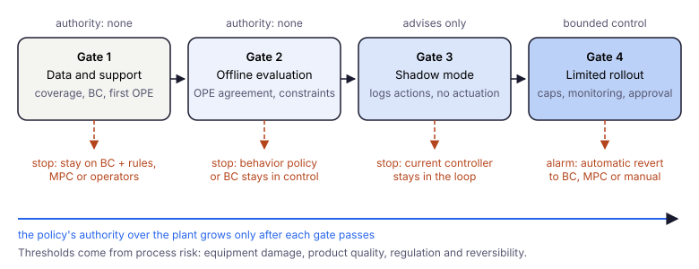

# Глава 13: Заключение и перспективы

> *«Цель offline RL – не заменить обучение со взаимодействием, а сделать знания, запертые в исторических данных, применимыми на практике, не подвергая процесс риску во время обучения.»*

---

## Что мы построили

В главе 1 мы начали с вопроса: может ли агент последовательного принятия решений обучаться исключительно из фиксированного журнала прошлого поведения, никогда не взаимодействуя со средой напрямую? Ответ – да, но с оговорками, которые оказываются не менее интересными, чем сами алгоритмы.

Эти оговорки – не инженерные детали. Они являются структурными характеристиками задачи обучения по офлайн-данным: разрыв экстраполяции между тем, что покрывают данные, и тем, что политика должна уметь оценивать; сдвиг распределения между поведенческой политикой и любой более качественной политикой; фундаментальная невозможность проверить политику именно в тех регионах, где она наиболее вероятно провалится. Каждый алгоритм в этой книге – разный ответ на одну и ту же базовую проблему.

**Поведенческое клонирование** (глава 1) отвечает на неё игнорированием: клонирует поведенческую политику и остаётся строго там, где есть данные. Это работает, когда поведенческая политика хороша, и катастрофически отказывает, когда нет – проблема накопительной ошибки. BC – не плохой алгоритм; это честный алгоритм, который не даёт никаких обещаний сверх данных, которые он видел.

**Оценка политик по офлайн-данным** (глава 3) даёт мерило, на которое опираются все следующие главы: оценку ценности кандидатной политики только по логам – со своими ограничениями покрытия.

**CQL и IQL** (главы 4–5) отвечают на неё пессимизмом в пространстве значений: штрафуют Q-значения за действия, не подкреплённые данными, или строят Bellman-бэкап так, чтобы никогда не запрашивать OOD-действия. Оба достигают одной цели – удерживают эффективную поддержку политики внутри распределения данных – разными алгебраическими путями.

**Методы ограничения политики и Decision Transformers** (главы 6–7) отвечают со стороны политики: удерживают актора у залогированных действий или заменяют функцию ценности моделированием последовательностей с обусловливанием на return.

**MOPO и MOReL** (глава 8) отвечают расширением данных: обучают модель мира, генерируют синтетический опыт, но штрафуют или жёстко прекращают переходы там, где модель неопределена. Модельные методы обменивают вычисления на разнообразие выборки – когда модель динамики точна, они могут превосходить безмодельные методы, особенно при редких данных.

**Физически-информированные методы** (глава 9) отвечают заимствованием структуры: заменяют неизвестные части модели известной физикой, ограничивают сигнал награды физическими законами и обеспечивают жёсткие ограничения через двойственность Лагранжа. Этот подход возможен только при наличии инженерных знаний – но когда они есть, он может заметно сократить объём необходимых данных.

**Промышленный кейс** (глава 10) показал, как эти инструменты компонуются в условиях, когда ставки реальны: пятипеременный процесс с интегрирующей динамикой, транспортной задержкой, неравномерным покрытием данных и жёсткими ограничениями оборудования. Измерение на десяти seeds с парными сравнениями показало, что выиграл простой консервативный метод: CQL убрал статические ошибки политики логов, ни разу не нарушив границ; штраф за ограничения добавил небольшой выигрыш, который удалось обнаружить только парным сравнением; гибридный модельный метод в нашей настройке был ненадёжен. Абляция 2×2 показала, где проблема: с выключенным HALT по неопределённости – то есть с модельным SAC без пессимизма – агент обогнал CQL с весом по умолчанию на обоих вариантах состояния и на десяти свежих seeds, но так же справился и SAC только на реальных данных – задаче не были нужны ни модель, ни пессимизм, – а HALT – перцентильный порог, останавливавший пятую часть rollouts на данных, со штрафом, достаточно большим, чтобы определять работу критика, – вызывал провалы даже с истинной динамикой; более строгий порог убрал катастрофические прогоны, но агент всё равно остался позади поведенческого клонирования, а штраф, рассчитанный по данным, а не по худшему случаю, вернул большую часть потерь, но не все. Сужение логов показало, где пессимизм окупается: model-free SAC развалился, как только исследование урезали, а CQL устоял; модельный SAC без пессимизма тоже устоял и провалился только при длинных rollouts, где HALT со штрафом из данных избежал всех провалов наравне с настроенным CQL – и на исходных, и на свежих seeds, – а штраф для худшего случая оказался худшим выбором. Неопределённость ансамбля слабо следила за ошибкой модели на шаг вперёд и совсем не следила на протяжении rollout. Урок здесь не столько про алгоритмы, сколько про проверки: состояние, единицы, качество физики и разброс между seeds нужно проверить прежде, чем доверять сравнению.

**Объяснимость** (глава 11) делает эти политики проверяемыми: SHAP-атрибуции для критика, актора и модели динамики показывают, на что опирается каждый компонент, а проверки согласованности выявляют физически неправдоподобные модели до внедрения.

**Tool-using LLM-агенты** (глава 12) переносят ту же постановку на multi-turn agent traces. Состояния там сложнее, награды реже, а первое условие – инфраструктура: воспроизводимые логи, verifiers и явный контракт оценки.

---

## Когда не стоит использовать Offline RL

Offline RL – не универсальный инструмент для любой задачи последовательных решений. **Улучшение политики в пределах support данных** имеет смысл, только когда задача действительно устроена как задача RL и логи позволяют рассчитывать на улучшение.

Стоит **отказаться** от offline RL или отложить его, если:

- **BC уже достаточно хорош** – безопасное улучшение относительно поведенческой политики не нужно или его невозможно измерить.
- **Награда плохо определена** – она запаздывает, служит лишь косвенным показателем (proxy) или искажена конфаундерами, и «максимизировать return» теряет смысл.
- **Логи получены одной узкой политикой** – действия и состояния почти не различаются, и извлекать лучшие режимы не из чего.
- **В пространстве действий нет нужных рычагов** – вы не управляете тем, что на самом деле важно, и в логах нет ключевых управляющих воздействий.
- **Конфаундеры не попали в состояние** – причинная структура задана неверно, и любая политика унаследует ложные корреляции.
- **Риск внедрения высок, а OPE слаба** – оценки расходятся или покрытие для целевой политики плохое.
- **По сути задача ближе** к обычному прогнозированию с учителем, MPC с известной моделью, условной оптимизации, байесовской оптимизации, contextual bandits или причинной оценке политики, чем к RL на длинном горизонте по логам.

В производстве и управлении процессами сначала спросите себя: *что узкое место – данные, динамика, постановка награды или риск вмешательства?* Часто ответ указывает на более простой baseline, чем CQL или IQL.

**Что стоит попробовать раньше:** сильный BC плюс правила; model predictive control; суррогатную модель с оптимизатором при ограничениях; offline contextual bandits при коротком горизонте; тщательную OPE до любого value-based метода.

Ориентиры по отдельным методам собраны в [Приложении: выбор алгоритма](/offline-rl-book/ru/appendix.html).

---

## О коде в этой книге

Python-файлы, на которые ссылаются главы, – **учебные каркасы**: они показывают устройство алгоритмов на игрушечной среде и **не** претендуют на роль эталонных реализаций для бенчмарков.

Относитесь к ним соответственно: нормализацию, протокол оценки и работу с начальными состояниями в OPE легко незаметно сделать неправильно. Если фрагмент в тексте расходится с `code/*.py`, **доверяйте коду в репозитории** (или исправьте фрагмент). Книга излагает методы и подводные камни, но не заменяет ни чтения оригинальных статей, ни промышленных библиотек (d3rlpy, CleanRL, релизы авторов).

---

## Что Offline RL пока не может гарантировать

Честность требует назвать то, что в этой области не решено.

**Сдвиг распределения при развёртывании.** Каждый алгоритм offline RL обучает политику $\pi$, предполагая, что развёртываемая среда соответствует обучающей. Когда процесс меняется – оборудование изнашивается, состав сырья смещается, внешние условия меняются – офлайн-обученная политика не имеет механизма обнаружения или адаптации. Теоретические гарантии глав 4–9 справедливы только пока тестовое распределение напоминает обучающее. На практике это вопрос времени: как скоро разрыв станет опасным?

**Спецификация функции награды.** Каждый алгоритм в книге предполагал, что функция награды задана. Во многих промышленных условиях это не так. Операторы интуитивно понимают, как выглядит хорошее управление, но перевод этих интуиций в скалярную функцию награды, корректно взвешивающую конкурирующие цели – качество продукта, энергоэффективность, производительность, безопасность – нетривиальная инженерная задача. Неправильно заданная награда приводит к политике, оптимизирующей не то, что нужно.

**Квантификация неопределённости.** Ансамблевая неопределённость (главы 8–9) измеряет эпистемическую неопределённость в отношении модели динамики. Она не измеряет неопределённость в отношении функции награды, спецификации ограничений или самой стоимости офлайн-политики. Калиброванная неопределённость для всего конвейера остаётся открытой задачей.

**Интерпретируемость.** Нейросетевые политики из глав 1–10 – чёрные ящики. Инструменты апостериорного анализа вроде SHAP из главы 11 показывают, на какие входы опирается политика, но атрибуция – ещё не обоснование. Оператор, которому нужно понять *почему* политика назначила конкретную уставку в конкретный момент, не может получить ответ из весов. Это ограничивает применение в регулируемых отраслях, где решения должны быть объяснимы и поддаваться аудиту.

**Разрыв sim-to-real для физических моделей.** Гибридные динамические модели главы 9 предполагают, что физическая модель и реальный процесс имеют одинаковую структуру, различаясь лишь остатками. Когда физическая модель структурно неверна – неправильный порядок, неправильная топология связей, неправильные законы сохранения – остаточная сеть должна выучить поправку, которой физический член активно сопротивляется. Систематическое обнаружение и обработка структурного несоответствия модели пока не разработаны.

---

## Новые направления

Область развивается быстро. Направления ниже не исчерпывающие, но представляют наиболее активные течения на момент написания.

### Decision Transformer и последовательные модели

Decision Transformer подробно разобран в главе 7; здесь он лишь помещён в ряд современных направлений. **Decision Transformer** (Chen et al., NeurIPS 2021) переформулирует offline RL как задачу моделирования последовательностей. Вместо обучения Q-функции или градиента политики он обучает причинный Transformer предсказывать следующее действие по прошлой траектории и желаемому return-to-go:

$$a_t = \pi_\theta\!\left(R_t,\, s_t,\, a_{t-1},\, \ldots,\, R_1,\, s_1,\, a_1\right)$$

При инференсе вы обуславливаете на высоком целевом доходе – «хочу накопленную награду $\geq R^*$» – и модель генерирует действия для его достижения.

Этот подход концептуально элегантен: весь конвейер offline RL сводится к обучению с учителем на последовательностях. Нет Bellman-бэкапов, нет Q-функций, нет явного пессимизма. Модель просто учится из данных, какие последовательности действий ведут к высоким доходам, и имитирует этот паттерн при обуславливании на высокой цели.

Практические следствия значительны. Трансформеры хорошо известным образом масштабируются с ростом данных и размера модели. Масштабируется ли так же Q-обучение, долго вызывало сомнения, но недавние работы показывают, что да (масштабированное offline Q-обучение, Kumar et al., 2023; Q-Transformer, Chebotar et al., 2023). Decision Transformer, обученный на большом разнообразном датасете, может обобщаться на новые задачи и среды – а специализированный агент CQL на это не рассчитан. Это связь с большими языковыми моделями: та же архитектура, которая учится предсказывать текст по интернет-данным, может учиться предсказывать действия по данным траекторий.

**Trajectory Transformer** (Janner et al., NeurIPS 2021) идёт дальше: моделирует всю траекторию $(s_1, a_1, r_1, s_2, a_2, r_2, \ldots)$ как последовательность, затем использует лучевой поиск по этой последовательности для нахождения высоковознаграждаемых траекторий при инференсе.

Ограничение последовательных моделей то же, что у BC: они не экстраполируют за пределы распределения доходов в обучающих данных. Если обучающий датасет имеет максимальный доход $R_{max}$, обуславливание на $R > R_{max}$ создаёт входы со сдвигом распределения, на которых модель никогда не обучалась. В стохастических средах есть и ещё одна проблема: высокий return в логах может объясняться удачей, а не хорошими действиями (глава 7).

### Imitation Learning и Offline RL: необходимое разграничение

Прежде чем рассматривать диффузионные модели, стоит прояснить концептуальную границу, которую практики часто размывают: разницу между **имитационным обучением (IL)** и **Offline RL**.

Оба подхода обучаются по фиксированному датасету прошлого поведения без онлайн-взаимодействия. Разница в том, что содержит датасет и что оптимизирует обучающийся:

| | Imitation Learning | Offline RL |
|---|---|---|
| Требования к датасету | Только экспертные демонстрации | Любые записанные переходы $(s, a, r, s')$ |
| Сигнал награды | Не нужен – действия являются метками | Необходим – управляет оптимизацией |
| Цель | Воспроизвести поведенческую политику | Улучшиться *сверх* поведенческой политики |
| Типичный сбой | Накопительная ошибка (ковариатный сдвиг) | Сдвиг распределения + ошибка экстраполяции |
| Ключевые алгоритмы | BC, DAgger, GAIL | CQL, IQL, MOPO, MOReL |

Поведенческое клонирование (глава 1) – простейший IL-алгоритм: дано $(s, a^*)$ от эксперта, обучить политику предсказывать $a^*$ по $s$ через обучение с учителем. Награда не нужна. Ценой является накопительная ошибка: во время работы политика посещает состояния, чуть отличающиеся от обучающего распределения, делает чуть худшие предсказания, и ошибки накапливаются.

Offline RL решает это не улучшением поведенческого клонирования, а оптимизацией функции награды – он может в принципе превзойти поведенческую политику, «сшивая» субоптимальные траектории способами, которыми исходные операторы никогда не действовали. Эта способность к сшиванию требует сигнала награды, которого у IL нет.

**Когда что использовать:** если есть экспертные демонстрации и важно воспроизвести поведение точно – IL проще и часто достаточен. Если есть неоднородные исторические логи с разными стратегиями операторов и субоптимальными эпизодами – offline RL может извлечь политику, лучшую, чем любой отдельный демонстратор.

На практике подходы сходятся: offline RL с регуляризацией поведенческого клонирования (как в IQL и TD3+BC) использует IL как ограничение для удержания вблизи распределения данных при оптимизации награды.

### Диффузионные модели для Offline RL

**Диффузионные вероятностные модели** стали одним из наиболее мощных семейств генеративных моделей, и их применение к последовательному принятию решений – активное и продуктивное направление.

Ключевое наблюдение: обучение политике $\pi(a|s)$ является задачей условной генерации. Диффузионные модели превосходны в условной генерации.

### Проблема мультимодальных действий

Самый важный сбой поведенческого клонирования – и ключевая мотивация для Diffusion Policy – это **проблема мультимодальных действий**. В промышленных процессах операторы разных смен нередко вырабатывают разные, но допустимые стратегии при одном и том же нештатном состоянии. Например, на линии нанесения покрытия при уходе температуры и наполнителя от уставки один оператор реагирует снижением нагрева (консервативно, приоритет – восстановление температуры), другой – увеличением подачи наполнителя для коррекции состава. Оба подхода могут быть корректны в своей практике. Гауссова политика $\pi_\theta(a|s)$ подгоняет одномодальное распределение над действиями. Столкнувшись с двумя такими ответами, она предсказывает их среднее – например, небольшое изменение и тепла, и потока, которое ни один оператор бы не выбрал. Итог может быть катастрофическим: усреднённое действие способно нарушить материальный баланс, усилить отклонение или подвести процесс к ограничению. Политика терпит неудачу не из-за плохих данных, а потому что архитектура не может представить два допустимых ответа на один и тот же вопрос.

$$\text{Гаусс коллапсирует: } \hat{a} = \mathbb{E}[a | s] = \frac{a_{\text{смена A}} + a_{\text{смена B}}}{2} \notin \{a_{\text{смена A}}, a_{\text{смена B}}\}$$

Модель, усредняющая стратегии операторов, может выдать действие, которое никто никогда не применял – и не без причины. Диффузионные модели решают это, моделируя полное условное распределение $p(a|s)$, а не его среднее.

### Diffusion Policy: архитектура и временны́е горизонты

**Diffusion Policy** (Chi et al., RSS 2023) применяет фреймворк денойзирующей диффузии к генерации действий. При инференсе политика начинает с чистого гауссова шума в пространстве действий и итеративно денойзирует его, обусловливаясь на текущем наблюдении:

$$A^{k-1}_t = \alpha \left( A^k_t - \gamma\, \epsilon_\theta(O_t, A^k_t, k) + \mathcal{N}(0, \sigma^2 I) \right)$$

Обучение – с учителем: берём чистую последовательность действий $A^0_t$ из датасета, зашумляем до $A^k_t$ при уровне шума $k$, и обучаем сеть $\epsilon_\theta$ предсказывать добавленный шум:

$$\mathcal{L} = \mathbb{E}_{k, A^0_t, \epsilon}\left[\|\epsilon - \epsilon_\theta(O_t, A^k_t, k)\|^2\right]$$

Три временны́х решения отличают Diffusion Policy от пошаговых политик:

**Горизонт наблюдения $T_o$:** сколько прошлых наблюдений получает политика. При $T_o = 2$ робот видит текущий и предыдущий кадр – давая информацию о скорости без явной оценки состояния.

**Горизонт предсказания $T_p$:** сколько будущих шагов действия выдаёт диффузионная модель за один проход денойзинга. Типично $T_p = 16$. Предсказание куска будущего вместо одного шага создаёт временно́ согласованные последовательности действий и избегает высокочастотного дрожания.

**Горизонт действия $T_a$:** сколько из $T_p$ предсказанных действий фактически выполняется перед следующим планированием. Типично $T_a = 8$. Политика выполняет первую половину плана, снова наблюдает и генерирует новый план. Такая структура скользящего горизонта (receding horizon) обеспечивает устойчивость: ошибки в дальней части предсказания исправляются перепланированием, а не накапливаются.

Для денойзингового бэкбона предлагаются две архитектуры: 1D-темпоральная свёрточная сеть с FiLM-обусловливанием (масштабирует и сдвигает скрытые активации функциями наблюдения) как стандартная рабочая лошадка, и Transformer-декодер с cross-attention к наблюдениям для задач со сложной временнóй структурой.

**Diffuser** (Janner et al., ICML 2022) рассматривает траекторный уровень: моделирует всю $(s_1, a_1, r_1, s_2, \ldots)$ совместно как диффузионный процесс, затем направляет генерацию к высоковознаграждаемым траекториям через guidance классификатора:

$$\text{траектория} \sim p_\theta(\tau) \cdot \exp(\beta \cdot J(\tau))$$

Это планирование без явной модели динамики – диффузионная модель неявно кодирует динамику в выученном распределении траекторий.

**Decision Diffuser** (Ajay et al., ICLR 2023) разделяет обусловливание на доходе от генерации траекторий, позволяя компоновку при инференсе: несколько функций награды комбинируются умножением кондиционирующих сигналов в процессе денойзинга. Для промышленных применений, где награда выражает компромисс между энергией, качеством и производительностью, это позволяет настраивать веса при развёртывании без переобучения.

Вычислительная стоимость итеративного денойзинга – типично 10–100 прямых проходов на действие – главное препятствие для быстрых промышленных контуров. Недавние работы по consistency-моделям и flow matching сводят это к одному-нескольким шагам, делая диффузионные политики практически развёртываемыми в реальном времени.

### Диффузия для Offline RL: к масштабируемым классам политик

Комбинация диффузии и архитектуры Transformer – активное направление, движимое конкретным наблюдением: денойзинговая сеть внутри диффузионной модели не обязана быть U-Net. **Diffusion Transformer (DiT)** (Peebles & Xie, ICCV 2023) заменил U-Net на стандартный Transformer в генерации изображений и показал благоприятное масштабирование – более крупные модели на большем объёме данных улучшаются предсказуемо. Естественный вопрос для offline RL: работает ли та же замена для сетей политик и планирования.

Несколько линий работ сходятся к этому:

**Diffusion Q-Learning (DQL)** (Wang et al., ICLR 2023) использует диффузионную модель как класс политик внутри actor-critic фреймворка для offline RL. Диффузионная политика генерирует высококачественные действия из распределения данных, а Q-функция направляет к высоковознаграждаемым регионам. На бенчмарках D4RL диффузионные политики стабильно превосходят гауссовы базовые линии.

**DTQL** (Chen et al., NeurIPS 2024) решает проблему стоимости инференса: итеративный денойзинг слишком медленен для быстрых контуров управления. DTQL обучает двойную политику – диффузионную модель для поведенческого клонирования, определяющую доверительную область, и быструю одношаговую политику для фактического развёртывания. Такое разделение отвязывает выразительность от скорости инференса – практически важный дизайн для промышленных применений.

**Reasoning with Latent Diffusion** (Venkatraman et al., ICLR 2024) применяет диффузию в латентном пространстве модели мира, а не в пространстве действий – объединяя модельное планирование с мультимодальной выразительностью диффузии.

Архитектурный тренд очевиден, даже если единая доминирующая работа «DiT для offline RL» ещё не существует: Transformer-бэкбоны заменяют U-Net внутри диффузионных политик, а диффузионные политики заменяют гауссовы политики как выразительный класс политик для offline RL. Масштабируется ли эта комбинация так же, как языковые модели – где одна большая модель, обученная на разнообразных данных, переносится на новые задачи с минимальным дообучением – открытый эмпирический вопрос, на который ответят ближайшие несколько лет.

### Offline-to-Online: преодоление разрыва

Чисто офлайн-политика статична по определению. Реальные развёртывания требуют адаптации: процесс меняется, вводятся новые режимы работы, ограничения пересматриваются. **Offline-to-online RL** инициализируется из офлайн-обученной политики и продолжает обучение с ограниченным онлайн-взаимодействием.

Сложность в том, что наивное дообучение офлайн-политики онлайн вызывает катастрофическое забывание консервативного поведения, обеспечивавшего её безопасность. Методы **IQL с онлайн-дообучением** (Kostrikov et al., 2022) и **Cal-QL** (Nakamoto et al., 2023) сохраняют офлайн-пессимизм в начале онлайн-обучения и постепенно ослабляют его по мере накопления онлайн-данных. Это правдоподобная схема для промышленного развёртывания: офлайн-политика служит **стартовым кандидатом** и улучшается только при явных ограничениях безопасности и поэтапном допуске, а не потому, что офлайн-метрики будто бы уже подтвердили её безопасность.

### Безопасный Offline RL и формальная верификация

Лагранжев подход главы 9 обеспечивает соблюдение ограничений в ожидании – он минимизирует ожидаемые нарушения, но не гарантирует их отсутствия. Для критически важных по безопасности приложений этого недостаточно.

[Conservative Safety Critics](https://research.nvidia.com/labs/srl/publication/bharadhwaj-2021-conservative/) (Bharadhwaj et al., 2021) обучает консервативно завышенную оценку риска катастрофического отказа для более безопасного online exploration. Если $Q_c(s,a)$ обозначает cost или риск отказа, фильтр действий должен требовать $Q_c(s,a)\leq d$, а не нижнюю границу риска. [CVPO](https://proceedings.mlr.press/v162/liu22b.html) (Liu et al., 2022) оптимизирует constrained RL objective с бюджетом ожидаемой накопленной стоимости $\mathbb{E}_\pi[\sum_t\gamma^t c_t]\leq d$; это не то же самое, что поточечный фильтр риска. Оба метода относятся к смежным safe/off-policy RL подходам, а не к чисто offline RL по фиксированному датасету. Их гарантии зависят от предположений и качества оценок; ни один не является формальной верификацией или безусловной гарантией нулевых нарушений.

Формальная верификация нейросетевых политик – доказательство того, что политика удовлетворяет ограничению для *всех* состояний в данном множестве – остаётся вычислительно неосуществимой для больших сетей. Но для низкоразмерных пространств состояний, типичных для промышленного управления процессами (5–20 переменных), недавние работы по верификации на основе функций Ляпунова делают формальные сертификаты безопасности всё более реальными.

### Большие языковые модели как дизайнеры функций награды

Проблема спецификации функции награды – пожалуй, наиболее сложная нерешённая задача в прикладном offline RL – может быть решена с помощью больших языковых моделей. Вместо того чтобы просить инженера написать функцию награды с нуля, можно попросить LLM перевести описание хорошего управления на естественном языке в математическую функцию награды, верифицировать её на примерах траекторий и итеративно уточнять на основе производительности политики.

**EUREKA** (Ma et al., 2023) демонстрирует этот цикл: GPT-4 генерирует функции награды для задач роботизированной манипуляции, оценивает их в rollouts и самосовершенствует итеративно, превосходя награды, написанные экспертами, на большинстве изученных задач – в статье на 83%, что авторы называют наградами человеческого уровня.

---

## Промышленное внедрение: этапы допуска (gates)

Промышленное внедрение лучше понимать как **последовательность этапов допуска**, а не как готовый рецепт вида «начните с алгоритма X». Ни один метод offline RL – ни CQL, ни IQL, ни physics-informed варианты – нельзя внедрять по одним лишь метрикам обучения. На каждом этапе нужно решить, достаточно ли собрано свидетельств, чтобы дать политике следующий уровень полномочий над установкой.

### Gate 1 – данные и support

**Цель:** убедиться, что задача действительно устроена как задача RL и что логи позволяют рассчитывать на заявленное улучшение (главы 1–3, 12).

- Опишите разнообразие поведенческой политики, покрытие состояний и действий, определение награды и жёсткие ограничения.
- Обучите BC и примените хотя бы один метод OPE; отметьте области, где у целевой политики нет support.

**Стоп и запасной вариант:** не выводите value-based офлайн-политику в контур. Оставайтесь на **BC с правилами**, **MPC с проверенной моделью** или **текущей стратегии операторов**, пока качество данных и награды не улучшится.

### Gate 2 – офлайн-оценка

**Цель:** проверить кандидата под нагрузкой **до** того, как он коснётся процесса.

- Сравните оценки OPE между собой; их расхождение – сигнал остановиться.
- Воспроизведите или смоделируйте проверки ограничений (метрики в духе `IndustrialEvaluator` из главы 10).
- Разберите возможные сбои: OOD-действия, неверно заданную награду, пробелы физической модели.

**Стоп и запасной вариант:** управление остаётся за **поведенческой политикой** или **BC baseline**. Офлайн-обученная политика считается экспериментальной, пока офлайн-оценки не согласуются с инженерным суждением.

### Gate 3 – shadow-режим

**Цель:** запустить кандидата **параллельно** с действующей системой управления: он вычисляет и логирует рекомендованные действия, но **не** подаёт их на исполнительные механизмы (или подаёт только в точный симулятор, привязанный к живому состоянию установки).

- Отслеживайте расхождение между предложенными и фактическими действиями, запасы до ограничений и случаи, когда операторы вмешиваются.
- Помните, чего shadow-режим показать не может. Установка по-прежнему следует текущему регулятору, поэтому посещаемые состояния – не те, к которым привёл бы кандидат; shadow-режим проверяет операционную совместимость и распределение предлагаемых действий, а не то, что произошло бы, если бы их применили. Запасы до ограничений для *предложенных* действий – это прогнозы, а не наблюдения.

**Стоп и запасной вариант:** **текущий регулятор** остаётся в контуре. Shadow-режим продолжается, пока все заинтересованные стороны не согласятся, что кандидат достаточно стабилен и понятен для ограниченных испытаний.

### Gate 4 – ограниченный rollout

**Цель:** дать кандидату **ограниченные** полномочия при непрерывном мониторинге.

- Ограничьте размер шага, скорость изменения управляющих воздействий или рабочую область; там, где риск того требует, требуйте **одобрения оператора** при смене режима.
- Следите за сдвигом распределения и запускайте **переобучение или откат**, когда живые состояния выходят за support обучающих данных (см. главу 10: детекция дрейфа и резервные политики).
- Дообучение offline-to-online допустимо только **после** успешного ограниченного rollout и без ослабления ограничений.

**Стоп и запасной вариант:** по тревоге – автоматический откат на **BC с правилами**, **базовый MPC** или **ручное управление**, а не «пусть RL-политика как-нибудь справится».

---

> **Пример метрик из кейса главы 10 (только для иллюстрации).**
> В бенчмарке процесса нанесения покрытия (десять seeds, 95%-ные $t$-интервалы) CQL получает награду **−1.4 [−1.5, −1.4]** против **−2.7** у BC и держит уровень к уставке в два-три раза ближе; **нарушений не наблюдалось** даже при старте с возмущения, хотя это и не доказательство безопасности; штраф за границы добавляет около **0.05–0.07** в парном сравнении. У HybridMOReL в среднем **−5.6 [−10.2, −1.1]** на залогированном состоянии из пяти переменных, где на одном seed он выводит уровень за границы на **62%** шагов после возмущения, и он по-прежнему разваливается в двух прогонах из двадцати, когда запаздывающие команды подачи включены в состояние; без HALT – то есть как модельный SAC без пессимизма – тот же агент получает **−1.2** на выученной модели, как и с истинной динамикой, и обгоняет CQL, – и **−1.3** даже на залогированном состоянии, где его физика ошибается в контуре наполнителя. `diagnose_physics_coverage` оценивает долю наполнителя примерно в **−50%** на залогированном состоянии – хуже прогноза «ничего не изменится» – и в **+64%** с запаздывающими командами; на такой сигнал нужно реагировать, прежде чем опираться на гибридные rollouts. Это числа для одного симулированного процесса, а не универсальный рейтинг.
> **Ваши** критерии остановки и числовые пороги должны вытекать из **риска процесса**: повреждения оборудования, качества продукции, регуляторных требований и обратимости вмешательств. Не переносите эти цифры как отраслевые критерии безопасности.

---

## Заключительные замечания

Offline RL – не решённая задача. Алгоритмы этой книги – мощные инструменты с хорошо изученными типичными сбоями, а не чёрные ящики для слепого применения. Самое важное, что может сделать практик – достаточно хорошо понять эти сбои, чтобы распознавать их, когда они происходят.

Вопросы, над которыми стоит думать:

*Что поведенческая политика никогда не делала?* Области пространства состояний-действий, отсутствующие в датасете – это области, в которых каждый алгоритм offline RL занимается домыслами. Знать их ценнее любого алгоритмического улучшения.

*Что физическая модель неправильно предсказывает?* Ответ в остатке. Запускайте `diagnose_physics_coverage` перед каждым обучающим запуском. Если физика плохо объясняет приращения ключевой переменной, эту переменную фактически несёт остаточная сеть, и её предсказаниям можно доверять лишь там, где рядом есть данные.

*Что реально означало бы нарушение ограничения?* Ответ определяет, нужны ли методы с минимизацией *ожидаемых* нарушений (Lagrangian / pessimistic offline RL) или формальный safety layer (hard limits, verified backup controller) – и какой **gate** должен пройти политика до получения полномочий.

Область продолжит развиваться – диффузионные трансформеры будут масштабироваться, методы offline-to-online будут зреть, LLM-based дизайн функций награды снизит нагрузку спецификации. Но фундаментальная структура задачи – обучение по фиксированным данным, осторожное обобщение, уважение физики – останется. Инструменты этой книги – не снимок преходящего тренда. Это словарь, на котором будет написано следующее десятилетие работы.

---

## Литература

**Бенчмарки для промышленного и безопасного offline RL**

- Hein, D., Depeweg, S., Tokic, M., Udluft, S., Hentschel, A., Runkler, T. A., et al. (2017). *A Benchmark Environment Motivated by Industrial Control Problems (Industrial Benchmark).* IEEE SSCI. [arXiv:1709.09480](https://arxiv.org/abs/1709.09480).
- Qin, R.-J., Zhang, X., Gao, S., Chen, X.-H., Li, Z., Zhang, W., & Yu, Y. (2022). *NeoRL: A Near Real-World Benchmark for Offline Reinforcement Learning.* NeurIPS Datasets and Benchmarks. [arXiv:2102.00714](https://arxiv.org/abs/2102.00714).
- Liu, Z., Guo, Z., Lin, H., Yao, Y., Zhu, J., Cen, Z., et al. (2024). *Datasets and Benchmarks for Offline Safe Reinforcement Learning (DSRL).* Journal of Data-centric Machine Learning Research. [arXiv:2306.09303](https://arxiv.org/abs/2306.09303).

**Decision Transformer и последовательные модели**

- Chen, L., Lu, K., Rajeswaran, A., Lee, K., Grover, A., Laskin, M., Abbeel, P., Srinivas, A., & Mordatch, I. (2021). *Decision Transformer: Reinforcement Learning via Sequence Modeling.* NeurIPS. [arXiv:2106.01345](https://arxiv.org/abs/2106.01345).
- Janner, M., Li, Q., & Levine, S. (2021). *Offline Reinforcement Learning as One Big Sequence Modeling Problem.* NeurIPS. [arXiv:2106.02039](https://arxiv.org/abs/2106.02039).
- Yamagata, T., Khalil, A., & Santos-Rodriguez, R. (2023). *Q-learning Decision Transformer: Leveraging Dynamic Programming for Conditional Sequence Modelling in Offline RL.* ICML. [arXiv:2209.03993](https://arxiv.org/abs/2209.03993). *(QDT)*
- Kumar, A., Agarwal, R., Geng, X., Tucker, G., & Levine, S. (2023). *Offline Q-Learning on Diverse Multi-Task Data Both Scales And Generalizes.* ICLR. [arXiv:2211.15144](https://arxiv.org/abs/2211.15144).
- Chebotar, Y., Vuong, Q., Irpan, A., Hausman, K., Xia, F., Lu, Y., et al. (2023). *Q-Transformer: Scalable Offline Reinforcement Learning via Autoregressive Q-Functions.* CoRL. [arXiv:2309.10150](https://arxiv.org/abs/2309.10150).

**Диффузионные модели для Offline RL**

- Janner, M., Du, Y., Tenenbaum, J. B., & Levine, S. (2022). *Planning with Diffusion for Flexible Behavior Synthesis.* ICML. [arXiv:2205.09991](https://arxiv.org/abs/2205.09991). *(Diffuser)*
- Ajay, A., Du, Y., Gupta, A., Tenenbaum, J., Jaakkola, T., & Agrawal, P. (2023). *Is Conditional Generative Modeling all you need for Decision-Making?* ICLR. [arXiv:2211.15657](https://arxiv.org/abs/2211.15657). *(Decision Diffuser)*
- Chi, C., Feng, S., Du, Y., Xu, Z., Cousineau, E., Burchfiel, B., & Song, S. (2023). *Diffusion Policy: Visuomotor Policy Learning via Action Diffusion.* RSS. [arXiv:2303.04137](https://arxiv.org/abs/2303.04137).

**Диффузионные модели и Transformer'ы для Offline RL**

- Peebles, W., & Xie, S. (2023). *Scalable Diffusion Models with Transformers.* ICCV. [arXiv:2212.09748](https://arxiv.org/abs/2212.09748). *(архитектура DiT)*
- Wang, Z., Hunt, J.J., & Zhou, M. (2023). *Diffusion Policies as an Expressive Policy Class for Offline Reinforcement Learning.* ICLR. [arXiv:2208.06193](https://arxiv.org/abs/2208.06193). *(DQL – диффузия как класс политик)*
- Chen, T., Wang, Z., & Zhou, M. (2024). *Diffusion Policies creating a Trust Region for Offline Reinforcement Learning.* NeurIPS. [arXiv:2405.19690](https://arxiv.org/abs/2405.19690). *(DTQL – быстрый инференс)*
- Venkatraman, S., Khaitan, S., Akella, R.T., Dolan, J., Schneider, J., & Berseth, G. (2024). *Reasoning with Latent Diffusion in Offline Reinforcement Learning.* ICLR.

**Flow Matching и Consistency Models**

- Lipman, Y., Chen, R.T.Q., Ben-Hamu, H., Nickel, M., & Le, M. (2022). *Flow Matching for Generative Modeling.* [arXiv:2210.02747](https://arxiv.org/abs/2210.02747).
- Song, Y., Dhariwal, P., Chen, M., & Sutskever, I. (2023). *Consistency Models.* ICML. [arXiv:2303.01469](https://arxiv.org/abs/2303.01469).

**Offline-to-Online RL**

- Kostrikov, I., Nair, A., & Levine, S. (2022). *Offline Reinforcement Learning with Implicit Q-Learning.* ICLR. [arXiv:2110.06169](https://arxiv.org/abs/2110.06169).
- Nakamoto, M., Zhai, Y., Singh, A., Mark, M.S., Ma, Y., Finn, C., Kumar, A., & Levine, S. (2023). *Cal-QL: Calibrated Offline RL Pre-Training for Efficient Online Fine-Tuning.* NeurIPS. [arXiv:2303.05479](https://arxiv.org/abs/2303.05479).

**Безопасный Offline RL**

- Liu, Z., Cen, Z., Isenbaev, V., Liu, W., Wu, S., Li, B., & Zhao, D. (2022). *Constrained Variational Policy Optimization for Safe Reinforcement Learning.* ICML. [arXiv:2201.11927](https://arxiv.org/abs/2201.11927).
- Bharadhwaj, H., Kumar, A., Rhinehart, N., Levine, S., Shkurti, F., & Garg, A. (2021). *Conservative Safety Critics for Exploration.* ICLR. [arXiv:2010.14497](https://arxiv.org/abs/2010.14497).
- Berkenkamp, F., Turchetta, M., Schoellig, A., & Krause, A. (2017). *Safe Model-based Reinforcement Learning with Stability Guarantees.* NeurIPS. [arXiv:1705.08551](https://arxiv.org/abs/1705.08551).
- Chang, Y.-C., Roohi, N., & Gao, S. (2019). *Neural Lyapunov Control.* NeurIPS. [arXiv:1905.09490](https://arxiv.org/abs/1905.09490).

**LLM-based дизайн функций награды**

- Ma, Y.J., Liang, W., Wang, G., Huang, D.A., Bastani, O., Jayaraman, D., Zhu, Y., Fan, L., & Anandkumar, A. (2023). *Eureka: Human-Level Reward Design via Coding Large Language Models.* [arXiv:2310.12931](https://arxiv.org/abs/2310.12931).

**Обзоры и основы**

- Levine, S., Kumar, A., Tucker, G., & Fu, J. (2020). *Offline Reinforcement Learning: Tutorial, Review, and Perspectives on Open Problems.* [arXiv:2005.01643](https://arxiv.org/abs/2005.01643).
- Prudencio, R.F., Maximo, M.R.O.A., & Colombini, E.L. (2023). *A Survey on Offline Reinforcement Learning.* IEEE TNNLS. [arXiv:2203.01387](https://arxiv.org/abs/2203.01387).
