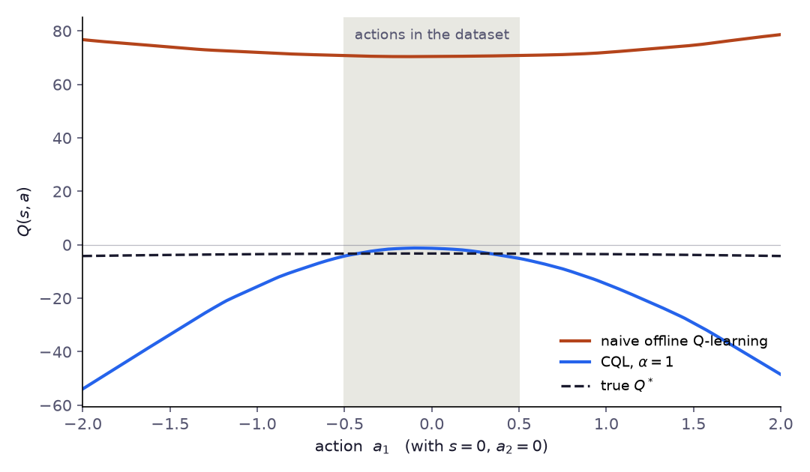

# Глава 4: Консервативное Q-обучение (CQL)

> *«Не доверяй значениям, которых не видел. А если не видел — занижай их.»*

---

## Ещё раз о проблеме

В главе 2 мы увидели, что стандартное Q-обучение на офлайн-данных порождает катастрофически оптимистичные Q-значения для действий вне распределения (OOD). Жадная политика эксплуатирует эти завышенные значения, выбирая действия, которых в датасете никогда не было — и терпит неудачу при развёртывании.

Корень проблемы: обновление Беллмана использует $\max_{a'} Q(s', a')$, перебирая все действия, включая ненаблюдавшиеся. Для таких действий Q-функция обобщается оптимистично.

**Conservative Q-Learning (CQL)** — Kumar et al., NeurIPS 2020 — исправляет это одной элегантной идеей: **добавить регуляризационный член, явно штрафующий Q-значения для действий вне датасета**.

Результат: Q-функция, которая по построению пессимистична для OOD-действий. Жадная политика, видя более низкие значения вне датасета, естественным образом остаётся близко к поведенческой политике — без явного ограничения.

---

## Идея

Стандартное TD-обучение минимизирует:

$$\mathcal{L}_{TD}(\theta) = \mathbb{E}_{(s,a,r,s') \sim \mathcal{D}} \left[ \left( r + \gamma \max_{a'} Q_{\bar\theta}(s', a') - Q_\theta(s, a) \right)^2 \right]$$

CQL добавляет к этой цели два члена:

$$\mathcal{L}_{CQL}(\theta) = \mathcal{L}_{TD}(\theta) + \alpha \cdot \underbrace{\left( \mathbb{E}_{s \sim \mathcal{D},\, a \sim \mu} \left[ Q_\theta(s, a) \right] - \mathbb{E}_{(s,a) \sim \mathcal{D}} \left[ Q_\theta(s, a) \right] \right)}_{\text{консервативный штраф}}$$

где:
- $\mu$ — некоторое распределение над действиями (как правило, равномерное или текущая политика)
- $\alpha > 0$ — гиперпараметр, управляющий силой консерватизма
- Первое математическое ожидание **занижает Q-значения** для действий из $\mu$
- Второе математическое ожидание **завышает Q-значения** для действий из датасета

Иными словами: **минимизировать Q-значения везде, но максимизировать их в точках датасета**. Разрыв между двумя членами — то, что минимизирует CQL: действия из датасета выглядят лучше, чем OOD-действия.

---

## Формализация

### Целевая функция CQL

Точнее, CQL минимизирует следующую регуляризованную ошибку Беллмана:

$$\min_\theta \, \alpha \left( \mathbb{E}_{s \sim \mathcal{D}} \left[ \log \sum_a \exp Q_\theta(s, a) \right] - \mathbb{E}_{(s,a) \sim \mathcal{D}} \left[ Q_\theta(s, a) \right] \right) + \frac{1}{2} \mathcal{L}_{TD}(\theta)$$

Первый член — **log-sum-exp** по всем действиям — гладкая аппроксимация $\max_a Q(s,a)$. Он опускает всю Q-поверхность вниз. Второй член поднимает Q-значения именно в точках датасета.

Определим:

$$\mathcal{R}_{CQL}(\theta) = \mathbb{E}_{s \sim \mathcal{D}} \left[ \log \sum_a \exp Q_\theta(s, a) \right] - \mathbb{E}_{(s,a) \sim \mathcal{D}} \left[ Q_\theta(s, a) \right]$$

Тогда: $\mathcal{L}_{CQL}(\theta) = \mathcal{L}_{TD}(\theta) + \alpha \cdot \mathcal{R}_{CQL}(\theta)$

> **Замечание о множителе $\frac{1}{2}$.** В оригинальной статье CQL написано $\frac{1}{2}\mathcal{L}_{TD}$ — это соглашение о нормировке в рамках их вывода. На практике множитель поглощается скоростью обучения и $\alpha$, поэтому реализации (включая нашу) его опускают.

### Почему Log-Sum-Exp?

Член logsumexp — это аппроксимация максимума через softmax:

$$\log \sum_a \exp Q(s, a) = \max_a Q(s, a) + \log \sum_a \exp(Q(s,a) - \max_a Q(s,a))$$

При температуре → 0 это сходится к $\max_a Q(s,a)$. При конечной температуре выражение дифференцируемо и штрафует всё распределение Q-значений, а не только максимум.

Для непрерывных пространств действий перебрать все $a$ невозможно. CQL аппроксимирует logsumexp через importance sampling:

$$\log \sum_a \exp Q(s, a) \approx \log \mathbb{E}_{a \sim \mu(a|s)} \left[ \frac{\exp Q(s,a)}{\mu(a|s)} \right]$$

где $\mu$ — распределение-предложение (proposal). На практике $\mu$ — либо равномерное над пространством действий, либо текущая политика $\pi_\theta$.

**Зачем вычитать $\log \mu(a|s)$ в коде?** При $\mu = \pi_\theta$ importance-sampling оценка принимает вид:

$$\log \mathbb{E}_{a \sim \pi_\theta} \left[ \frac{\exp Q(s,a)}{\pi_\theta(a|s)} \right] \approx \log \frac{1}{N} \sum_{i=1}^N \frac{\exp Q(s, a_i)}{\pi_\theta(a_i|s)} = \text{logsumexp}_i \left[ Q(s, a_i) - \log \pi_\theta(a_i|s) \right] + \text{const}$$

Именно поэтому в коде перед logsumexp из `q_pi` вычитается `log_pi`: вычитание $\log \pi_\theta(a|s)$ реализует коррекцию importance weights. Без неё мы бы аппроксимировали $\mathbb{E}_{\pi_\theta}[Q]$ (простое среднее Монте-Карло), а не $\log \sum_a \exp Q$ (мягкий максимум, который требует CQL). Равномерным сэмплам нужна такая же поправка. Их плотность на $[-1,1]^d$ равна $2^{-d}$, поэтому код прибавляет к их Q-значениям $d \log 2$. Постоянный сдвиг был бы безвреден, если бы использовались только равномерные сэмплы, но здесь два распределения-предложения усредняются: без поправки равномерный член оценивает $\log \int e^{Q}\,da - d \log 2$, а член политики — $\log \int e^{Q}\,da$, и их относительный вес незаметно меняется. Юнит-тесты в `code/test_cql_td3bc.py` сверяют оценку с интегралом, вычисленным аналитически.

### Теоретическая гарантия

Kumar et al. (2020) доказывают две родственные нижние оценки, и разница между ними важна.

**Теорема 3.1 (только «опускающий» член).** Если штраф содержит только $\mathbb{E}_{a \sim \mu}[Q]$, то для любого $\mu$, support которого лежит внутри support $\hat\pi_\beta$, обученная $\hat{Q}^\pi$ — *поточечная* нижняя оценка: $\hat{Q}^\pi(s, a) \leq Q^\pi(s, a)$ для всех $s \in \mathcal{D}$ и всех $a$, если $\alpha$ достаточно велико.

**Теорема 3.2 (полная целевая функция CQL).** Если добавлен член данных $-\mathbb{E}_{a \sim \hat\pi_\beta}[Q]$ и $\mu = \pi$, Q-значения перестают быть поточечной оценкой — частые в данных действия могут даже переоцениваться, — но ценность политики ограничена снизу:

$$\hat{V}^\pi(s) = \mathbb{E}_{a \sim \pi(\cdot \mid s)}\bigl[\hat{Q}^\pi(s, a)\bigr] \leq V^\pi(s) \quad \forall s \in \mathcal{D}$$

Из двух оценок эта точнее. У неё есть три условия, о которых легко забыть:

- $\alpha$ должно превышать порог, который растёт вместе с ошибкой выборки эмпирического оператора Беллмана, — примерно $C\,R_{max} / \bigl((1-\gamma)\sqrt{|\mathcal{D}(s)|}\bigr)$, умноженное на множитель, зависящий от того, насколько $\pi$ далека от $\hat\pi_\beta$. Только при точном бэкапе достаточно любого $\alpha > 0$.
- Оценка выполняется с вероятностью не ниже $1 - \delta$ по датасету и только для состояний, которые в нём есть.
- Анализ проводится для неподвижной точки точной оценки политики без аппроксимации функций (в приложении он распространён на линейные модели и модели в духе NTK). Нейросеть, обученная конечным числом градиентных шагов, наследует мотивацию, но не гарантию.

Таким образом, теорема утверждает, что консервативна в среднем *целевая функция* CQL. Она не гарантирует, что конкретная нейросетевая реализация занижает каждое Q-значение или что полученная политика безопасна.

**Safe policy improvement (теорема 3.6).** Пусть $\pi^*$ — политика, полученная оптимизацией по Q-функции CQL, а $\hat M$ — эмпирический MDP, заданный данными. С вероятностью не ниже $1 - \delta$

$$J(\pi^*) \geq J(\hat\pi_\beta) - \zeta, \qquad \zeta = \underbrace{2\Bigl(\tfrac{C_{r,\delta}}{1-\gamma} + \tfrac{\gamma R_{max} C_{T,\delta}}{(1-\gamma)^2}\Bigr) \mathbb{E}_{s \sim d^{\pi^*}_{\hat M}}\!\left[\tfrac{\sqrt{|\mathcal{A}|}}{\sqrt{|\mathcal{D}(s)|}} \sqrt{D_{CQL}(\pi^*, \hat\pi_\beta)(s) + 1}\right]}_{\text{потеря из-за ошибки выборки}} - \underbrace{\bigl(J(\pi^*, \hat M) - J(\hat\pi_\beta, \hat M)\bigr)}_{\geq\ \frac{\alpha}{1-\gamma} \mathbb{E}_{s \sim d^{\pi^*}_{\hat M}}[D_{CQL}(\pi^*, \hat\pi_\beta)(s)]}$$

где $D_{CQL}$ измеряет, насколько $\pi^*$ отходит от поведенческой политики. Расхождение входит с обеих сторон. Удаление от данных увеличивает выигрыш, который CQL получает в эмпирическом MDP, но увеличивает и член ошибки выборки, который уменьшается только с ростом числа посещений состояний $|\mathcal{D}(s)|$. При достаточном объёме данных и подходящем $\alpha$ политика CQL гарантированно не намного хуже поведенческой — и может оказаться лучше.

---

## Реализация

> 📄 Полный код: [`cql.py`](https://github.com/corba777/offline-rl-book/blob/main/code/cql.py)

### Сети

CQL обычно строится поверх **Soft Actor-Critic (SAC)** (Haarnoja et al., 2018) — off-policy actor-critic алгоритма, стохастическая политика которого максимизирует награду плюс энтропийный бонус, не дающий ей слишком рано сойтись к одному действию. Архитектура в стиле SAC включает два Q-networks (для снижения переоценки через double-Q), стохастический актор и регуляризацию энтропией.

```python
import math
import torch
import torch.nn as nn
import torch.nn.functional as F
from copy import deepcopy

class QNetwork(nn.Module):
    def __init__(self, state_dim, action_dim, hidden_dim=256):
        super().__init__()
        self.net = nn.Sequential(
            nn.Linear(state_dim + action_dim, hidden_dim), nn.ReLU(),
            nn.Linear(hidden_dim, hidden_dim),              nn.ReLU(),
            nn.Linear(hidden_dim, 1),
        )
    def forward(self, state, action):
        return self.net(torch.cat([state, action], dim=-1)).squeeze(-1)


class GaussianPolicy(nn.Module):
    def __init__(self, state_dim, action_dim, hidden_dim=256):
        super().__init__()
        self.trunk = nn.Sequential(
            nn.Linear(state_dim, hidden_dim), nn.ReLU(),
            nn.Linear(hidden_dim, hidden_dim), nn.ReLU(),
        )
        self.mean_head    = nn.Linear(hidden_dim, action_dim)
        self.log_std_head = nn.Linear(hidden_dim, action_dim)

    def sample(self, state):
        h       = self.trunk(state)
        mean    = self.mean_head(h)
        log_std = self.log_std_head(h).clamp(-4, 2)
        std     = log_std.exp()
        eps     = torch.randn_like(mean)
        raw     = mean + std * eps
        action  = torch.tanh(raw)
        log_prob = (
            torch.distributions.Normal(mean, std).log_prob(raw)
            - torch.log(1 - action.pow(2) + 1e-6)
        ).sum(-1)
        return action, log_prob
```

### Функция потерь CQL

```python
def importance_sampled_logsumexp(q_rand, q_pi, log_pi, action_dim):
    """
    Оценка Монте-Карло для log ∫ exp Q(s,a) da на [-1, 1]^d (Kumar et al., прил. F):
        log( 1/2 E_Unif[exp Q / Unif(a)] + 1/2 E_pi[exp Q / pi(a|s)] )
    Каждое распределение-предложение делится на свою плотность; Unif(a) = 2^{-d}.
    """
    n = q_rand.shape[1]
    log_unif = -action_dim * math.log(2.0)
    weighted = torch.cat([q_rand - log_unif, q_pi - log_pi], dim=1)   # (B, 2N)
    # Один logsumexp по всем 2N сэмплам минус log 2N — это и есть смесь 1/2–1/2.
    return torch.logsumexp(weighted, dim=1) - math.log(2 * n)


def compute_cql_loss(Q, Q_other, Q_tgt, Q_other_tgt, policy,
                     states, actions, rewards, next_states, dones,
                     alpha_cql=1.0, alpha_ent=0.1, gamma=0.99, n_samples=10):
    """
    CQL loss = TD_loss + alpha_cql * CQL_penalty.
    Вызывается дважды — для Q1 и для Q2 (во втором вызове Q/Q_other и целевые сети меняются местами).
    """
    B = states.shape[0]
    dev = states.device

    with torch.no_grad():
        a_next, lp_next = policy.sample(next_states)
        v_next = (torch.min(Q_tgt(next_states, a_next), Q_other_tgt(next_states, a_next))
                  - alpha_ent * lp_next)
        td_target = rewards + gamma * (1 - dones) * v_next

    q_data  = Q(states, actions)
    td_loss = F.mse_loss(q_data, td_target)

    s_rep  = states.unsqueeze(1).expand(-1, n_samples, -1).reshape(B * n_samples, -1)
    a_rand = torch.FloatTensor(B * n_samples, actions.shape[-1]).uniform_(-1, 1).to(dev)
    a_pi, lp_pi = policy.sample(s_rep)
    q_rand = Q(s_rep, a_rand).reshape(B, n_samples)
    q_pi   = Q(s_rep, a_pi).reshape(B, n_samples)
    lse = importance_sampled_logsumexp(q_rand, q_pi,
                                       lp_pi.detach().reshape(B, n_samples),
                                       actions.shape[-1])
    cql_penalty = (lse - q_data).mean()

    loss = td_loss + alpha_cql * cql_penalty
    return loss, {'td_loss': td_loss.item(), 'cql_penalty': cql_penalty.item(),
                  'q_data': q_data.mean().item(), 'q_ood': lse.mean().item()}
```

### Автоматическая настройка alpha

```python
# Настройка alpha через двойственный градиентный спуск
log_alpha_cql = torch.zeros(1, requires_grad=True, device=device)
alpha_opt     = optim.Adam([log_alpha_cql], lr=1e-4)
target_gap = 10.0   # τ: целевой CQL-штраф (разрыв logsumexp, ≥ 0)

# В шаге обновления:
alpha_cql  = log_alpha_cql.exp().item()
alpha_loss = -log_alpha_cql * (cql_penalty - target_gap)
alpha_opt.zero_grad()
alpha_loss.backward()
alpha_opt.step()
```

**Замечание об энтропийном коэффициенте.** В коде используется фиксированное `0.1` для SAC-члена энтропии. В полноценном CQL этот коэффициент тоже настраивается автоматически — с целью поддерживать энтропию политики на уровне $\mathcal{H}^* = -\dim(\mathcal{A})$ (один нат на измерение действия):

```python
# Автонастройка коэффициента энтропии (SAC-стиль)
log_alpha_ent = torch.zeros(1, requires_grad=True, device=device)
ent_opt       = optim.Adam([log_alpha_ent], lr=3e-4)
target_entropy = -action_dim   # H* = -dim(A)

# В шаге обновления политики:
alpha_ent  = log_alpha_ent.exp().item()
loss_pi    = (alpha_ent * log_probs - q_pi).mean()
# ...
ent_loss   = -(log_alpha_ent * (log_probs + target_entropy).detach()).mean()
ent_opt.zero_grad()
ent_loss.backward()
ent_opt.step()
```

Фиксированное `0.1` работает для задачи управления тепловым процессом, но для других сред может потребоваться корректировка. При неопределённости рекомендуется автонастройка.

$\alpha$ — важнейший гиперпараметр CQL. Он управляет компромиссом между консерватизмом и производительностью:

| $\alpha$ | Поведение |
|---|---|
| $\alpha = 0$ | Стандартный SAC — нет консерватизма, эксплуатация OOD |
| $\alpha$ мало (0.1–1.0) | Мягкий консерватизм — допускает некоторое улучшение политики |
| $\alpha$ велико (5–10) | Сильный консерватизм — политика близка к $\pi_\beta$ |
| $\alpha \to \infty$ | Эквивалентно поведенческому клонированию |

---

## Интуиция: ландшафт Q-функции

Представьте Q-функцию как ландшафт над пространством состояние-действие. Стандартное Q-обучение формирует этот ландшафт только через точки данных — между ними ландшафт не ограничен и стремится расти из-за оптимистичного обобщения.

CQL добавляет гравитацию: тянет весь ландшафт вниз, пока TD-потеря удерживает его в точках данных. Результат — ландшафт, высокий в точках датасета и низкий во всех остальных местах.

Политика, действующая жадно по этому ландшафту, предпочитает действия из датасета — не потому что её явно ограничили, а потому что ландшафт естественно направляет её туда.

Рисунок ниже показывает это на игрушечной задаче из главы 2 (скрипт `code/chapter2_4_figures.py`). На тех же данных и с той же TD-целью штраф CQL с $\alpha = 1$ удерживает Q близко к истинной ценности внутри данных (примерно от $-5$ до $-1$ при истинных $-3.3$) и сильно опускает её снаружи — ровно там, где наивная сеть давала самые высокие оценки. CQL намеренно ошибается в пессимистичную сторону: истинная $Q^*$ к краям почти не падает, а оценка CQL опускается там примерно до $-50$.



---

## Как выбрать α

Правильное значение $\alpha$ зависит от качества датасета, масштаба наград и доверия к поведенческой политике.

### Шаг 1 — Проверьте знак CQL-штрафа

Перед настройкой убедитесь, что штраф положителен: $\mathbb{E}_\mu[Q] > \mathbb{E}_D[Q]$ должно выполняться после нескольких сотен обновлений. Если штраф отрицателен с самого начала — сэмплирование OOD-действий сломано.

### Шаг 2 — Грид-поиск по логарифмической шкале

```python
for alpha in [0.1, 0.5, 1.0, 5.0, 10.0]:
    agent = CQLAgent(..., alpha_cql=alpha)
    train_agent(agent, loader, n_epochs=80)
    res = evaluate(agent, env, ...)
    print(f"alpha={alpha:.1f}  reward={res['reward_mean']:.2f}")
```

Пять прогонов дают грубую карту компромисса награда–консерватизм.

### Шаг 3 — Читайте диагностику

| Симптом | Диагноз | Действие |
|---|---|---|
| Политика ≈ BC, нет улучшения | $\alpha$ слишком велик — Q подавлен везде | Уменьшить в 5–10× |
| Q-значения расходятся | $\alpha$ слишком мал — OOD не контролируется | Увеличить в 2–5× |
| CQL-штраф уходит в минус | $\alpha$ слишком мал | Увеличить $\alpha$ |
| CQL-штраф >> TD-потеря | $\alpha$ слишком велик или проблема масштаба наград | Нормализовать награды; уменьшить $\alpha$ |

### Типичные значения по типу данных

| Тип датасета | Стартовый $\alpha$ | Обоснование |
|---|---|---|
| Только экспертные (почти оптимальные) | 0.1 – 0.5 | Поведенческая политика хороша; сильный консерватизм вредит |
| Смешанное качество (эксперт + случайный) | 1.0 – 2.0 | Безопасное значение по умолчанию |
| Случайные / шумные операторские данные | 2.0 – 5.0 | Высокий шум → больше OOD-риска → больше консерватизма |
| Промышленные логи с несколькими режимами | 1.0 + авто-$\alpha$ | Лагранжиан адаптируется к разным режимам |

### Когда использовать автонастройку

Используйте `auto_alpha=True` если: (а) политика будет развёрнута в реальной системе и безопасность важнее производительности, или (б) датасет охватывает несколько режимов работы с разными масштабами наград. Задайте `target_gap` положительным значением в шкале logsumexp-разрыва (например, `10.0`).

Используйте фиксированный $\alpha$ если: проводите воспроизводимые офлайн-эксперименты, или уже нашли хорошее значение грид-поиском.

---

## CQL vs TD3+BC

TD3+BC (Fujimoto & Gu, 2021) — более простая альтернатива, добавляющая BC-член прямо в потерю политики:

$$\pi^* = \arg\max_\pi \mathbb{E}_{(s,a) \sim \mathcal{D}} \left[ \lambda Q(s, \pi(s)) - (\pi(s) - a)^2 \right]$$

| | CQL | TD3+BC |
|---|---|---|
| Где живёт пессимизм | Q-функция | Целевая функция политики |
| OOD Q-значения | Явно занижаются | Не изменяются |
| Теоретическая гарантия | Да (нижняя оценка) | Нет |
| Гиперпараметры | $\alpha$ | $\lambda$ |
| Сложность реализации | Средняя | Низкая |

TD3+BC — хорошая отправная точка для детерминированных политик. CQL более строго обоснован и обычно сильнее на сложных задачах.

---

## Практические советы

**Нормализуйте наблюдения.** CQL чувствителен к масштабу. Всегда нормализуйте состояния по статистикам датасета.

**Начинайте с $\alpha = 1.0$.** Безопасное значение по умолчанию. Если политика слишком консервативна — уменьшайте. Если Q-значения расходятся — увеличивайте.

**Используйте Double-Q.** Всегда используйте две Q-сети и берите минимум. Это снижает переоценку независимо от CQL — два механизма дополняют друг друга.

**Мониторьте CQL-штраф.** Логируйте `E_μ[Q] - E_D[Q]` во время обучения. Он должен быть положительным и стабильным. Если уходит в минус — $\alpha$ слишком мало.

**Совет для промышленных данных.** Если датасет содержит несколько режимов работы (остановленный/медленный/быстрый), рассмотрите обучение отдельных агентов CQL для каждого режима или добавление режима как признака состояния.

---

## Ограничения

**Требует разметки наград.** В отличие от BC, CQL нужны кортежи $(s, a, r, s')$. Если датасет содержит только $(s, a, s')$ — необходимо определить функцию вознаграждения.

**Чувствителен к масштабу наград.** Баланс между TD-потерей и CQL-штрафом зависит от величины наград. Если награды большие (например, в тысячах), TD-потеря доминирует и CQL теряет эффект. Нормализуйте награды в $[-1, 1]$ или $[0, 1]$.

**Консервативен по построению.** CQL не превзойдёт поведенческую политику значительно в регионах с редкими данными. Он создан для безопасности, а не для агрессивной экстраполяции. Для задач, требующих существенного выхода за пределы датасета, более уместны модельные методы (Глава 8).

**Непрерывные пространства действий требуют сэмплирования.** Аппроксимация logsumexp требует сэмплирования — как правило, 10 случайных действий и 10 действий политики на состояние. Каждый сэмпл делится на плотность распределения, из которого он взят ($2^{-d}$ для равномерных действий, $\pi(a|s)$ для действий политики); после этого один logsumexp по всем 20 взвешенным сэмплам минус $\log 20$ — это в точности оценка смеси 1/2–1/2 для $\log \int e^{Q}\,da$ из статьи Kumar et al. Дисперсия такой оценки растёт с размерностью действия, поэтому в статье вариант на основе политики оказывается устойчивее в пространствах действий большой размерности. Сэмплирование также добавляет вычислительных затрат по сравнению с BC или TD3+BC.

---

## Итоги

| Свойство | CQL |
|---|---|
| Необходимые данные | Переходы $(s, a, r, s')$ с наградами |
| Целевая функция | TD-потеря + CQL штраф (logsumexp − Q датасета) |
| Обработка OOD | Явная: Q-значения занижаются для OOD-действий |
| Теоретическая гарантия | Нижняя оценка ценности политики в состояниях датасета (при предположениях статьи) |
| Ключевой гиперпараметр | $\alpha$ (сила консерватизма) |

CQL закрывает разрыв между поведенческим клонированием и полным offline RL. Он использует информацию о награде для улучшения над поведенческой политикой, а пессимизм относительно OOD-действий предотвращает катастрофические отказы стандартного Q-обучения.

Остающееся ограничение: CQL является **безмодельным**. Глава 5 (IQL) уточняет идею пессимизма по значениям. Глава 8 (MOPO) показывает, как обучение модели мира позволяет генерировать синтетические данные — расширяя эффективный датасет за пределы собранного.

---

## Литература

- Kumar, A., Zhou, A., Tucker, G., & Levine, S. (2020). *Conservative Q-Learning for Offline Reinforcement Learning.* NeurIPS. [arXiv:2006.04779](https://arxiv.org/abs/2006.04779).
- Fujimoto, S., & Gu, S. (2021). *A Minimalist Approach to offline RL (TD3+BC).* NeurIPS. [arXiv:2106.06860](https://arxiv.org/abs/2106.06860).
- Haarnoja, T. et al. (2018). *Soft Actor-Critic.* ICML. [arXiv:1801.01290](https://arxiv.org/abs/1801.01290).
- Levine, S. et al. (2020). *Offline Reinforcement Learning: Tutorial, Review, and Perspectives.* [arXiv:2005.01643](https://arxiv.org/abs/2005.01643).
