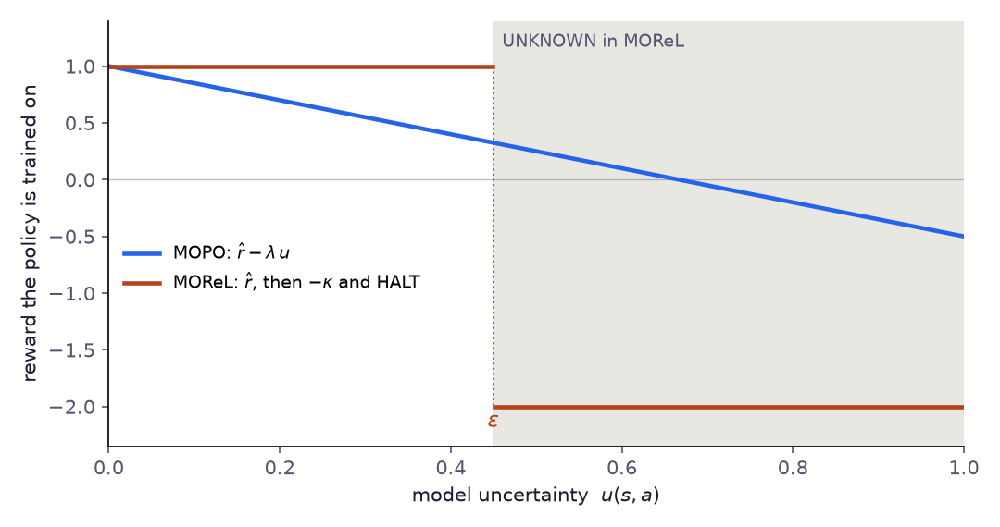

# Глава 8: Модельный Offline RL (MOPO, MOReL)

> *«Если нельзя провести новые эксперименты — постройте симулятор из имеющихся данных и экспериментируйте внутри него. Но помните: симулятор лжёт там, где вы никогда не бывали.»*

---

## За пределами безмодельных методов

Безмодельные методы глав 4–7 подходили к offline RL по-разному. CQL занижает Q-значения для OOD-действий; IQL вообще к ним не обращается; TD3+BC и AWAC удерживают актора у данных; Decision Transformers обходятся без функции ценности.

У всех них общее фундаментальное ограничение: **они могут использовать только переходы, собранные поведенческой политикой**. Если критически важные области пространства состояние-действие просто отсутствуют в датасете, безмодельным методам не на чем учиться.

Модельный offline RL предлагает иной подход: **обучить динамику системы**, а затем генерировать синтетические переходы «в уме». Вместо того чтобы ограничиваться существующими данными, строится мысленная модель и *воображается*, что произойдёт при новых действиях.

Это мощно — но опасно. Модель ошибается там, где данных мало, и политика, эксплуатирующая ошибки модели, провалится так же катастрофически, как и та, что эксплуатирует ошибки Q-функции. Два алгоритма этой главы решают проблему по-разному:

- **MOPO** (Yu et al., NeurIPS 2020) — штрафовать синтетические награды за неопределённость модели. Политика может свободно исследовать, но неопределённые регионы становятся непривлекательными.
- **MOReL** (Kidambi et al., NeurIPS 2020) — построить явную границу. Внутри хорошо смоделированных регионов агент оптимизирует нормально; снаружи — получает фиксированный большой штраф.

Одна цель, разная геометрия пессимизма.

---

## Часть I: MOPO

### Идея

**Model-Based Offline Policy Optimization (MOPO)** работает в три фазы:

1. **Обучить модель динамики** $\hat{T}(s' | s, a)$ из офлайн-датасета с помощью **ансамбля** нейронных сетей. Каждая модель ансамбля делает немного разные предсказания. Где они согласны — модель уверена. Где расходятся — неопределённость высокая.

2. **Генерировать синтетические rollouts**, ветвясь от реальных состояний. Стартуем из реального состояния $s \in \mathcal{D}$, выбираем действие, предсказываем $s'$ моделью, повторяем $h$ шагов. На каждом шаге **штрафуем награду** за неопределённость модели:

$$\tilde{r}(s, a) = \hat{r}(s, a) - \lambda \cdot u(s, a)$$

3. **Обучить стандартный RL-алгоритм** (SAC) на объединённых реальных + синтетических данных. Штраф гарантирует, что агент избегает ненадёжных регионов.

Результат: переходов для обучения становится гораздо больше, чем в исходном датасете, — насколько больше, зависит от длины и частоты rollouts, — со встроенной защитой от эксплуатации ошибок модели.

### Формализация

#### Ансамбль динамики

Обучаем ансамбль из $N$ вероятностных моделей $\{\hat{T}_i\}_{i=1}^N$, каждая возвращает гауссово распределение над следующими состояниями:

$$\hat{T}_i(s' | s, a) = \mathcal{N}\left(s + \mu_{\theta_i}(s, a), \; \sigma^2_{\theta_i}(s, a)\right)$$

Ключевые решения:

- **Остаточное предсказание**: предсказываем $\Delta s = s' - s$, а не $s'$ напрямую. Это даёт сети базовую линию «ничего не изменилось» — сети нужно обучиться только поправке.
- **NLL-обучение**: минимизация отрицательного логарифма правдоподобия $-\log \hat{T}_i(s' | s, a)$ обучает одновременно среднее (точность) и дисперсию (откалиброванная неопределённость).
- **Bootstrap-сэмплирование**: каждая модель обучается на собственной бутстрап-выборке — 80% от размера датасета, с возвращением, — что обеспечивает разнообразие ансамбля.

#### Оценка неопределённости

Для данной пары $(s, a)$ каждая модель предсказывает среднее $\hat{s}'_i$. **Эпистемическая неопределённость** — «насколько модели расходятся?»:

$$u(s, a) = \left\| \text{Std}_{i=1}^N \left[ \hat{s}'_i \right] \right\|_2$$

Это стандартное отклонение предсказаний по ансамблю, свёрнутое в скаляр через L2-норму.

**Почему расхождение ансамбля работает**: если все модели видели похожие данные рядом с $(s, a)$, они сходятся к похожим предсказаниям — малое $u$. Если данных мало, bootstrap приводит к тому, что каждая модель выучивает разные паразитные паттерны — большое $u$. Это ключевой механизм: неопределённость высокая именно там, где данных нет.

#### Цель MOPO

MOPO строит **пессимистическое MDP** $\tilde{\mathcal{M}}$ со штрафными наградами и оптимизирует политику в нём:

$$\tilde{r}(s, a) = \hat{r}(s, a) - \lambda \cdot u(s, a)$$

$$\pi^* = \arg\max_\pi \; \mathbb{E}_{\tilde{\mathcal{M}}} \left[ \sum_t \gamma^t \tilde{r}(s_t, a_t) \right]$$

Теория MOPO (Yu et al., 2020) опирается на одно предположение. Назовём $u$ **допустимой** (admissible) оценкой ошибки, если она ограничивает сверху ошибку модели в каждой паре $(s, a)$ — расстояние между предсказанным и истинным распределениями следующего состояния, масштабированное так, что $\lambda u$ ограничивает возникающую ошибку в ценности. При этом предположении штрафованный MDP консервативен: его return сам является нижней оценкой истинного,

$$J(\pi) \geq J_{\tilde{\mathcal{M}}}(\pi) \quad \text{для любой политики } \pi,$$

а найденная MOPO политика $\hat\pi$ почти не хуже любой политики, которая остаётся там, где модель точна:

$$J(\hat\pi) \geq \sup_{\pi} \bigl\{ J(\pi) - 2\lambda\, \epsilon_u(\pi) \bigr\}, \qquad \epsilon_u(\pi) = \mathbb{E}_{(s,a) \sim \rho^{\pi}_{\hat T}}\bigl[u(s, a)\bigr],$$

где $\rho^{\pi}_{\hat T}$ — дисконтированная частота посещений $\pi$ в обученной модели; это тот же объект, что $d^\pi$ в главе 2, только для $\hat M$ вместо реального MDP. Если взять в качестве $\pi$ поведенческую политику, неопределённость модели для которой должна быть мала, MOPO должен работать примерно не хуже данных, на которых учился.

Оговорка — само предположение. Ничто не гарантирует, что разброс ансамбля ограничивает сверху истинную ошибку модели: члены ансамбля могут соглашаться и всё равно ошибаться, особенно далеко от данных. Гарантия настолько хороша, насколько хороша оценка неопределённости. *Замечание:* в оригинальной статье $u$ — максимум по ансамблю нормы **обученного (алеаторного) std**; здесь используется **разброс предсказаний ансамбля** (std средних) — распространённый вариант реализации, близкий к USAD в MOReL. Ни тот, ни другой не обязаны быть допустимыми. Для вероятностного ансамбля два вида неопределённости разделяются явно: полная предсказательная дисперсия равна $\operatorname{Var}(s') = \mathbb{E}_m[\operatorname{Var}(s' \mid m)] + \operatorname{Var}_m(\mathbb{E}[s' \mid m])$, где первый член — выученный каждой моделью шум процесса (алеаторная часть), а второй — разногласие моделей (эпистемическая). Только второй уменьшается с ростом данных, и только он что-то говорит об удалённости от данных. Что бы ни использовалось, сверьте это с реальностью: на отложенных переходах и на переходах из сдвинутого режима неопределённость должна расти и падать вместе с фактической ошибкой предсказания. Разброс может сигнализировать только о тех ошибках, в которых члены ансамбля расходятся. Члены с общей структурой — одной и той же физической моделью, одними входными признаками, одними пробелами в данных — ошибаются согласованно, и их согласие выглядит как уверенность ровно там, где её быть не должно. Глава 10 показывает это на деле: все члены гибридного ансамбля использовали одну и ту же физику, не учитывавшую транспортную задержку, и неопределённость ансамбля не сигнализировала о возникших из-за этого ошибках в контуре наполнителя. Обойти ненадёжную $u$ можно, если она вовсе не нужна. COMBO ([Yu et al., 2021](https://arxiv.org/abs/2102.08363)) сохраняет модельные rollouts, но отказывается от штрафа за неопределённость: критик в стиле CQL обучается на смеси реальных и модельных переходов, Q-значения снижаются на парах состояние–действие из модели и поднимаются на залогированных. Ошибка модели тогда делает соответствующие синтетические переходы менее ценными, вместо того чтобы полагаться на то, что её заметит ансамбль, — ценой обычного консерватизма CQL и его $\alpha$, который нужно подбирать.

#### Ветвящиеся rollouts

Вместо того чтобы разворачивать полные эпизоды с нуля, MOPO использует **ветвящиеся rollouts**:

1. Сэмплируем начальное состояние $s_0$ из реального датасета $\mathcal{D}$.
2. Разворачиваем на $h$ шагов с моделью и текущей политикой.
3. Каждый синтетический переход $(s_t, a_t, \tilde{r}_t, s_{t+1})$ добавляется в синтетический буфер.

Старт из реальных состояний гарантирует, что rollout начинается в хорошо смоделированном регионе. Короткий горизонт $h$ ограничивает накопление ошибок. Штрафная награда препятствует посещению плохо смоделированных регионов внутри rollout.

### Реализация

> 📄 Полный код: [`mopo.py`](https://github.com/corba777/offline-rl-book/blob/main/code/mopo.py)

#### Вероятностная модель динамики

```python
class ProbabilisticDynamicsNet(nn.Module):
    """
    (s, a) -> (mean, log_var) для s'.
    Предсказывает остатки: s'_pred ~ N(s + mean(s,a), exp(log_var(s,a)))
    Обучается через NLL, а не MSE — сеть сама учится своей неопределённости.
    """
    def __init__(self, state_dim, action_dim, hidden_dim=256):
        super().__init__()
        self.trunk = nn.Sequential(
            nn.Linear(state_dim + action_dim, hidden_dim), nn.SiLU(),
            nn.Linear(hidden_dim, hidden_dim), nn.SiLU(),
            nn.Linear(hidden_dim, hidden_dim), nn.SiLU(),
        )
        self.mean_head    = nn.Linear(hidden_dim, state_dim)
        self.log_var_head = nn.Linear(hidden_dim, state_dim)
        self.min_log_var  = nn.Parameter(-10.0 * torch.ones(state_dim))
        self.max_log_var  = nn.Parameter(0.5  * torch.ones(state_dim))

    def forward(self, state, action):
        """Возвращает предсказанный остаток s' - s (mean) и его log-дисперсию."""
        h       = self.trunk(torch.cat([state, action], -1))
        mean    = self.mean_head(h)
        log_var = self.log_var_head(h)
        # Мягкое ограничение обучаемыми границами; без него они ни на что не влияют
        log_var = self.max_log_var - F.softplus(self.max_log_var - log_var)
        log_var = self.min_log_var + F.softplus(log_var - self.min_log_var)
        return mean, log_var
```

Активация `SiLU` (swish) превосходит ReLU для моделей динамики — более гладкие градиенты помогают аппроксимировать плавные физические переходы.

#### NLL-обучение

```python
    def nll_loss(self, state, action, next_state):
        mean, log_var = self.forward(state, action)
        residual = next_state - state
        var      = log_var.exp()
        # NLL = 0.5 * [ log_var + (residual - mean)² / var ]
        nll      = 0.5 * (log_var + (residual - mean).pow(2) / var)
        loss     = nll.sum(-1).mean()
        bound_reg = 0.01 * (self.max_log_var.sum() - self.min_log_var.sum())
        return loss + bound_reg
```

Обучение через NLL, а не MSE критично. MSE обучает только среднее, оставляя дисперсию неконтролируемой. NLL совместно обучает среднее (минимизация ошибки предсказания) и дисперсию (калибровка уверенности) — делая обученное $\sigma^2$ значимым как прокси неопределённости.

#### Синтетические rollouts со штрафом за неопределённость

```python
    def generate_synthetic_data(self, real_states):
        state = real_states[random_idx]

        for step in range(self.rollout_horizon):
            action, _   = self.policy.sample(state)
            next_state, uncertainty = self.ensemble.predict_with_uncertainty(
                state, action)
            reward = self._model_reward(state, action, next_state)

            # Ключевая строка: штрафуем награду за эпистемическую неопределённость
            penalized_reward = reward - self.lam * uncertainty
            state = next_state
```

Одно вычитание `reward - self.lam * uncertainty` — это то, что превращает наивный model-based RL (ошибки модели легко эксплуатировать) в MOPO (эксплуатировать их гораздо труднее).

---

## Часть II: MOReL

### Иная геометрия пессимизма

MOPO использует **непрерывный** штраф: чем дальше от данных, тем больше вычитается из награды. Политика всё равно может заходить в неопределённые регионы — они просто кажутся менее привлекательными.

MOReL использует **дискретный** подход: разделяет пространство состояние-действие на «известные» и «неизвестные» регионы и применяет **жёсткий штраф** $\kappa$ в неизвестном регионе. Это создаёт резкую границу, а не градиент.

На рисунке обе награды показаны как функции неопределённости модели (`code/chapter1_5_8_figures.py`). У MOPO награда плавно снижается с ростом неопределённости, поэтому достаточно большой предсказанный выигрыш всё ещё может заманить политику в неопределённую область. MOReL не трогает награду до порога $\varepsilon$, а затем заменяет её фиксированным $-\kappa$ и останавливает rollout: никакой выигрыш этого не компенсирует.



**Model-Based Offline Reinforcement Learning (MOReL)** — Kidambi et al., NeurIPS 2020 — строит **Пессимистическое MDP (P-MDP)** непосредственно из офлайн-данных со встроенным поглощающим состоянием отказа для OOD-переходов.

### Построение P-MDP

Пусть $\mathcal{D}$ — офлайн-датасет. MOReL определяет порог $\epsilon$ на неопределённость предсказания и разделяет пространство:

$$\text{KNOWN}   = \{(s,a) : u(s,a) \leq \epsilon\}$$
$$\text{UNKNOWN} = \{(s,a) : u(s,a) > \epsilon\}$$

**Пессимистическое MDP** $\tilde{\mathcal{M}} = (\mathcal{S} \cup \{s_\perp\}, \mathcal{A}, \tilde{T}, \tilde{r}, \gamma)$:

$$\tilde{T}(s' | s, a) = \begin{cases} \hat{T}(s' | s, a) & \text{если } (s,a) \in \text{KNOWN} \\ \delta(s_\perp) & \text{если } (s,a) \in \text{UNKNOWN} \end{cases}$$

$$\tilde{r}(s, a) = \begin{cases} \hat{r}(s, a) & \text{если } s \neq s_\perp \\ -\kappa & \text{если } s = s_\perp \end{cases}$$

где $s_\perp$ — поглощающее состояние отказа, а $\kappa > 0$ — большой штраф. Попав в неизвестный регион, агент переходит в $s_\perp$ и получает $-\kappa$ на каждом последующем шаге — сильнейший стимул избегать неизвестного. В реализации ниже поглощающее состояние заменено завершением эпизода: переход в UNKNOWN получает однократный штраф $-\kappa$ и `done=True`, поэтому TD-цель не несёт будущей ценности. При $\gamma < 1$ обе формы эквивалентны с точностью до масштаба штрафа: $-\kappa$ на каждом шаге бесконечно стоит столько же, сколько однократный $-\kappa/(1-\gamma)$.

### Теоретическая гарантия

**Следствие (Kidambi et al., 2020).** Пусть планировщик возвращает политику $\pi_{out}$, субоптимальную в P-MDP не более чем на $\epsilon_\pi$, а $\alpha$ ограничивает ошибку модели по полной вариации на области KNOWN. Тогда для оптимальной политики $\pi^*$ реального MDP

$$J(\pi^*) - J(\pi_{out}) \leq \epsilon_\pi + \frac{4 R_{max}}{1-\gamma}\, D_{TV}(\rho_0, \hat\rho_0) + \frac{4\gamma R_{max}}{(1-\gamma)^2}\, \alpha + \frac{2 R_{max}}{1-\gamma}\, \mathbb{E}\bigl[\gamma^{T^{\pi^*}_U}\bigr],$$

где $T^{\pi^*}_U$ — момент, когда *оптимальная* политика впервые попадает в область UNKNOWN в реальном MDP.

Слагаемые называют источники субоптимальности: неточное планирование, несовпадение распределения начальных состояний, ошибку модели внутри KNOWN и — последнее слагаемое — то, как скоро оптимальной политике пришлось бы покинуть данные. Если оптимальная политика остаётся в хорошо покрытых состояниях, это слагаемое исчезает; если ей нужно пройти через области, которых в данных не было, никакой офлайн-метод её не найдёт, и в статье показано, что в этом смысле оценка точна.

Как и у MOPO, эта гарантия опирается на правильный детектор ошибки: область KNOWN действительно должна удерживать ошибку модели ниже $\alpha$. Если детектор — разброс ансамбля, это предположение, а не факт. Практически методы различаются формой пессимизма: у MOReL граница жёсткая и требует аккуратного выбора $\epsilon$.

### Реализация

> 📄 Полный код: [`morel.py`](https://github.com/corba777/offline-rl-book/blob/main/code/morel.py)

MOReL использует ту же архитектуру ансамбля что и MOPO (`ProbabilisticDynamicsNet`, `DynamicsEnsemble`). Специфичные для MOReL дополнения:

**Шаг 1 — Калибровка epsilon по данным in-distribution:**

```python
# После обучения ансамбля — установить epsilon на 80-м перцентиле
# неопределённости на реальных переходах из датасета.
epsilon = ensemble.calibrate_epsilon(dataset, percentile=80.0)
```

Порог на 80-м перцентиле по построению помечает KNOWN 80% переходов датасета. Это утверждение об оценке неопределённости, а не о модели: перцентильный порог не гарантирует, что внутри KNOWN модель точна. Порог, откалиброванный по ошибке, выбирал бы $\epsilon$ так, чтобы на отложенных переходах фактическая ошибка модели оставалась ниже допуска всякий раз, когда $u \le \epsilon$, — и он хорош ровно настолько, насколько отложенные данные похожи на те области, куда пойдёт политика.

**Шаг 2 — Rollouts в P-MDP с жёстким HALT:**

```python
# Внутри MOReLAgent.generate_synthetic_data():
for step in range(self.rollout_horizon):
    action, _ = self.policy.sample(state[active])
    next_state, uncertainty = self.ensemble.predict_with_uncertainty(
        state[active], action)

    # Жёсткая граница: если OOD — завершить с штрафом
    ood = uncertainty > self.epsilon

    reward = torch.where(
        ood,
        -self.kappa * torch.ones(ood.shape[0], device=device),
        self._model_reward(state[active], action, next_state)
    )
    done = ood.float()

    # Поглощающее состояние: остановленные rollouts остаются на месте
    next_state_out = torch.where(
        ood.unsqueeze(-1), state[active], next_state)

    # Деактивировать остановленные rollouts
    active[active.nonzero(as_tuple=True)[0][ood]] = False
```

Ключевое отличие от MOPO: вместо вычитания непрерывного штрафа OOD-переходы немедленно завершаются с `done=True` и наградой $-\kappa$. Q-функция видит нулевое будущее вознаграждение после таких переходов.

**HALT должен действительно отпугивать.** Когда награды неположительны, как в тепловой задаче и задаче нанесения покрытия, ранняя остановка может оказаться выгодной: HALT обрывает поток отрицательных наград. В пессимистическом MDP из статьи состояние HALT даёт $-R_{max}$ на каждом шаге; в форме с завершением эпизода, которая используется здесь, однократный штраф $\kappa$ должен превышать $|r_{min}|/(1-\gamma)$ — ценность вечного пребывания в состоянии с худшей наградой, — иначе агент может научиться стремиться к границе. При нормированных наградах и $\gamma = 0.99$ это около $100\,|r_{min}|$, поэтому $\kappa = 100$ по умолчанию в `morel.py` — нижняя граница, а не надёжный запас.

### Выбор $\epsilon$

| $\epsilon$ | Эффект |
|---|---|
| Очень малый | Крошечный известный регион — агент ограничен рядом с поведенческой политикой (≈ BC) |
| Умеренный (по умолчанию) | Включает хорошо смоделированные экстраполяции |
| Очень большой | Всё пространство «известно» — возврат к неограниченному MBRL |

**Практика**: устанавливайте $\epsilon$ на уровне 70–80-го перцентиля неопределённости на данных in-distribution.

```python
# Калибровка epsilon по данным in-distribution
with torch.no_grad():
    s_cal = torch.FloatTensor(dataset['states'][:2000]).to(device)
    a_cal = torch.FloatTensor(dataset['actions'][:2000]).to(device)
    _, u_cal = ensemble.predict_with_uncertainty(s_cal, a_cal)
epsilon = torch.quantile(u_cal, 0.80).item()
print(f"Откалиброванный epsilon = {epsilon:.4f}")
```

---

## MOPO, MOReL и безмодельные методы

| | CQL | IQL | MOPO | MOReL |
|---|---|---|---|---|
| Использует модель | Нет | Нет | Да | Да |
| Обработка OOD | Занижает Q | Никогда не запрашивает OOD | Непрерывный штраф $-\lambda u$ | Жёсткая граница + $-\kappa$ |
| Аугментация данных | Нет | Нет | Да | Да |
| Геометрия пессимизма | Мягкая (штраф Q) | Структурная (V-сеть) | Мягкая (штраф награды) | Жёсткая (поглощающее состояние) |
| Теоретическая гарантия | Нижняя оценка ценности политики | Формальной нет; in-sample по построению | Нижняя оценка $J(\pi)$, если $u$ допустима | Оценка субоптимальности, если детектор KNOWN/UNKNOWN верен |
| Гиперпараметры | $\alpha$ | $\tau, \beta$ | $\lambda, h, N$ | $\epsilon, \kappa, h, N$ |
| Лучше всего для | Плотные датасеты | Стабильное обучение | Разреженные, гладкая динамика | Жёсткая граница доверия к модели |

---

## Выбор гиперпараметров

### MOPO: $\lambda$ (вес штрафа за неопределённость)

| $\lambda$ | Поведение |
|---|---|
| $\lambda = 0$ | Нет штрафа — полное доверие модели (опасно) |
| $\lambda = 0.5$ | Лёгкий штраф — для высококачественных моделей |
| $\lambda = 1.0$ | По умолчанию — разумный пессимизм |
| $\lambda = 3.0$+ | Сильный штраф — для зашумлённых данных |
| $\lambda \to \infty$ | Возврат к безмодельному обучению на реальных данных |

### Оба: $h$ (горизонт rollout)

- `h=1`: однощаговые предсказания. Безопаснее всего, но ограниченная аугментация.
- `h=5`: по умолчанию. Хороший баланс аугментации vs накопление ошибок.
- `h=10+`: только при очень высокой точности модели.

**Грубый ориентир**: если у модели ошибка $\epsilon_1$ за шаг, то за $h$ шагов ошибка растёт не медленнее $h \cdot \epsilon_1$ (и быстрее, если динамика её усиливает). Выбирайте $h$ так, чтобы накопленная ошибка оставалась малой по сравнению с изменениями состояния, важными для награды, и проверяйте это напрямую, сравнивая многошаговые rollouts модели с отложенными траекториями из логов.

### Оба: $N$ (размер ансамбля)

- `N=3`: минимум для значимой неопределённости (не рекомендуется в продакшене).
- `N=5`: по умолчанию.
- `N=7–10`: лучше оценки, пропорциональные вычислительные затраты.

---

## Практические советы

**Нормализуйте всё.** Состояния, действия, награды — всё нормализуется до обучения модели динамики. Входные данные в $[-1, 1]$ или $[0, 1]$ критически важны для сходимости.

**Остаточное предсказание обязательно.** Всегда предсказывайте $\Delta s = s' - s$. Для медленно изменяющихся систем (большинство промышленных процессов) остаток на порядки меньше абсолютного состояния.

**Мониторьте расхождение ансамбля.** Отношение `u(OOD) / u(in-distribution)` должно быть >> 1. Если близко к 1 — ансамбль недостаточно разнообразен.

**Периодически перегенерируйте синтетические данные.** По мере улучшения политики она посещает другие регионы. Перегенерируйте каждые 5–10 эпох SAC.

**Для промышленных приложений**: если у вас есть физический симулятор (хотя бы приближённый), обучайте нейронный ансамбль на остатках между физической моделью и реальными данными. Этот гибридный подход часто требует значительно меньше офлайн-данных. Глава 9 развивает эту идею в полноценную методологию.

---

## Ограничения

**Ошибки модели накапливаются.** На $h$ шагах однощаговые ошибки суммируются. Штраф MOPO или жёсткая граница MOReL снижают риск, но очень длинные горизонты остаются проблематичными.

**Высокоразмерные наблюдения.** Обучение $T(s' | s, a)$ по пикселям требует значительно больше данных, чем по компактным представлениям состояния.

**Вычислительные затраты масштабируются с размером ансамбля.** Обучение и инференс требуют $N \times$ вычислений по сравнению с одной моделью.

**Модель вознаграждения.** В нашей реализации функция вознаграждения известна аналитически. На практике награды тоже могут потребовать обучения — ещё один источник ошибок.

**Разнообразие ансамбля хрупко.** Если все модели сходятся к одному решению, оценки неопределённости обрушиваются до нуля — штраф MOPO и граница MOReL становятся бесполезными.

---

## Итоги

| Свойство | MOPO | MOReL |
|---|---|---|
| Необходимые данные | Переходы $(s, a, r, s')$ | Переходы $(s, a, r, s')$ |
| Ключевой механизм | Неопределённость ансамбля как мягкий штраф награды | Жёсткое разделение known/unknown через порог $\epsilon$ |
| Пессимизм | Непрерывный: $\tilde{r} = r - \lambda u$ | Дискретный: поглощающее состояние за $\epsilon$ |
| Теоретическая гарантия | Нижняя оценка $J(\pi)$, если $u$ допустима | Оценка субоптимальности, если детектор верен |
| Лучше для | Максимизация производительности, гладкая динамика | Жёсткая остановка на границе данных |

Оба алгоритма представляют качественный сдвиг от безмодельного offline RL: вместо ограничения политики рядом с данными мы расширяем данные на большую область пространства состояние-действие. Ансамбль удерживает это расширение под контролем: агент доверяет модели в основном там, где члены ансамбля согласны, — и это настолько надёжно, насколько откалиброван сам ансамбль.

Следующий вопрос: можно ли делать лучше, чем обучать динамику с нуля? Если мы знаем физику системы — законы сохранения, дифференциальные уравнения, свойства материала — мы можем встроить эти знания прямо в модель и резко сократить объём необходимых данных. Это тема Главы 9: Physics-Informed offline RL.

---

## Литература

- Yu, T., Kumar, A., Rafailov, R., Rajeswaran, A., Levine, S., & Finn, C. (2021). *COMBO: Conservative Offline Model-Based Policy Optimization.* NeurIPS. [arXiv:2102.08363](https://arxiv.org/abs/2102.08363).
- Yu, T., Thomas, G., Yu, L., Ermon, S., Zou, J., Levine, S., Finn, C., & Ma, T. (2020). *MOPO: Model-Based Offline Policy Optimization.* NeurIPS. [arXiv:2005.13239](https://arxiv.org/abs/2005.13239).
- Kidambi, R., Rajeswaran, A., Netrapalli, P., & Kakade, S. (2020). *MOReL: Model-Based Offline Reinforcement Learning.* NeurIPS. [arXiv:2005.05951](https://arxiv.org/abs/2005.05951).
- Janner, M., Fu, J., Zhang, M., & Levine, S. (2019). *When to Trust Your Model: Model-Based Policy Optimization.* NeurIPS. [arXiv:1906.08253](https://arxiv.org/abs/1906.08253).
- Chua, K., Calandra, R., McAllister, R., & Levine, S. (2018). *Deep Reinforcement Learning in a Handful of Trials using Probabilistic Dynamics Models.* NeurIPS. [arXiv:1805.12114](https://arxiv.org/abs/1805.12114).
- Lakshminarayanan, B., Pritzel, A., & Blundell, C. (2017). *Simple and Scalable Predictive Uncertainty Estimation using Deep Ensembles.* NeurIPS. [arXiv:1612.01474](https://arxiv.org/abs/1612.01474).
- Levine, S. et al. (2020). *Offline Reinforcement Learning: Tutorial, Review, and Perspectives.* [arXiv:2005.01643](https://arxiv.org/abs/2005.01643).
- Fu, J. et al. (2020). *D4RL: Datasets for Deep Data-Driven Reinforcement Learning.* [arXiv:2004.07219](https://arxiv.org/abs/2004.07219).
